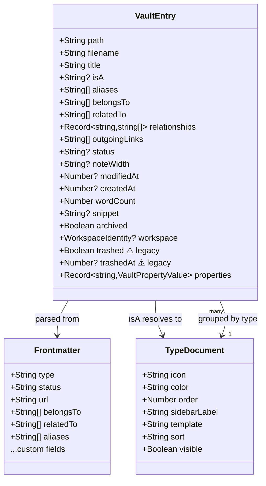
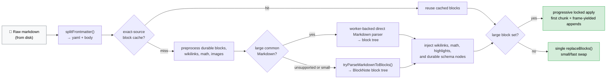
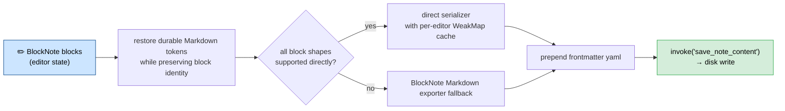

# Abstractions

## Scripted AI Stream Hook

`window.__mockAiStream.setScript(chunks)` loads a frame-controlled browser mock response. `next()` releases one chunk, while `releaseUntil(count)` advances to a one-based chunk count. It is installed only when the development browser mock handlers are present; tests and Remotion scenes can use the same subscription boundary. The stream callback adapter maps chunks to the existing AI panel callbacks.

## Desktop Note Save Transport

`persistContent` sends native desktop saves through `save_note_content_bytes`
for notes over 256 Ki characters, using raw UTF-8 content and a base64 UTF-8 `x-tolaria-note-path` header. The
command rejects malformed requests and delegates to `save_note_content`, retaining
active-vault path validation and the existing off-thread atomic writer. This
bounds the JSON note payload and avoids a full JSON copy of embedded image payloads; memory remains proportional
to note length. Browser fixtures retain their JSON save API. See ADR 0278.

Key abstractions and domain models in Tolaria.

## Mobile Note-List Creation

`MobileNoteListPanel` keeps a round create action anchored inside the list body,
above the open/archive and bulk-action controls. The list reserves trailing space
so the last row can scroll clear of the action. Bulk selection hides it. The
existing create command still owns persistence, analytics and initial H1 focus;
moving its button introduces no second creation path.

## Mobile Filename Breadcrumb

`MobileEditorFileIdentity` shows the literal filename and resolved type icon. A
Markdown filename can be edited directly in the toolbar using the existing RNR
Input and Button primitives. The inline form reuses the controller's filename
draft and rename command, including collision/path validation and the existing
write queue, backlink rewrites and undo history. Save/Return confirms; Cancel or
Escape discards the draft. Changing the selected note resets the inline form.
The note title/body is not a filename input. Non-Markdown file names remain
read-only because the current rename command is Markdown-specific.

## Mobile WYSIWYG Link Navigation

Long-pressing a link in the TenTap WebView emits a typed link action over its
existing WebView bridge. Native code routes custom wikilink URIs through the
workspace's existing target resolver and supported external schemes through the
existing link opener. Ordinary taps still place the caret; phone navigation
keeps the source note available through the editor back control.

## Mobile Native Lifecycle

`apps/mobile/app.config.js` enables Expo SDK 57's supported scene lifecycle
through `expo-build-properties`. Prebuild emits the scene manifest and Expo
window owner; Tolaria does not maintain a parallel scene delegate. Existing Expo
module subscribers and the keyboard root-controller handler remain responsible
for lifecycle-dependent work and keyboard input. SDK/native dependency changes
require a new signed binary and accepted OTA fingerprint. Sentry's JavaScript,
core and native dependency declarations are aligned while existing consent and
redaction boundaries remain unchanged. See ADR 0246.

Editor mode changes use `useEditorModeSwitch` and the existing workspace editor
save barrier before unmounting either editor. Failed reads retain the current
draft; note-selection generations invalidate stale mode requests.

## Mobile Installation Settings

The sidebar vault chevron uses `MobileVaultPicker` and the existing RNR dropdown
primitive to list remembered vaults, followed by Manage vaults. Quick selection
reuses the save barrier and catalog actions without presenting a second modal.
`MobileSettingsSheet` is the shared presentation for both Settings and vault
operations; `MobileVaultManager` supplies its embedded vault controls, progress,
conflict review, remembered-vault removal and GitHub account sections. Manual
commit fields are present only when AutoGit is off. Existing vault catalog and
sync analytics remain attached to the underlying actions, not duplicated by the
new entry points.

`apps/mobile/src/settings/` owns validated, installation-local preferences.
`mobileSettingsController` publishes changes only after persistence succeeds and
refuses writes after an unreadable load. Native storage retains the last valid
backup through interrupted publication, including when the current file is
corrupt. `MobileSettingsProvider` supplies settings and the settings sheet;
`components/ui/switch.tsx` is a thin native RNR Switch composition (ADR 0212).
`mobileAutoGit` is a pure debounced scheduler; `useWorkspaceAutoSync` connects it
to lifecycle state, editor dirt and the existing vault operation/save boundary.
`workspaceSyncLifecycle` requests a final flush on departure, joining any active
sync, and retries on foreground return. `WorkspaceBackgroundLease` owns finite
UIKit execution time and releases it even if JavaScript cannot respond to expiry.
Expiry cancels Git HTTP and later phases; durable local saves remain recoverable.
Manual mode refuses dirty syncs and exposes user-authored local commits. AutoGit
is opt-in, with foreground scheduling and a best-effort background flush (ADR
0219). Local commits precede authentication/network access. The footer and vault
manager expose both paths.

`useMobilePullToSync` adapts the vault controls context to a native refresh control
for remote and linked-folder vaults. It delegates to the existing sync callback,
so duplicate-operation guards, AutoGit checkpointing, editor save barriers, and
failure reporting are not duplicated in list or editor UI.

## Mobile Git Working Copies

`useVaultNotices` owns bounded, session-local notification deduplication by vault
and failure category. Automatic sync failures and conflicts do not open the vault
manager or retain an editor block. A notice offers explicit access to the existing
manager, while the per-vault sync ledger retains the actionable failure after the
notice is dismissed. Successful synchronization or conflict resolution starts a
new notification episode. Editing while diverged keeps that conflict state and
its automatic-sync block until explicit resolution; it still advances the dirty
version for subsequent synchronization. Raw errors, paths and note contents never enter notice
copy. Catalog restore failures instead render `MobileWorkspaceLoadFailure` with
Retry and Manage vaults; they never silently replace the catalog or show an empty
workspace as if restore had succeeded.

`managedLocalVaults.ts` validates local catalog entries and contained relative
directories. `managedLocalStorage.native.ts` registers imports, migrates the
legacy local copy in place, and resolves current sandbox paths on activation.
`starterVaultStorage.native.ts` prepares a bundled starter in an owned staging
directory and publishes the complete tree before returning a catalog record.
Its retained revision marker supports interrupted-copy and registration retries
without rewriting published files. Existing catalog files, orphaned vaults, and
ambiguous preparation state prevent automatic replacement (ADR 0230).
`initializeLocalVaultCatalog` loads `bundledStarterVault.native.ts` only after
excluding existing local catalogs and legacy imports. This adapter resolves
Expo-packaged images and invokes preparation before registering the local copy;
failed preparation never publishes an empty catalog. An existing Git selection
remains active. On subsequent launches the registered user copy is not refreshed
from the bundle, so edits and deletions remain local user data.
`apps/mobile/scripts/generate-starter-vault.ts` packages an immutable commit of
the canonical Getting Started repository. Its `starterVaultBundle.ts` helper
validates regular-file paths, types and size bounds before writing the bundle;
text remains verbatim in a SHA-256 manifest and images are separate native assets.
`apps/mobile/assets/starter-vault/images.ts` resolves asset modules lazily. Run
`node apps/mobile/scripts/generate-starter-vault.ts <local-template-repo> <full-commit-sha>`
to regenerate; existing user copies are never an output target. The bundled
revision and original relative paths remain recorded in `manifest.json`.
`starterVaultFiles.native.ts` copies that manifest into the preparation-owned
staging directory sequentially, resolving binary assets through a supplied native
file resolver. It reads back SHA-256 checksums before completion and reuses only
verified staged files on retry. The caller never passes a published vault here.
Local and Git records share `updateManagedGitCatalog` and its serialized atomic
publication. Catalog reads prefer the published file, then its backup, then a
validated pending file only when both published copies are absent. An invalid
pending first save remains a recovery error, never a fresh-install signal.
`useManagedVaultCatalog` is the single restoration owner;
`useMobileVaults` saves pending editor work before add, switch, and forget.
`mobileVaultCatalogActions` owns those catalog operations and clone activation;
every action runs through the controller's existing saved-workspace barrier.
Sync scheduling, editor recovery and notices remain in the controller. Forgetting
a vault only removes its catalog entry, never its working-copy files.
Restoration distinguishes catalog decoding failures from selected-vault recovery
failures, retains readable catalog entries, and exposes a retry without deleting
the catalog or working copy.
`MobileSavedVaults` renders both kinds and confirms metadata-only removal.
Settings shares `MobileGitHubAccount` with the manager rather than creating a
second authorization session. Consented `mobile_vault_catalog_used` events carry
only action and kind, never vault names, paths, URLs, or content. See ADR 0216.

`apps/mobile/src/workspace/git/` separates the embedded Git engine, GitHub
authentication, and Expo filesystem adapter from the editor. `gitVault.ts` owns
checkpoints and commit-graph classification. `githubClientId.ts` resolves the
public Tolaria OAuth client ID with an optional trimmed build-time override, so
clean release and OTA builds do not depend on a developer's local dotenv file.
`apps/mobile/fingerprint.config.js` normalizes only release channel routing and
Expo version metadata for native compatibility hashing (ADR 0263). Embedded
channels remain unchanged, and all other native configuration stays hashed.
`gitRemote.ts` performs serialized clone and sync. New clones retain the complete current tree at depth one;
`gitHistory.ts` retrieves older shallow-boundary ancestors only when a merge
lacks a common base. Existing full clones are unchanged. Unavailable history,
cancellation, and unchanged boundaries fail before working-copy publication;
remote history is never rewritten (ADR 0229).
`gitSelectiveStaging.ts` verifies fresh regular-file bytes against staged blobs
before individually staging a small batch. Unchanged packed objects stay packed;
timestamps alone never exclude an edit. Unsupported adapters, conversion, file
kinds and larger batches retain recursive serial library staging (ADR 0234).
Its single public working-tree/index/HEAD walk visits children serially, reusing the
walker's metadata rather than inspecting each path twice. Fresh byte reads stay
on the filesystem adapter so read errors propagate and large-file buffers are
not loaded concurrently by the library's default walker iteration.
When every tracked byte hash and mode also matches HEAD, checkpoint/require-clean
reuse that verified-clean result instead of repeating the working-tree status
scan. Deletions, staged differences, additions and unsupported cases retain the
library-backed status walk. This result is not cached across operations or the HTTP wait;
both editor/save barriers and the pre-checkout dirty-tree guard remain intact.
`gitWorkingTreeChanges.ts` keeps that integration guard and changed-checkpoint
status reads read-only and serial via the public HEAD/WORKDIR/STAGE walkers.
The integration guard stops at the first dirty path; checkpoints collect every
changed path and deletion before committing. Object IDs, stat-cache decisions,
line-ending conversion and ignored-path handling
still belong to isomorphic-git. This avoids a whole-vault parallel stat fan-out
and does not refresh the index just because unchanged timestamps drifted.
`gitFileSystemSessions.ts` retains an adapter for only the most recently used root
URI. Its bounded 16,384-entry caches hold only URI/File/Directory handles, not
bytes, metadata, Git state or credentials. Operation caches remain independent;
every filesystem check and read stays fresh (ADR 0240). Native Git probes use the
same getter as managed vault connections.
The supported isomorphic-git version must propagate filesystem permission/I/O
errors rather than treating unreadable paths as missing. `assertGitReadFailureSafety`
checks that failed directory walks cannot checkpoint deletions, object-read errors
retain their identity, and corrupt-object diagnostics remain distinct from absent
objects. The same real-filesystem proof runs in Node and the disposable native
Git probe; HEAD, index bytes, and frontmatter/content must remain unchanged.
Local Git contexts whitelist filesystem, directory and cache options so a
transport's short branch ref cannot redirect a checkpoint away from HEAD.
`fetchTrackedGitBranch.ts` uses the last-known origin tracking ref for ordinary
same-name branch negotiation, with an explicit remote branch. An unpublished
local checkpoint therefore does not cause the server to resend unchanged objects.
Nonstandard remotes/upstreams retain the library's default selection. Fetch stays
single-branch and does not alter the explicit shallow-history deepening path
(ADR 0239).
Type-swap preparation walks immutable before/target trees serially through the
existing cooperative task runner. Identical object IDs and one-sided subtrees
cannot contain type swaps, so their descendants are pruned. This never skips
working-copy verification or the original-content guards before removing a swap.
Recovery and push use fully-qualified branch refs, including when older working
copies contain a stray pseudo-ref that shadows the branch's short name.
`gitMerge.ts` builds conflict-free merge objects without changing
HEAD or the working tree, rejects lossy binary/text conversion, and publishes
through the existing checkout journal. Genuine conflicts preserve both histories;
push races receive at most three fetch/integrate/push attempts (ADR 0218).
`workspaceOperationQueue.ts` is the shared working-copy mutation boundary.
`expoGitFileSystem.ts` maps virtual `/vault` paths to one app-owned file URI, with
explicit path containment and unsupported symlink errors. `githubAuth.ts` uses
device authorization and checks the resulting account identity; no client secret
belongs in the mobile bundle. See ADR 0194 and the mobile October assessment for
integration status and remaining native-provider work. This layer is not an
iCloud synchronizer and must not label local disk writes as remote synchronization.
`githubRequest.ts` bounds the complete JSON exchange, including the response
body, and settles cancellation even if a transport ignores its abort signal.
Device-code, token, identity, and repository requests share that boundary.
Device authorization retries network interruptions and request timeouts with
exponential polling backoff until the original code deadline; explicit denial
and cancellation remain terminal. An issued token stays in memory while retrying
identity verification, rather than exchanging the device code again. No session
is published or persisted until identity verification succeeds.
`githubAccountState.ts` retains the visible account until secure credential
deletion succeeds; network and storage failures are not reported as expired
authorization. `githubFailure.ts` maps only known error identifiers to localized
copy, never raw responses or credentials. `useMobileVaults` distinguishes the
save barrier from the subsequent remote operation. Failed local saves expose a
retry through the same serialized write queue, including local-only vaults.
`assert-native-git.mjs` exercises real smart-HTTP transport through Hermes and
Expo's filesystem on the booted iOS simulator, using disposable repositories only.
Standalone probes use the existing QA-only native launch arguments, without
depending on delivery of a cold-start URL. The native capability and loopback
endpoint checks remain required. Set `TOLARIA_GIT_QA_FILES=6000` for the opt-in
large-vault fixture and separate clone/push/pull/unchanged-sync timings. Large
fixtures require `--device <UDID>` to select an explicitly booted disposable
simulator; they never target an ambiguous `booted` simulator. Routine checks
retain the fast two-note fixture and its existing booted-device default.
`TOLARIA_GIT_QA_HISTORY_MIB=128` additionally creates incompressible historical
attachment revisions, removed from the current tree but retained in Git history.
This checks that current-tree clone cost is independent of deleted attachment
history; it does not certify memory use for large current blobs or deepening.
`measureEventLoopDelay.ts` measures timer scheduling delay across the round trip,
including a blocked tail, and always removes its timer. This is not an animation
FPS measurement. `nativeStorageQaCapability.ts` accepts development mode or the
exact native boolean exposed only by `DEBUG` / `TOLARIA_QA` builds. Optimized QA
uses an embedded production bundle; ordinary Release cannot enable these probes
through a URL parameter (ADR 0208). Proof delivery reuses the loopback-only
collector with redirects rejected and credentials omitted.
`nativeSimulatorLease.ts` is host-only QA infrastructure. The Git and write-recovery
entry points acquire one loopback TCP port before creating fixtures or touching
the simulator, reject overlapping runs, and release it in `finally`. Connections
receive no data; process exit also releases the OS-owned lease. Other native QA
entry points must still be scheduled sequentially; this is not an app data lock.
`measureEventLoopDelay.ts` retains aggregate JavaScript timer-delay measurements
and optionally accepts named phase transitions. `eventLoopSampler.ts` closes a
phase synchronously before the next begins, so a blocked terminal segment is not
misattributed to the following phase. Repeated phases remain separate and late
callbacks are ignored after completion. The native Git proof records library
clone progress phases and sync checkpoint/fetch/checkout/push boundaries using
fixed diagnostic labels, never note content or paths. These samples measure
JavaScript scheduling delay, not native animation frame rate.
The QA-only `measureGitFileSystem.ts` wrapper adds fixed-method call/failure counts
and cumulative awaited-operation latency to each clone proof. It records no paths,
arguments, contents or error messages, preserves byte views and rejection identity,
and adds no cache. Overlapping waits contribute independently; these numbers must
not be interpreted as CPU time or summed into clone wall-clock time.
Rejected filesystem calls include expected missing-entry probes, not just failures
of the overall clone.
`nativeMetroProofLog.ts` is a host-only, bounded reader for development-build
proofs that React Native sends to Metro instead of iOS system logs. The workspace
persistence command accepts `--metro-log` and captures its byte boundary before
launching the app, rejects file replacement/truncation, and never falls back to
older system logs when this source is selected. Other legacy log-based probes
still require separate collection-path verification.
`gitRuntime.native.ts` supplies missing digest support through Expo Crypto, while
`gitDigest.ts` preserves existing runtime APIs and byte-view boundaries. Git uses
one library-owned cache per sync operation, released afterwards (ADR 0200).
The Expo adapter separately reuses bounded path handles without caching contents
or metadata; directory enumeration returns names without allocating child handles.
Binary reads and writes share bounded ArrayBuffer views rather than duplicating
entire Git packs; writes still supply the plain Uint8Array required by Expo JSI.
Standalone iOS additionally uses `WorkspaceGitMetadata` through `gitEntryInfo`
for one fresh sandbox-relative stat lookup, including symlink rejection. The
optional capability leaves Expo Go and Android on the existing path (ADR 0205).
`ManagedWorkspacePath` keeps only the trusted container prefix. It validates
decoded URI components without filesystem normalization, rejects dot/empty
segments and file authorities with credentials or ports, and leaves symlink
rejection to the descriptor-relative stat. No file state is cached.
`gitTaskRunner.ts` supplies a per-instance cooperative task boundary for synchronous
Expo metadata/mutation calls and awaited Git progress callbacks. Requests share
one pending timer after a sixteen-millisecond budget; each synchronous operation
runs immediately after rechecking that budget, including concurrent resumptions.
Native byte/directory reads share that budget rather than resetting it on promise
completion: a chain of fast native promises does not prove that input or timers
had a turn. Only the actual shared timer resets the budget (ADR 0274).
This is not a new mutation queue or a latency guarantee for individual
large operations (ADR 0209).
Transport progress deliberately keeps a separate budget from native filesystem
IO. Renewing its budget on every native promise completion can starve input and
timers during checkout even when total clone time looks unchanged.
`gitCloneIoYield.test.ts` protects that independent task boundary and cancellation
while the progress callback is waiting; do not merge the two budgets as an IO
optimization without new native responsiveness evidence.
Checkpoints explicitly stage content before comparing the matrix, protecting
same-length rapid edits that the library's coarse timestamp shortcut misses.
This requires a content scan; the measured large-vault sync cost remains a
release blocker, not hidden behind a misleading success/performance claim.
`workspaceWriteQueue.ts` retains failed mutations in order and drains them before
Git. Its saved-workspace callback receives whether native text-journal recovery
replaced files. That recovery cannot be dismissed by a later unchanged or
cancelled task: the saved-vault boundary keeps the replacement generation and
awaits fresh editors, including when fresh indexing fails.
`workspaceSyncEditors.ts` collects awaitable editor preparation operations;
`editorSaveGate.ts` prevents stale TenTap replies from overwriting pulled content.
Automatic foreground sync defers at each local write barrier while the rich
editor is focused, including the barrier after a Git network wait. This does not
disable ordinary note autosave. The scheduler retains the pending sync and retries
at its idle interval without counting focus as a transport failure. Manual sync
and foreground departure retain the normal flush, drain and recovery barriers.
The vault manager uses both boundaries (ADR 0196). `MobileVaultProvider` owns
the revisioned pending-path set consumed by `MobilePendingNoteIndicator` for
Git and linked-folder notes. `workspaceSyncEditors` passes written paths into
the existing sync ledger; rename/move operations include both endpoints.
Checkpoint acknowledgement clears only revisions captured under the write
barrier, retaining later edits even on the same path. Old ledgers without paths
remain valid. This is a presentation hint, not an authoritative Git index, and
never removes the byte-verification checkpoint (ADR 0271). The provider owns
vault switching and manual sync, while a separate memoized workspace context
prevents progress updates from re-indexing the vault.
The manager's `useGitSyncProgress` forwards real Git object counts to Settings,
throttled to ten updates per second except phase boundaries and completion.
Each operation owns its callbacks; finished/unmounted operations cannot publish
late progress. Phase changes and finalization clear stale counts. The sidebar
pill remains two lines, and counts never imply an overall sync percentage.
`useMobileWorkspaceResolution`
also retains the repository request and initial snapshot across equivalent parent
renders; a new vault selection revision still invalidates that snapshot.
`preloadNativeWorkspace` awaits the iOS background index bridge when restoring
the catalog, serialized with working-copy operations. The bridge validates the
managed root and completes interrupted writes before indexing under the native
mutation lock. It does not add a persistent cache or bypass a real disk refresh.
The native Git QA probe benchmarks this same preload and pure snapshot path on
its owned disposable working copy, never a saved user vault. It reports native
index/bridge time, snapshot construction, throwaway interaction timings and
JavaScript scheduling delay separately from the Git round-trip measurements.
`savedVaultOperation.ts`
freezes/flushes editors, drains disk writes, invalidates old callback generations,
and publishes a freshly prepared disk snapshot; a pre-barrier failure instead resumes the existing draft.
`useWorkspaceSnapshotFrame` swaps revision-scoped snapshot/history stores after
that publication without remounting the same-root workspace controller. Search,
navigation and mounted list surfaces survive; editor documents alone receive a
new revision key. Retired stores retain their own late persistence completions,
while prepared actions and retries require both the current generation and exact
frame identity. Ordinary parent renders do not reset drafts or history. Switching
the actual native root still remounts the workspace. This does not authorize edits
through a replacement barrier or make provisional cached previews writable (ADR 0275).
The native Reload Vault command reselects the current managed entry silently,
using that same save/recovery/fresh-preparation boundary instead of synchronously
rebuilding from the consumed launch index. No selected catalog entry means no
native reload, never a fallback filesystem scan. Fixture/host reloads retain
their repository behavior and clear undo history after replacement.
A confirmed no-change folder-picker cancellation or Git result without native recovery also resumes that draft without
re-indexing or remounting. It restores the frozen editor's callback generation;
replacement IDs are never reused, and an older cancellation cannot undo a newer
replacement. Failures after import or Git starts still require the disk refresh.
`gitRemote` reports both incoming checkout and checkpoint-time journal recovery
as document replacement. Recovery requires fresh editors even when it advances
HEAD to the fetched tip or credentials fail afterwards. Local commits and
push-only/no-op syncs with no recovery preserve the mounted editor under ADR 0221.
The shared Git checkpoint/require-clean result reports successful checkout
recovery as `workspaceChanged`, separately from the count of newly committed
files. Manual commits honor that same replacement flag; sync consumes it without
replaying a second recovery check just to discover whether files changed.
Relationship-picker exclusions resolve each existing reference once per search,
then filter candidate IDs with a set. They must not resolve a vault-wide link
inside the per-note candidate loop.
`managedGitStorage.native.ts` keeps app-owned working copies and a credential-free
catalog. Catalog publication renames a validated pending file and retains a
recoverable backup. Git clone control forwards real library phases
and object counts, coalescing progress notifications without synthesizing an
overall percentage. Cancellation aborts transport and stops at cooperative Git
boundaries; cleanup is limited to the newly allocated clone directory. A
completed clone is retained if catalog publication fails, preserving recovery.
`MobileCloneProgress` keeps phase/count progress and cancellation above the vault
manager's scrollable content. Counts describe the current library phase, not an
invented overall completion percentage. Cancellation stays pending through
cleanup and is no longer offered once catalog publication starts.
Clone phase/count snapshots use a per-clone-controller external store subscribed
to by `MobileCloneProgress`, so progress ticks do not rerender the vault provider
and surrounding panes. Lifecycle changes (start, cancellation, publication and
completion) still update the provider's controls.
`githubAccountState.ts` isolates cancellation and ordered
SecureStore writes from React. Native Git HTTP uses Expo's streaming fetch with
redirects disabled. Its 120-second timeout bounds connection/header waits and
each pending body read, rather than the total pack download. The timer pauses
while Git processes a delivered chunk; caller cancellation remains active and
early consumer termination cancels the reader. Large progressing clones are not
aborted solely for taking more than two minutes. The footer distinguishes local-only folders, pending sync,
success, failure, and divergence; edits clear the previous successful sync state.
`gitCheckoutRecovery.ts` persists checkout intent before replacing files and
advances the branch only after checkout succeeds. Managed-vault activation and
checkpointing finish pending intent before proceeding. `gitCheckoutGuard.ts`
blocks native workspace reads/writes while checkout is incomplete; recovery never
forces away unexpected edits. See ADR 0201 and the native Git recovery probe.

## Native Text Save Recovery

`mobileEditableNote.ts` owns conversion from persisted Markdown/frontmatter to an
editable note's metadata and preview blocks. Workspace edit orchestration imports
that pure conversion instead of maintaining its parsing helpers inline. Alias
precedence, scalar-array conversion, and original raw Markdown remain unchanged.
Both initial snapshots and edited/hydrated metadata retain the complete tag list.
Presentation limits belong to list components, never the persisted-data model or
the property form's editable value.

`MobileEditorFileIdentity` renders the shared phone/tablet breadcrumb icon and
literal basename, including its extension, from the note's write path. It does
not derive a filename from the display title or modify the document heading.
Custom note/type icons retain the existing desktop-derived colors and sizes.

`mobileEditorFocus` owns one-shot, note-specific focus requests in the existing
workspace editor registry. Successful note creation requests focus; ordinary
navigation does not. The native editor consumes the request after initial content
has settled, places the cursor at the empty H1, and enables its normal change
pipeline. Unmount, timeout and workspace replacement cancel stale requests, so
late readiness or background refresh cannot steal focus back.

`mobileDefaultNoteType` completes successful writable note-creation plans with a
missing root `note.md` Type definition, using the existing type reducer. It keeps
the new note selected, preserves existing definitions and legacy paths, and never
overwrites a filename collision. Read-only workspaces, unsuccessful creation and
ordinary edits do not bootstrap definitions. The definition shares the existing
repository write queue rather than adding a separate filesystem path.

`WorkspaceTextRecovery` atomically publishes a pending text save outside the vault,
replaces the destination, and removes the record last. Replay checks the previous
or intended SHA-256 digest; conflicts retain both versions and prevent further
operations. `ManagedWorkspaceText` restricts access to app-container roots and
keys records by stable home-relative paths. `workspaceTextRecovery.ts` connects
the asynchronous native writer and recovery checks to the existing Expo adapter,
repository reads, and Git save barrier. A recovered save invalidates stale launch
indexes and cached raw note content. Old standalone binaries fail closed rather
than silently falling back to a non-atomic writer. Expo Go/Android do not yet
provide this native guarantee. See ADR 0203.

`LinkedWorkspaceSession` coordinates a bookmarked iOS folder and an app-owned
working copy. `LinkedWorkspacePlan` performs three-way content comparison;
`LinkedWorkspaceTree` applies checked file/directory changes without following
symlinks or touching Git internals. `LinkedWorkspaceStore` keeps bookmarks and
baselines outside vault content using stable container-relative identities.
`linkedWorkspace.ts` joins the existing save queue; `useLinkedFolderSync` reuses
the shared lifecycle scheduler for foreground write-back, refresh, explicit
retries and a bounded departure flush. iCloud delivery remains provider-owned.
The status reports provider persistence, not cross-device delivery (ADR 0217).

`LinkedConflictPublication` marks successfully completed private resolution
backups before retiring their journal. Best-effort cleanup retains the latest
three and all completions within seven days. Pending, superseded, unmarked,
malformed and symlinked data is never pruned; a corrupt active journal blocks
cleanup. This does not delete vault/provider content or establish a total backup
quota (ADR 0237).

Asynchronous repository note reads join the per-root operation queue before
synchronous native recovery, so they remain ordered with writes and Git. During
the marked native linked-folder merge only, note reads bypass that queue and
read the app-managed copy through Expo's async file API; sync has already
flushed writes/recovery, and each changed file is atomically replaced. Recovery
is skipped only for that window, while writes remain queued until sync ends.
Cached bytes are still rejected after recovery or an external conflict.
Snapshot reads remain a synchronous lifecycle boundary; this does not claim
that every filesystem read is nonblocking (ADR 0296).

`WorkspaceTextRecord` owns version-two text batches and completion fingerprints,
including decoding of version-one single-save records. `WorkspaceTextRecovery`
publishes the whole plan, checks every precondition, and replaces members under
coordination before acknowledging the batch. Conflicts retain unfinished intent;
this is roll-forward recovery, not atomic visibility across external writers.
`workspaceTextBatch.ts` converts entirely text-based repository plans to the
optional `saveWorkspaceTexts` capability, preserving final content for repeated
paths. Unsupported runtimes retain individually queued writes; they never retry
a whole JavaScript loop of already-completed writes. The `--batch` native proof
checks cross-launch partial replacement, conflict exclusion, and the repository's
actual two-member completion receipt (ADR 0207).

`nativeWorkspaceMutation.ts` retains a native UUID across failed attempts for
both text and entry bridges. `saveWorkspaceText` requires that ID; completed
receipts contain only a path/content digest and are consulted before acquiring
new file preconditions. An exact retry cannot overwrite a later edit, resurrect
a deletion, or act on a recreated entry. Receipts are bounded under the existing
per-root serialized queue, not a general command ledger. See ADR 0206.

`assert-ios-write-recovery.mjs` terminates/relaunches the standalone simulator app
between journal publication and recovery, then repeats with an external edit.
Its native Debug / opt-in optimized QA probe uses only a dedicated cache fixture and the regular
repository/read/write/sync barriers. It is separate from browser visual QA.

`WorkspaceEntryRecovery` adds recoverable file/folder moves and deletions at the
same boundary. It fingerprints the source, publishes intent, and exclusively
renames to the destination or a private deletion quarantine. A bounded completion
receipt identifies queue retries by native UUID; `workspaceEntryRecovery.ts`
retains that identifier only while the operation is failed/in flight. Reads and
Git also replay structural intent, while external changes block replay. The
`--entries` native proof checks actual app restarts. This is not yet a transaction
over a move and every subsequent backlink rewrite. See ADR 0204.

## Native Provider File Foundation

`modules/tolaria-workspace-access/ios/CoordinatedWorkspaceFile.swift` wraps scoped,
coordinated reads and atomic revision-checked writes. `WorkspaceBookmarkStore`
persists and restores the original directory grant; `WorkspaceFileSafety` rejects
unsafe relative paths and symlinks. These are not yet wired to the live-folder UI.
The Swift package's filesystem tests run without Expo. The standalone native Git
probe additionally invokes the DEBUG-only iOS file-access proof with disposable
files and isolated preferences. See ADR 0198 for the remaining integration gates.

`WorkspaceFileIndex` rejects incomplete enumeration, invalid UTF-8 text, and
visible symlinks instead of publishing blank editable notes. `ManagedWorkspaceImport`
validates a staged copy before replacing the previous managed folder. Import and
restore failures reach the vault manager; cancellation alone returns no selection.
Expo filesystem reads likewise propagate failures instead of synthesizing empty content.
`WorkspaceLoadBoundary` keeps vault-management controls available after a read or
render failure; a successful vault revision resets a failed boundary without
remounting healthy workspace children.

`useMobileNoteRead` handles lazy selected-note reads independently of workspace
loading. It exposes loading/error/retry before the editor mounts, cancels stale
responses, and never replaces a loaded draft. `mobileNoteRead.ts` distinguishes
unread content from valid empty files and guards mutations that require that
content. Hydration is a read-only operation, including for read-only repositories;
failed reads never synthesize writable blank notes.

`useMobileInspectorReferenceGroups` defers inverse relationships and backlinks
from the current note pool. Its selection input contains only reference-matching
fields (identity, title, type, path, aliases and workspace alias), so display-only
note copies do not restart a whole-vault calculation. Selection and pool changes
still invalidate it; navigation and unmount cancel pending publication.
Direct neighborhood navigation builds one local first-match note-ID index for
its outgoing relationships instead of scanning the whole pool for each target.
It does not retain an index between snapshots or change matching/order semantics.

`mobilePreparedEdits.ts` prepares metadata-only note actions before mutation,
including deletions whose Undo needs the original bytes. Bulk actions read all
required notes before applying any edits; a failed read leaves the write plan
empty. The controller's `usePreparedWorkspaceEdits` keeps loaded editor saves
synchronous, registers pending preparations with the existing sync barrier,
rejects obsolete vault generations, and exposes an actionable, non-modal
`MobileWorkspaceEditNotice` for failed action preparation. Its Retry remains
available until the action succeeds; removing the normal status footer does not
silently discard a failed action.
Hydration never overwrites an already loaded draft. This is action preparation,
not a replacement for the per-root disk queue or a multi-file disk transaction.

`nativeQaSink.ts` carries layout measurements and known persistence proofs to the
simulator harness over loopback, so standalone QA does not depend on JavaScript
console messages appearing in the iOS unified log.
Async write-recovery runs capture an independently validated loopback sender;
layout sink clearing or replacement cannot redirect or discard their proofs.
Recovery also checks the native QA capability before creating disposable fixtures.

## Tablet Panel Motion

`tabletPanelGestureIntent.ts` decides whether a touch should move panels or yield
to vertical content scrolling. `tabletNativePanGesture.ts` runs gesture updates
and springs on the UI thread. `useTabletPanelGestures.ts` exposes toolbar actions
and settled accessibility state. Offsets always use desktop panel tokens. Native
interaction QA is mandatory; web tests cannot verify native responder arbitration.
See ADR 0195.

Tablet drag sessions are invalidated on window resize, explicit pane actions and
unmount. Inactive UI-thread callbacks cannot move panes, and generation-tagged
settlements cannot restore an obsolete layout after crossing the JS boundary.

Editor-interior horizontal drags retain sequential panel navigation. Note-list
rows own their touch quick actions and leave two-finger trackpad gestures to the
list's native scrolling. The row's local `useSwipeableNoteActions` hook owns its
imperative close-and-dispatch handler; gesture construction only registers that
handler and reads measured width through Reanimated's shared-value accessors.
The formatting strip uses Gesture Handler's native
scroll view to keep horizontal tool scrolling from moving panels. Phone navigation
uses the editor toolbar's leading/trailing slots, not a second title bar. The
workspace has no permanent bottom status bar. `MobileSidebarSettings` anchors
Settings and the command palette above the home indicator, using circular secondary
controls. Their transparent, non-intercepting overlay floats over the sidebar;
the scroll content reserves its measured height so the last row can clear every
control without an opaque footer strip. Section-label buttons toggle Views,
Favorites, Types and Folders independently of their sibling add/visibility actions;
collapsing chrome does not change the active note or selected section.
The vault-title chevron reuses the
existing vault manager through `MobileVaultControlsContext`; it does not bypass
the manager's save/switch barrier. Type rows retain their individual counts, but
the Types section heading has no aggregate count. The existing
Settings sheet exposes GitHub and vault management. The sidebar sync pill uses the
same sync/recovery operations as the vault manager. Panes extend to the bottom edge, including their backgrounds
and dividers. The note list keeps controls within its own bottom padding; the
inspector adds clearance to scrollable content, not a strip outside the panel.
Formatting strips own their home-indicator clearance through `useMobileBottomInset`,
which removes that clearance when a software keyboard is visible. There is no
second workspace inset below the toolbar.
`mobileEditorBlockStyles` groups the read-only block renderer's typography,
inline marks, lists, quotes, code and table styles into shared-token factories.
The extraction preserves every style value in both themes at 100% and 120%.
`mobileViewFilterStyles` and `mobileWhiteboardActionStyles` likewise separate
layout, controls and editor-state styling without changing their existing tokens.
Phone drawers pass `fullWidth` to the shared sidebar so its measured trailing
edge meets the note-list preview without a desktop-width gap.

The properties panel's `MobileRelationshipRows` helper owns the shared typed icon
and colored label; the relationship row retains navigation and removal actions.

`MobileWysiwygWikilinkBridgeModel` keeps its existing public insertion API while
delegating read-only matching to `mobileNativeInlineAutocomplete`. Shared
document-node positioning lives in `mobileNativeDocumentTree`, and payload/selection
contracts in `mobileNativeWikilink.types`. Autocomplete preserves lazy wikilink,
nonempty person-mention, then emoji precedence; its cursor contexts distinguish
document coordinates from projected text offsets.

Phone drag responders retain their gesture identity while reading the latest
callbacks. A completed native animation commits navigation in a microtask, after
React Native synchronizes its final animated value, so that synchronization cannot
overwrite the zero-offset destination. Interrupted drags never commit navigation.
Phone edge hit zones translate window touch coordinates into the horizontally
safe-area-inset workspace, keeping both editor edges reachable in landscape.
They retain the original touch-down position rather than reconstructing it from
movement samples, which can start after the finger has already left the edge.
The raw editor permits responder handoff for these edge gestures; interior text
selection and vertical scrolling remain outside the panel drag hit zone.
Retained phone screens remain full-height independently of the active screen.
Opening the sidebar therefore cannot resize the hidden list and clamp away its
saved scroll offset. Bottom clearance belongs to each screen's controls/content.

When the adaptive iPad window cannot fit both left panes plus the 520-point
editor minimum, the animated left strip is clipped to the 340-point list slot.
Revealing the 260-point sidebar leaves an 80-point list preview rather than
compressing the editor. Selecting a scope or note restores the full list; the
sidebar header can also dismiss it. The same UI-thread offsets drive buttons
and drags, and wide/compact layouts retain their existing dimensions.

`apps/mobile/native-ui-tests/` adds an independent XCUITest runner for actual
native panel drags and toolbar actions. `test-ios-panel-gestures.mjs` generates
the project outside the repository, reinstalls only the disposable runner to avoid
stale unsigned test bundles, and retains an `.xcresult` artifact. See ADR 0199.

## Design Philosophy

Tolaria's abstractions follow the **convention over configuration** principle: standard field names, types, and relationships have well-defined meanings and trigger UI behavior automatically. This makes vaults legible both to humans and to AI agents — the more a vault follows conventions, the less custom configuration an AI needs to navigate it correctly.

The full set of design principles is documented in [ARCHITECTURE.md](./ARCHITECTURE.md#design-principles).

## Semantic Field Names (conventions)

These frontmatter field names have special meaning in Tolaria's UI:

| Field | Meaning | UI behavior |
|---|---|---|
| `title:` | Legacy display-title fallback for older notes | Used only when a note has no H1; new notes do not write it automatically |
| `type:` | Entity type (Project, Person, Quarter…) | Type chip in note list + sidebar grouping |
| `status:` | Lifecycle stage (active, done, blocked…) | Colored chip in note list + editor header |
| `icon:` | Per-note icon (emoji, Phosphor name, or HTTP/HTTPS image URL) | Rendered on note title surfaces; editable from the Properties panel |
| `url:` | External link | Clickable link chip in editor header |
| `date:` | Single date | Formatted date badge |
| `start_date:` + `end_date:` | Duration/timespan | Date range badge |
| `goal:` + `result:` | Progress | Progress indicator in editor header |
| `Workspace:` | Vault context filter | Global workspace filter |
| `belongs_to:` | Parent relationship | Humanized to `Belongs to` in the UI |
| `related_to:` | Lateral relationship | Humanized to `Related to` in the UI |
| `has:` | Contained relationship | Humanized to `Has` in the UI |

Relationship fields are detected dynamically — any frontmatter field containing `[[wikilink]]` values is treated as a relationship (see [ADR-0010](adr/0010-dynamic-wikilink-relationship-detection.md)). Tolaria's own default relationship vocabulary uses snake_case on disk, but labels are humanized at render time and existing user-authored keys are left untouched.

### System Properties (underscore convention)

Any frontmatter field whose name starts with `_` is a **system property**:

- It is **not shown** in the Properties panel (neither for notes nor for Type notes)
- It is **not exposed** as a user-visible property in search, filters, or the UI
- It **is editable** directly in the raw editor (power users can access it if needed)
- It is used by Tolaria internally for configuration, behavior, and UI preferences

Examples:
```yaml
_pinned_properties:       # which properties appear in the editor inline bar (per-type)
  - key: status
    icon: circle-dot
_icon: shapes             # icon assigned to a type
_color: blue              # color assigned to a type
_order: 10                # sort order in the sidebar
_sidebar_label: Projects  # override label in sidebar
_width: wide              # rich-editor width override for this note
_list_properties_display: # properties shown in note-list rows for this type
  - status
```

**This convention is universal** — apply it to all future system-level frontmatter fields. When a new feature needs to store configuration in a note's frontmatter (especially in Type notes), use `_field_name` to keep it hidden from normal user-facing surfaces while still stored on-disk as plain text.

The frontmatter parser (Rust: `vault/mod.rs`, TS: `utils/frontmatter.ts`) must filter out `_*` fields before passing `properties` to the UI.

## Document Model

All data lives in markdown files with YAML frontmatter. There is no database — the filesystem is the source of truth.

### Rich-Editor Markdown Serialization

`src/utils/richEditorMarkdown.ts` is the canonical owner for rich-editor Markdown import/export boundaries. It installs the app-facing serializer on real BlockNote editors, preprocesses Markdown before parsing, injects Tolaria schema blocks after parsing, and turns BlockNote documents back into vault Markdown. It restores Tolaria's durable Markdown syntax for wikilinks, linked inline-code labels, math, highlights, attachments, Mermaid, tldraw, sandboxed HTML blocks, and blockquote callouts before the save path writes bytes to disk. Linked inline code and literal path-template backslashes use Markdown-inert placeholders during BlockNote import, then restore their editable representations before serialization. `markdownTables.ts` owns escape-aware row splitting and table start/separator/body boundaries for both the fast parser and table-break preprocessing. Both consumers use `markdownFences.ts` for fence scanning. Table cell line breaks use `<br>` on disk; `tableCellBreakMarkdown.ts` protects those tags during import and restores editable newlines after either parser, leaving fenced code and inline code untouched. Hot save paths should pass an already-read block snapshot when they have one; a debounced rich-editor flush should not ask BlockNote for `editor.document` twice.

Loaded notes retain their original Markdown and an import-time serialization baseline in editor-scoped source snapshots. Rich saves apply the changes between that baseline and the edited serialization to the original bytes, preserving untouched entities, inline HTML, comments, table alignment, line endings and EOF. `markdownSourceLines.ts` shares the source-line splitter used by import preprocessing. Each bounded editor-scoped snapshot caches its source-to-rendered span map. Alignment compares line bodies separately from line endings when line counts match, and falls back to whole-document alignment when they differ. Saves shift unaffected spans and realign only regions touched by rich edits; prior snapshots remain immutable for undo and tab reuse. The resolver captures snapshots for every load strategy, including cache hits. Frontmatter-only property changes reuse the unchanged body baseline with the current frontmatter. Entering raw mode uses this same source-preserving save boundary so pending rich edits are included; raw CodeMirror transactions then apply to the original source offsets, preserving mixed line endings. Wikilink import skips inline code spans as well as fenced code. Comments remain invisible in rich mode; this does not add comment editing or warning UI.

The experimental direct serializer remains a lower-level implementation in `src/utils/blockNoteDirectMarkdown.ts`, with inline text, style, link, and code-span serialization in `src/utils/blockNoteDirectInline.ts`. App/editor flows should go through `richEditorMarkdown.ts` entry points instead of installing the direct serializer, invoking `blocksToMarkdownLossy()`, or composing durable Markdown codecs locally. The direct helper uses cached direct serialization when every block shape is supported and falls back to BlockNote's exporter when a custom or unknown block appears. Plain identifiers keep safe in-word underscores, Windows-style separators stay literal when Markdown does not require escaping, and style delimiters stay adjacent to their non-whitespace content instead of crossing line endings.

The direct serializer cache is derived state, scoped to the editor instance, and disposable. Bridge helpers that transform blocks for Markdown restoration should preserve object identity when a block, its children, and table cells are unchanged; that lets frequent debounced saves reuse cached Markdown for stable subtrees without treating the cache as the source of truth. Before an unsupported block set reaches BlockNote's fallback serializer, `blockNoteTableCardinality.ts` normalizes malformed table header and span cardinalities so WebKit cannot turn corrupt metadata into an unsafe array allocation.

Opening a Markdown note goes through `resolveBlocksForTarget()` rather than calling BlockNote's parser unconditionally. The resolver first checks exact-source block caches, then uses cheap blank/H1 recognition, then tries Tolaria's worker-backed direct parser for large common Markdown. Standalone Markdown images with unambiguous destinations are emitted directly as BlockNote image blocks after vault URL preprocessing, so image-heavy notes stay on the off-thread path; inline images and title/complex-destination forms still fall back to BlockNote to preserve semantics. Unsupported Markdown returns to BlockNote's parser with the same `richEditorMarkdown.ts` preprocessing and block-injection path, preserving correctness while keeping the common large-note path off BlockNote's heavier import lifecycle. Large block sets are then mounted through `applyBlocksToEditorProgressively()`, which locks the editor while chunks append over animation frames and commits the path only after the full document is present. Synchronous, progressive, and recovery content swaps are non-history transactions: navigation and external refresh must not retain whole previous note documents in the user's undo stack, while typed edits remain undoable. Ordinary BlockNote block wrappers remain fully measurable after mount so side menus and dialogs can preserve viewport position in long documents.

Hot edit paths should avoid document-wide BlockNote lifecycle work. `richEditorBlockNoteOptions.ts` disables BlockNote's previous-block animation tracker for Tolaria editors because it scans the full old and new ProseMirror documents for every doc-changing transaction. `richEditorDispatchPerformance.ts` wraps the ProseMirror dispatch function once and logs `richEditorDispatch` timings for large or slow transactions without traversing the document. Feature code that subscribes to `editor.onChange` must either be debounced/coalesced or active only while its UI state requires it; collapsed-heading rendering follows this rule by subscribing only while sections are collapsed. A collapsed heading section includes dividers and ends only at the next heading of the same or a higher outline level.

Full-note metadata derived after a rich-editor change (outgoing links, word count, and saved snippets) runs in `editorEntryMetadata.worker.ts`. The main thread only schedules the request after an unforced idle callback and applies the small result in a React transition; macOS WKWebView's timer fallback posts to the same worker instead of scanning the note on the typing thread.

`SingleEditorView` contains recoverable BlockNote render failures at the editor boundary. A recoverable error is marked during React's derived error-state phase so root telemetry can recognize it even when production minification removes component names; the boundary remounts the editor once, then switches the active note to the existing raw editor if the same failure persists, keeping both the vault shell and note content usable without another rich-editor remount cycle. Render-time `RangeError: Invalid array length` joins this narrow recovery path without changing transform/serialization handling, keeping it distinct from non-render RangeErrors. Rich-editor wikilink, emoji, and slash-menu item hooks live in `singleEditorSuggestionItems.tsx`, while whitespace selection and container-click behavior live in `singleEditorPointerInteractions.ts`; both keep their memoized callbacks stable without adding unrelated complexity to the render boundary.

When the exhausted recovery reason is React update depth, the content model activates the persisted raw mode directly instead of running the ordinary rich-editor flush first. This prevents the fallback itself from re-entering the already-looping editor while retaining the normal flush behavior for user-requested mode switches and other recovery reasons.

Block-selection behavior keeps UI/plugin wiring separate from block operations. `richEditorBlockSelectionExtension.ts` owns the ProseMirror plugin, state reducer, decorations, and keyboard/clipboard event dispatch. `richEditorBlockSelectionDocument.ts` owns BlockNote document traversal, nested-selection pruning, collapsed hidden-content operation IDs, and block-move helpers. `richEditorBlockSelectionClipboard.ts` owns Tolaria clipboard MIME data, BlockNote HTML/Markdown fallback parsing, and ID stripping before paste.

Rich-editor keyboard extensions share their capture-phase wiring through `src/components/richEditorKeyboard.ts`. That helper owns active ProseMirror-view resolution, browser and ProseMirror composition detection, listener mounting, and consistent handled-event consumption. Individual extensions retain their feature-specific key matching and editor mutations; the helper is not a general keyboard controller.

Focused block type changes share the same block-type catalog in `src/utils/richEditorBlockTypes.ts` across the formatting toolbar, command palette, and block handle menu. UI surfaces call the helpers in `src/components/richEditorBlockTypeCommands.ts` instead of manually constructing BlockNote updates so conversion preserves current block content, re-resolves captured block ids, runs inside one editor transaction, restores focus only after the mutation, and emits the shared `editor_block_type_changed` analytics event.

## Mobile UI Foundation

The React Native app in `apps/mobile` has its own UI abstraction layer. Mobile screens should compose Tolaria-native primitives from `apps/mobile/src/ui` instead of directly styling raw React Native controls in feature screens.

`MobileAnalyticsProvider` applies persisted, default-off consent to a typed
allowlist of swipe, settings and Git-request events. The PostHog capture transport
uses ephemeral session identifiers, no document/repository metadata, bounded
requests and immediate opt-out cancellation. It is inert without a configured
public project key; see ADR 0214. Shared successful actions use desktop event
names and carry explicit mobile OS/device/build attribution. `mobileSuccessfulEdit`
emits creation/deletion only after persistence; requests remain separate events.
`mobileTelemetryContext` constrains build metadata to safe categorical values.

Crash reporting has independent default-off consent. `mobileCrashReporting`
serializes SDK lifecycle changes; `mobileSentryDriver` lazily loads the official
React Native SDK and uses a revocable, bounded SDK transport. `mobileCrashPrivacy`
rebuilds reports from stack coordinates and safe exception types, excluding raw
messages, vault data, attachments and automatic UI/network context. A small
`mobileCrashChannel` allows domain error boundaries to report without importing
the SDK. `mobileCombinedCrashDriver` coordinates that driver with the local
`tolaria-crash-reporting` Expo module on iOS. The module owns native allowlist
redaction, a cancellable URL session and generation-isolated crash caches. Only
loaded, explicit consent starts either SDK; revocation cancels both immediately.
Expo/Metro source-map upload requires private CI credentials. See ADRs 0225 and
0226 for attribution, privacy policy and native crash-recovery boundaries.

`MobileThemeProvider` resolves installation appearance preferences and publishes
desktop-derived palettes to both NativeWind/RNR and explicit native styles.
`useMobileColors` supplies semantic roles; `useMobileStyles` memoizes a component's
palette-dependent style factory. `useEditorAppearance` changes WebView CSS without
resynchronizing the document. The generated palette is checked against desktop
CSS in the scoped mobile unit suite; see ADR 0213.

`mobileMetrics` derives the fixed 120% mobile baseline from desktop parity
tokens, retaining 100% metrics for canonical parity tests. Valid legacy density
preferences normalize to 120%; Settings no longer exposes a scale switch. The
appearance context publishes the metrics; style
factories receive colors and metrics, while `useMobileMetrics` serves geometry
and icon consumers. Fonts, spacing and controls scale together without changing
panel widths, strokes, radii or document state. Rich-editor CSS shares this
recipe. Native measured density checks complement canonical token tests; see
ADR 0228. System accessibility text scaling remains enabled.

The Markdown source editor keeps its RNR input as the editable surface and uses
Reanimated native scroll events to move a non-interactive syntax layer on the UI
thread. The layer lays out the complete document before viewport clipping. Raw
Markdown and plain-text editors share `MobileKeyboardAvoidingView` with the rich
editor so keyboard and rotation changes resize the real input, not just its
visual overlay.

`useMobileSourceEditorDraft` owns the shared Markdown/plain-text edit buffer,
idle and unmount saves, and sync preparation. Foreground automatic sync defers
before flushing or disabling a focused native input; manual/background sync
still flushes and pauses it. New-note focus requests are consumed once at the
document body (after frontmatter and the initial H1 marker), cancelled on
unmount, and never replayed by save acknowledgements or later editor modes.
`MobileSourceEditorInput` retains the RNR input and native syntax-scroll layer.

Current primitives:

| Primitive | Purpose |
|---|---|
| `MobileButton` | Text or icon+text actions with Tolaria variants |
| `MobileIconButton` | Toolbar and compact icon actions |
| `MobileTextInput` | Tolaria-styled text entry over the local RNR-style input primitive |
| `MobilePanel` / `MobileToolbar` | Sidebar, note-list, editor, and properties structure |
| `MobileKeyboardAvoidingView` | Keyboard avoidance for nested surfaces, using measured screen coordinates rather than guessed safe-area/header offsets. On iOS, public keyboard metrics and frame/show/hide events drive bounded inner padding, covering a keyboard already visible or appearing during mount without double-applying React Native avoidance. Other platforms keep native sizing. |
| `MobileListRow` | Dense note-list rows with selected state, metadata, and chips |
| `MobileChip` | Type, tag, and relationship labels |
| `MobilePropertyRow` | Properties panel label/value rows |

Workspace surfaces now sit one level above those primitives:

| Surface | Purpose |
|---|---|
| `MobileWorkspaceSnapshot` | Production-shaped data contract for mobile workspace UI |
| `mobileWorkspaceEditing.ts` | Pure in-process reducer for note creation, full raw markdown/frontmatter edits, title edits, frontmatter scalar properties, favorite/archive flags, relationship add/remove, folder edits, saved View edits, Type definition metadata/schema edits, exact restore edits for undo/redo, and write planning |
| `mobileWorkspaceHydration.ts` | Lazy body-hydration metadata guard that preserves file-derived timestamps while enriching metadata-only notes |
| `mobileWorkspaceTypeTone.ts` | Shared Type-definition color lookup with legacy mobile fallbacks for derived note metadata |
| `mobileWorkspaceFolders.ts` | Shared mobile folder path normalization, portable folder-name validation, subtree matching, and sidebar tree derivation |
| `mobileWorkspaceTypeEditing.ts` | Type document create/delete/update/reorder write planning for the mobile reducer |
| `mobileTypeDefinitionSchema.ts` | Mobile form conversion for Type document instance schema/default fields |
| `tabletWorkspaceTypeDefinitionSave.ts` | Validates Type rename/save edits and preserves custom labels; default section-label detection uses desktop `src/shared/typeLabels.ts` rather than a mobile pluralizer |
| `mobileVaultConfig.ts` | Mobile vault-path-local config normalization for primary All Notes/Inbox display properties |
| `mobileWikilinkAutocomplete.ts` | Cursor-aware mobile wikilink query detection, canonical target insertion, and desktop-style suggestion matching across title, aliases, filename, type, tags, and path |
| `mobileEditorCommands.ts` | Active editor command registry for tablet/phone selection-sensitive actions and overlay focus handoff; stable forwarders call the latest registered editor without importing its internals |
| `mobileInlineMath.ts` | Shared desktop-compatible inline math parser for mobile hydration, input transforms, and save serialization |
| `src/utils/externalUrl.ts` | Shared dependency-free external URL normalizer used by desktop link opening and mobile WYSIWYG link editing |
| `MobileWysiwygMathHtml.ts` | Mobile KaTeX MathML rendering helper for native TenTap inline math nodes |
| `MobileWysiwygTentapWebEditor.tsx` | Tolaria TenTap WebView entrypoint that bundles custom mobile Tiptap extensions |
| `MobileWysiwygLinkBridge.web.ts` | Configures the production/test TenTap link schema to preserve internal wikilink addresses through HTML hydration, while retaining external-link validation |
| `MobileWysiwygContentBridge.ts` | Silent programmatic-content bridge that prevents initial hydration from being persisted as a user edit |
| `MobileWysiwygTentapEditorHtml.ts` | Generated custom TenTap WebView HTML used by the native WYSIWYG editor |
| `build-wysiwyg-editor-html.mjs` | Builds TenTap from its shipped web source against the installed dependency graph; the in-memory build exposes provenance metadata without rewriting generated HTML during imports/tests |
| `updates.config.js` | SDK-native OTA launch configuration, explicit channel/profile matching and EAS project identity; validation uses a separate application container |
| `publish-mobile-update.mjs` | Main CI automatically publishes compatible alpha iOS OTA after the current validation graph; desktop-only ranges skip native-target and credential checks. Uses the last successful Alpha check (full-history fallback), verifies ancestry, accepted native runtime/build, and strict Sentry source-map processing. SDK 57 publishing explicitly selects the EAS environment (ADR 0269) |
| `promote-mobile-update.mjs` | Explicit, approval-gated stable promotion of a selected alpha update group; validates the stable native runtime and republishes the original iOS artifact without bundling again or moving alpha/stable branch pointers (ADR 0247) |

OTA publishing disables dotenv for preflight, export and upload, matching EAS's
explicit-environment behavior. Public Sentry/PostHog ingestion configuration must
be supplied explicitly and match the accepted binary: it is part of Expo's native
configuration fingerprint. The publisher checks the returned EAS platform,
branch, runtime and source commit before reporting success; a successful upload
alone does not establish compatibility or native delivery.
| `mobileUpdateMetadata.ts` | Projects update UUID, native fingerprint, channel and launch source into consent-governed build metadata without copying manifests or recovery messages |
| `mobileUpdateChannel.ts` / `MobileUpdateSettings.tsx` | Stable-default saved channel selection, distinct running-version metadata, compatible OTA download and explicit restart; native runtime adapter overrides only the embedded channel header (ADR 0272) |
| `mobileUpdateDiagnostics.ts` | Settings exposes the actual native app/build, full running OTA UUID, runtime and selected-channel check state; successful-check time is session-local and invalidated on channel changes. Native channel and compiled Alpha metadata are not treated as the running update's channel. A negative check reports no newer compatible offer, not a global latest-version guarantee. |
| `mobileForegroundUpdates.ts` | Reuses the same update controller on non-active-to-active transitions, with a 60-second cooldown after launch/check, no overlapping or already-ready downloads, and no automatic restart while editing |
| `prepareMobileUpdateRestart.ts` | Freezes and flushes active editors, drains pending workspace writes and restores the prior editing barrier on failure; update preparation never commits, syncs or changes vault formats |
| `nativeWysiwyg*Probe.ts` | Native Expo simulator proof models for mobile editor behavior that must be verified outside React Native Web |
| `TabletWorkspace` | Tablet shell that owns selected-note state, panel layout, action-sheet forms, and editable snapshot state. `TabletWorkspacePanels` composes the existing sidebar/list/editor/inspector without owning persistence; `TabletWorkspaceActionSheetHost` maps existing form values and commands for both phone and tablet. `TabletWorkspaceStyles` keeps their shared numeric layout contract. |
| `tabletPanelResize` | Reconciles current pane visibility with a resized window and the existing readable-editor minimum; preserves hidden panes when widening |
| `PhoneWorkspace` | Phone shell that reuses the tablet controller/repository boundary while adapting navigation to list, sidebar, editor, and properties screens; new-note commands share a create-and-open transition without changing the no-vault/read-only picker path |
| `MobileWorkspaceSidebar` | Sidebar groups, counts, and folder tree; internal `SectionTitleActions` keeps count/visibility/create controls together and wraps them below the label at enlarged system text sizes, preserving the default desktop-derived row geometry |
| `MobileNoteListPanel` | Note-list toolbar, rows, chips, and empty state |
| `MobileCommandPalette` / `mobileCommandPalette.ts` | Desktop-ID-preserving mobile command search over existing workspace callbacks, including selected-note file utilities and retargeting; uses the shared keyboard-aware viewport with a constrained results scroller |

The mobile command catalog separates shared types, command construction/search,
sidebar navigation, and selected-note predicates into `mobileCommandPalette.types`,
`mobileCommandPaletteCore`, `mobileCommandPaletteNavigation`, and
`mobileCommandPaletteSelectedNote`. The original entry point retains its public
exports and command order; handlers remain owned by the workspace controller.

`mobileDocumentContent` retains the public document/frontmatter conversion API.
`mobileMarkdownHtmlBlocks` and `mobileMarkdownHtmlInline` render Markdown for
TenTap; `mobileTiptapMarkdown` serializes editor nodes back to Markdown.
`mobileMarkdownSourceLines` contains shared line/indentation semantics, and
`mobileDocumentContent.types` contains their type contracts. Rendering and
serialization share those helpers without a runtime import cycle.

`useNativeEditorRecovery` handles iOS WebContent termination and Android renderer
loss without remounting the workspace or reloading the vault. It retires dead
document requests before an editor-only session replacement; confirmed Markdown
remains authoritative, never the empty dead WebView. `nativeEditorRecovery` queues
replacement until foreground activity and the existing working-copy barrier allow
it, rejects stale session callbacks, and does nothing on healthy foreground
transitions. Opt-in recovery analytics contain only a fixed reason enum; local
queue timing logs contain no note content, filenames or vault identifiers.
`useNativeEditorSurfaceSession` keeps picker/link state and bridge event bindings
outside JSX rendering; the surface retains its existing commands and overlays.

`mobileWorkspaceEditing` retains edit dispatch and the public write-result API.
Its type contracts live in `mobileWorkspaceEditing.types`; note creation,
note mutations, snapshot projection, saved-view edits, and raw-content/frontmatter
helpers live in their corresponding `mobileWorkspaceNoteCreation`,
`mobileWorkspaceNoteMutations`, `mobileWorkspaceSnapshotEdits`,
`mobileWorkspaceViewEdits`, and `mobileWorkspaceNoteContent` modules. The helpers
do not import the dispatcher at runtime; serialized write ordering stays with the
existing repository pipeline.
| `MobileQuickOpenSheet` | Ephemeral all-notes quick-open query, keyboard result selection, and direct title-less note creation without mutating the current note-list filter |
| `MobileWorkspaceMoreActionsContent` | Keeps Note/Edit/File category controls fixed above scrollable action groups; reuses controller callbacks without duplicating mutation state. Markdown defaults to Note, other files to File; binary entries do not expose editing actions |
| `MobileWorkspaceActionSheet` | Search, create and more-action shell. `MobileWorkspaceTextFieldForms` owns view/filename/folder forms; `MobileWorkspacePropertyForms` owns property/relationship fields and focused-input scrolling; `MobileWorkspaceSheetChrome` owns shared action rows/footers. The type-only contract stays re-exported from the shell. `mobileWorkspaceSheetPresentation` holds existing titles/phone presentation, and theme values remain in `mobileWorkspaceActionSheetStyles`. Phone-landscape forms keep actions in one header; phone portrait relationship actions remain outside scrolling fields; tablet footers are unchanged. |
| `TabletEditorPanel` | Editor rendering plus full raw markdown/frontmatter editing with wikilink suggestions |
| `MobileWysiwygMarkdownEditor` | Native TenTap UI and command registration. `useMobileNativeEditorRuntime` owns bridge setup, refs, hydration and save scheduling; `mobileNativeEditorOperations` owns selection-aware document mutations; `useMobileNativeEditorProbes` composes existing opt-in QA probes. Shared type-only contracts live in `MobileNativeEditor.types`; no runtime import from these helpers back to the UI wrapper. |
| `mobileMarkdownLinkParser` / `mobileMarkdownLinkHtml` / `mobileHtmlEncoding` | Markdown link parsing and escaped HTML generation, with a protocol allowlist before emitting links; relative attachment targets and Tolaria wikilinks remain supported. |
| `MobileWysiwygDocumentReads.native` | Per-editor public CoreBridge adapter for bounded JSON/HTML/text request lifetimes; preserves the existing WebView wire protocol and final-save drain (ADR 0235) |
| `nativeInitialContentSync` | Waits for the explicit native editor-ready message (not the later SDK state update), acknowledges its silent content write with a bounded document read, and cancels stale handoffs; new-note focus also waits for WebView load and never moves an already placed caret |
| `prepareNativeWorkspace` / `cooperativeWorkspaceSnapshot` | Prepare the fresh launch index through the existing task budget before publishing a restored/selected vault; synchronous and cooperative parsing drain the same iterator (ADR 0236) |
| `usePreparedVaultRefresh` | After changed or uncertain Git/folder operations, discard consumed indexes and await native indexing plus cooperative preparation before publishing a replacement. Save/editor barriers remain held through preparation, outside the disk-operation lock. Confirmed unchanged operations resume the same editor without indexing. Preparation failures keep the stale workspace unmounted behind Retry/Manage recovery until a fresh handoff succeeds; automatic sync stays blocked during recovery. |
| `mobileUiWorkspaceSourceRequest` | Maps the active native selection, explicit launch query and environment defaults to the workspace request; owns persistence-probe repository/request selection outside the rendering shell |
| `preparedWorkspaceSnapshot` | Weak, single-use handoff keyed by the exact index/array identities and vault/config identity; a repaired or mismatched index cannot reuse it, and later reads do not retain a cached snapshot |
| `workspaceSnapshotCache` / `workspaceSnapshotStorage.native` | Disposable, size-bounded snapshot reuse only after a fresh native text-digest/index identity match, payload integrity and editable-source checks; date labels refresh without rebuilding metadata (ADR 0238) |
| `workspaceSnapshotEnvelope` / `workspaceSnapshotPreview` | Shared version/build/root-bound envelope integrity and a distinct provisional metadata reader; config changes preserve source-free startup navigation with current presentation settings (ADR 0279), while editable cache hits still require exact config and fresh index/source validation (ADR 0241). Preview results exclude document sources/blocks and sync authority. Cancelled envelope reads stop before IO and discard late IO/checksum results before JSON decoding. The native read-only benchmark reports preview time separately from fresh indexing, not as a screen-paint measurement |
| `nativeWorkspaceStartupPreview` / `MobileWorkspaceStartup` | Managed-root/recovery-checked cached presentation. Startup prioritizes cache IO before indexing so existing binaries cannot starve cache reads on Expo's shared async queue; this ordered path does not discard valid slow cache IO at the optional preview's 250 ms deadline. Failure and retry retain browsable metadata; cancellation keeps loads isolated. An active workspace never receives a blocking restoration flag; progress stays in the existing sync pill and cached-load failures use the existing notice. Metadata supports scrolling, sidebar filtering and queued note selection, but never editor/write/sync authority. Fresh-source and checkout barriers remain unchanged. Late cache results cannot replace an active workspace (ADRs 0242, 0273) |
| `MobilePanelSafeArea` | Applies the existing safe-area context's top inset in the initial panel layout, avoiding a second native measurement and a zero-inset flash during panel remount; backgrounds/dividers remain edge-to-edge, with no bottom footer inset |
| `localVaultFileKinds` / `localVaultPresentation` | Shared file classification and date/count presentation used by fresh parsing and validated cached snapshots |
| `MobileFilePreview` / `mobileFilePreviewSource` | Desktop extension rules and validated vault-local paths feed native image previews and iOS WebKit PDF rendering without reading binary files into JavaScript. Image load errors and unsupported platform formats retain the existing fallback; each selected URI owns its loading/error state. PDF navigation is file-scoped with JavaScript disabled. Android PDF rendering remains unsupported. |
| `mobileSpreadsheetNeedsFallback` | Desktop `_display: sheet` / legacy `_format` routing for mobile: a disabled rich preview never mounts a Markdown editor, while raw mode retains the original CSV and frontmatter. |
| `mobileEditorFileSource.native` | Per-editor disposable shell/image cache with scoped WebView reads, portable image URLs, serialized preparation, and cleanup outside user vaults (ADR 0232) |
| `MobileWysiwygDiagramBridge` / `mobileDiagramNodeView.web` | Atomic Mermaid/tldraw nodes preserve original fences and snapshot JSON. Visible Mermaid nodes lazily request offline SVG previews from a source-checked opaque iframe. Whiteboards and failed previews retain source; raw mode remains editable (ADR 0233). |
| `MobileDiagramRenderer.web` / `mobileDiagramRendererAsset.native` | Separately bundled desktop Mermaid engine, staged only in diagram-containing editor caches. Strict CSP, serialized rendering, bounded messages, Blob-backed images, and explicit cleanup keep preview output outside authoritative vault content. |
| `MobileWysiwygFormattingToolbar.native` | Small TenTap cursor-state subscriber feeding the shared tablet command strip or compact phone toolbar; state changes do not own document rendering |
| `MobileCompactFormattingToolbar` / `mobileFormattingToolbarModel` | Existing command registry grouped into primary actions and contextual menus, with 24-point glyphs inside unchanged 44-point native touch targets. Source and rich editors share the phone layout; its fixed keyboard-dismiss action stays outside the horizontally scrolling commands. |
| `MobileSwipeableNoteRow` / `MobileNoteSwipeActions` | Gesture Handler trailing Star/Delete/Archive actions routed to existing callbacks; full swipe archives and never deletes. Rightward phone drags remain available to reveal the sidebar, two-finger trackpad input stays with scrolling, and bulk selection disables row swipes. |
| `components/ui/dropdown-menu` | Thin RNR dropdown composition with Tolaria colors/spacing and a root portal host; primitive-owned anchoring and dismissal |
| `MobilePropertiesPanel` | Inspector composition; delegates scalar/tag rendering to `MobilePropertyValues`, typed relationships/references to `MobileRelationshipRows`, and shared section/action primitives to `MobilePropertyRows`. Phones defer empty schema suggestions until after populated properties, relationships and references, while tablets preserve desktop ordering |
| `MobileSidebarSettings` / `mobileSidebarSyncStatus` | Sidebar-bottom sync pill before Command and Settings, without a workspace footer. The root-matched controls context supplies the existing ledger's availability and last success; the pill never invents a zero pending count or iCloud-upload confirmation. Visible content is limited to a single-line source and single-line detail: last success normally, actionable status for errors or active sync. Complete status/history stays accessible without a third visual line or a fabricated failure timestamp. Linked folders report provider writeback, GitHub uses the existing manual sync operation, and local-only/conflict/manual-commit states open existing management controls. Minute labels update locally without re-indexing or re-mounting the editor. |

Mobile UI copy should reuse the localization catalog in `src/lib/locales/en.json` whenever the desktop concept already exists. New mobile-specific copy must be added to that catalog and translated through the normal Lara workflow.

`useMobileModalDismiss` registers a visible sheet's existing Cancel/Close callback
with `mobileModalDismissal`. Android hardware Back uses the same topmost dismissal
stack while a sheet is visible; its listener is removed with the last sheet and
does not intercept normal activity navigation when no sheet is open. Native
`Modal` surfaces retain their `onRequestClose` path. The last opened dialog owns
Escape until cleanup;
rerenders update the callback without changing ownership. A single native/browser
subscription and event deduplication prevent one Escape from closing two dialogs.
Native modal eligibility is separate from palette arrow navigation, preserving
text-input cursor keys and busy-operation close guards (ADR 0231).

The mobile UI lab uses a fixture-backed repository. The same boundary reads an
injected host snapshot from `tolaria:mobile-workspace-snapshot` for local
large-vault QA and native vaults through `source=native-vault`. Native startup
restores the saved catalog; first launch prepares the bundled local starter vault
when there is no existing local catalog or legacy selection (ADR 0230). It never
treats Expo's entire private document directory as a vault. An intentionally empty
catalog remains empty. Standalone iOS builds retain explicit provider grants as
security-scoped bookmarks through `TolariaWorkspaceAccess`; Expo Go access remains
session-scoped. Explicit QA sources and deterministic probes take precedence over
remembered user data. The Laputa development bridge is read-only and rejects writes.

Prepared multi-note actions validate every
target's current identity/path before publishing any hydration, so a moved or
deleted later target cannot leave partial hydration from an abandoned action.

`workspaceSnapshotFrame.beginBackgroundReload` owns a single-use, cancellable
read-only-scan reconciliation ticket (ADR 0277). Its baseline is an authoritative
snapshot, not a source-free startup preview. `workspaceReloadReconciliation`
merges scan results with the frame's latest immutable state; source changes,
hydration, creations, moves and deletions made during the scan take precedence.
It retains selected-note identity, search, undo history and current failures,
while accepting external changes to untouched notes. Type/view/folder changes
use the same three-way baseline rules. The merge performs no repository writes.

Collection indexing, source comparisons and merge batches share the existing
input-task budget. Input arriving during a yield invalidates the candidate and
causes a retry against the latest frame; cancellation or a newer ticket prevents
publication. Duplicate identities/case aliases, cross-vault results and ambiguous
creation collisions fail before any state is published. This boundary does not
replace checkout/save/recovery barriers or grant cached metadata edit authority.
Startup admission and its fresh type/template inputs must be connected separately
before using it to enable editing during startup.

`folderOpenFailure.ts` keeps cancellation separate from folder-open failures.
Known native cancellation codes (or the legacy exact cancellation message) stay
quiet; provider/picker, selected-folder import, catalog and preparation failures
carry a categorical stage to localized recovery copy. A failed folder attempt
does not replace the in-memory active selection or its existing sync history.
Consent-gated `mobile_folder_open_failed` sends only the stage, never the native
error, provider name, URI or filenames. Existing linked-folder coordination and
file preservation are unchanged; native picker availability and physical Files
provider behavior still require separate device acceptance.

`localVaultSnapshot.ts` converts scanned Markdown files, folder paths and
`views/*.yml` into `MobileWorkspaceSnapshot`: type-color inheritance, Type metadata
and raw content, instance schema/defaults, relationship values, Markdown previews,
sidebar counts, custom scalar properties, empty folders and saved View results.
Raw content is capped to visible notes while metadata covers the full pool.
Relationship-target indexing yields every 32 normalized targets through the same
snapshot iterator and cooperative task budget. This bounds both multi-note and
alias-heavy indexing work without publishing a partial resolver or changing
first-match precedence. Cancellation is checked before the next batch runs.
Type metadata follows desktop-normalized frontmatter aliases for casing and spacing,
preserving underscore-only system fields such as `_organized`. Host QA injects
full Markdown separately through `tolaria:mobile-workspace-note-contents`, allowing
lazy hydration when navigation opens a metadata-only note.

`mobileWorkspaceEditing.ts` returns the next snapshot and a write plan. Saved View
edits write `views/*.yml`; note moves and filename renames emit a file move and
backlink rewrite saves; folder edits emit directory operations. Type edits write
or delete Type documents, preserving custom scalar defaults and relationship
fields. `tabletWorkspaceHistory.ts` records before/after snapshots and structural
restore edits so notes, folders, Views and Type definitions round-trip without
losing content, filenames, ordering or write paths. `tabletWorkspacePathHistory.ts`
owns inverse path-changing commands; backlink rewrites remain reducer-owned. The
filesystem repository persists relative-path write plans. Fixture and host
repositories retain deterministic QA behavior; Git checkout and linked-folder
reconciliation use the separate editor/write barriers described above.

The tablet workspace controller owns temporary interaction state: selected sidebar scope, selected note, search query, action-sheet form values, and an editable snapshot derived by `mobileWorkspaceEditing.ts`. `TabletWorkspace` and `PhoneWorkspace` should share that controller/repository boundary; phone-specific work should adapt navigation and chrome, not fork business logic. The repository boundary owns persistence. Visual components must continue to receive callbacks and snapshots rather than importing Expo or filesystem APIs directly.

`tabletWorkspaceNavigationSelectors` owns the existing pure sidebar/view/type filters and note presentation projections; `tabletWorkspaceNavigation` keeps React state, memoization and history traversal. Controller action bindings are partitioned by responsibility into `tabletWorkspaceActionOpeners`, `tabletWorkspaceViewActions`, `tabletWorkspaceTypeActions` and `tabletWorkspaceFieldActions`. `tabletWorkspaceActionForms` shares the existing initial form data and edit dispatch helpers; their type-only contract is `tabletWorkspaceController.types`. These modules receive the same controller context and do not own vault storage or a second navigation state.

`PhoneWorkspaceLayout` composes the phone shell; `PhoneWorkspaceScreens` and
`PhoneWorkspaceEditorScreen` render its retained panels. Shared
chrome, styles, and editor options remain separate from navigation callbacks.
The standalone phone inspector uses the editor's literal filename identity in
its existing single header; tablet Properties chrome remains unchanged.
`usePhonePanelRail` owns one native gesture and the absolute offset of the real
panels. `phoneNativePanGesture` recognizes intent and settles with Reanimated;
an epoch rejects interrupted completion callbacks. `phonePanelRail` owns pure
geometry, bounds and snap selection. `PhoneWorkspaceTransition` clips the rail
without creating preview copies or replaying a route entrance after settlement.
The native detector has exclusive gesture ownership: the legacy JavaScript
PanResponder is attached only for the web fallback, never to the native stage.
Opt-in layout probes can record recognition, numeric offsets and settlement
epochs through the existing loopback QA sink; ordinary gestures emit no trace.
`usePhoneViewportWidth` subtracts the app's outer horizontal safe areas exactly
once; gesture coordinates are local to that usable viewport. Lightweight panes
are prepared eagerly, while the single editor is retained after its first visit.
Native panel-drag tests verify the destination bounds alongside lifecycle tests
for cancellation and duplicate-animation prevention.
Mobile editor and list toolbars omit redundant pane toggles and editor back
buttons. Panel navigation remains available through drags and command-palette
commands; note-row swipes retain their quick actions. The phone root clips
off-screen transitions so browser layout overflow cannot change gesture bounds.
Shared native/browser navigation test helpers perform drags and wait for the
destination geometry rather than activating removed toolbar controls.

Mobile pane footers share `mobilePaneFooterLayout.ts`: a 48-point control row
centers the sidebar utilities, note-list filters and compact/wide formatting
actions. Safe-bottom clearance is added once, by the list pane or the owning
sidebar/editor footer; editor hosts add no second vertical padding. Sidebar
utilities remain transparent and floating over scrollable content.
Mobile Settings keeps Auto Git inside the active vault's Git controls and the
local-folder action inside Available Vaults, including the empty catalog state.
The sidebar sync pill owns the compact sync summary; Settings retains operation
errors and conflict controls without repeating the last-sync/commit overview.

Mobile deep-link copying follows the same boundary. `mobileDeepLinks.ts` owns URL construction from `MobileWorkspaceSnapshot.source` and the selected note path, and `mobileClipboard.ts` owns the Expo Clipboard call plus deterministic QA logging. Components such as `MobileWorkspaceActionSheet` receive `onCopyDeepLink` and do not import clipboard or URL-building modules directly.

Mobile PDF export uses the same callback boundary. `mobilePdfExport.ts` converts the selected `MobileNote` into frontmatter-free HTML with the mobile Markdown body renderer, records deterministic web/Playwright export attempts, and calls `expo-print` plus `expo-sharing` only from the controller-owned action path. Generated PDFs are temporary platform share artifacts and do not mutate the vault.

Mobile attachment import stays behind the same boundary. `mobileAttachmentImport.native.ts` is the only mobile module that talks to `expo-document-picker` for user file selection, `mobileAttachments.ts` owns timestamped safe filenames and portable `attachments/...` Markdown serialization, and editor components receive importer callbacks plus pure attachment payloads.

`apps/mobile/src/ui/mobileParityInventory.ts` is the executable mobile surface map,
with desktop source references, parity contracts and assertions. Its coverage test
guards unmapped visible implementation files. Work and outstanding acceptance live
in the [Tolaria Mobile Linear project](https://linear.app/refactoringhq/project/tolaria-mobile-e4f418a855d6),
not a parallel repository checklist. See [mobile development](GETTING-STARTED.md#react-native-mobile-development)
for setup and native QA. Browser screenshots are a fast parity check, never a
substitute for native interaction, layout and persistence checks.

Mobile host tests use `fixtures/requiredFixture.ts` to require a present fixture
value without a TypeScript non-null assertion. It rejects only null/undefined,
preserving valid falsy values and object identity; it is not a mobile runtime
dependency.

The native workspace persistence probe keeps its disposable-vault orchestration
in `nativeWorkspacePersistenceProbeRepository.ts`. Its scenario content, seed
writes, edit plans, and independent read-back assertions live in the sibling
`nativeWorkspacePersistenceScenario`, `Seeds`, `Edits`, and `Readback` modules.
The proof compares saved-view filter values structurally without relying on YAML
object-key insertion order; array order, nested conditions, and value types remain
part of the contract. Both workspace and WYSIWYG persistence probes decline to
run when their disposable native root cannot be resolved; neither falls back to
the currently selected user vault.
Disposable rich-editor fixtures are seeded synchronously before the synchronous
snapshot read; subsequent editor saves still use the durable repository path.

`nativeLayoutMetrics.ts` is the host-side numeric QA entry point, not a mobile
runtime dependency. Its surface-specific validators live in the sibling sidebar
item/section, folder, note-list, phone-shell and WYSIWYG layout modules.
`nativeLayoutMetricCore.ts` owns log parsing, failure formatting, tolerance and
shared exact-stacking checks. The entry point preserves the existing contracts
and assertion order so simulator-log consumers keep the same numerical evidence.
Sidebar validation accepts an explicit 120% density projection while preserving
other panels' physical widths. Header labels resolve through the measured toggle
parent; native checks fail closed if that parent measurement is missing. Folder
stacking alone allows a half-point canonical discrepancy for native edge rounding,
while retaining the measured delta in failures and rejecting larger overlaps.

### Vault Git Capability

Git is a per-vault capability, not a prerequisite for the document model. A vault can be:

| State | Meaning | UI behavior |
|---|---|---|
| Git-backed | The vault path is inside a Git work tree, including a parent repository above the mounted folder | History, changes, commits, sync, conflict resolution, remotes, AutoGit, and auto-sync are available according to remote/config state |
| Non-git | The vault path is a plain folder | Markdown scanning, editing, search, and navigation work; Git-dependent status-bar controls and command-palette entries are replaced by `Git disabled` + `Initialize Git for Current Vault` |

Plain folders become Git-backed only when the user explicitly runs Git initialization from the setup dialog, status bar, or command palette. The setup dialog supports "not now" for a one-time dismissal and "never for this vault" for a local per-vault opt-out from future automatic prompts. Features that depend on Git must check both the vault capability and the installation-local `git_enabled` setting instead of assuming every vault has `.git` or that Git chrome is globally visible.

The Git executable provider is an installation-local setting layered under that vault capability. Native Git is the default provider. On Windows, users may explicitly select WSL2 Git and a distribution in Settings; command launch then goes through the Rust Git provider abstraction, translates repository paths to WSL form, and never switches away from native Git without the stored provider setting.

Git-backed vaults resolve a `GitWorkspace` before vault-facing Git work. `vault_root` remains the content/index boundary, `git_root` owns repository metadata and repository-wide sync state, and `vault_pathspec` is the vault's repository-relative subtree. Git commands execute at `git_root`; vault-scoped commands include `vault_pathspec`, and repository-relative output crosses one mapping boundary before reaching note features. Settings displays the resolved root. Telemetry emits only the categorical `git_root_relation` and failure category, never either path.

Git initialization is intentionally scoped to dedicated vault folders. When the current non-git folder looks like a broad personal root such as Documents, Desktop, or Downloads and does not already carry Tolaria-managed vault markers, `init_git_repo` refuses to run Git and asks the user to select or create a dedicated subfolder instead.

### VaultEntry

The core data type representing a single note, defined in Rust (`src-tauri/src/vault/mod.rs`) and TypeScript (`src/types.ts`).



```typescript
// src/types.ts
interface VaultEntry {
  path: string              // Absolute file path
  filename: string          // Just the filename
  title: string             // From first # heading, or filename fallback
  isA: string | null        // Entity type: Project, Procedure, Person, etc. (from frontmatter `type:` field)
  aliases: string[]         // Alternative names for wikilink resolution
  belongsTo: string[]       // Parent relationships (wikilinks)
  relatedTo: string[]       // Related entity links (wikilinks)
  relationships: Record<string, string[]>  // All frontmatter fields containing wikilinks
  outgoingLinks: string[]   // All [[wikilinks]] found in note body
  status: string | null     // Active, Done, Paused, Archived, Dropped
  noteWidth?: 'normal' | 'wide' | null // Rich-editor width mode from `_width`
  modifiedAt: number | null // Unix timestamp (seconds)
  // Note: owner and cadence are now in the generic `properties` map
  createdAt: number | null  // Unix timestamp (seconds)
  fileSize: number
  wordCount: number | null  // Body word count from the shared Rust/TS contract; excludes frontmatter/H1/wikilinks
  snippet: string | null    // First 200 chars of body
  workspace?: WorkspaceIdentity // Mounted-workspace provenance for cross-vault graph entries
  archived: boolean         // Archived flag
  trashed: boolean          // Kept for backward compatibility (Trash system removed — delete is permanent)
  trashedAt: number | null  // Kept for backward compatibility (Trash system removed)
  properties: Record<string, VaultPropertyValue>  // Scalar and scalar-array custom properties
  fileKind?: 'markdown' | 'text' | 'binary'  // Controls editor/raw/preview behavior
}
```

### WorkspaceIdentity

Mounted workspace provenance is renderer-owned metadata attached to `VaultEntry.workspace` when entries are loaded through the registered workspace set. It is not parsed from note frontmatter and is not written into vault files.

```typescript
interface WorkspaceIdentity {
  id: string
  label: string
  alias: string          // Stable prefix used in cross-workspace wikilinks
  path: string           // Absolute workspace root
  shortLabel: string     // Compact note-list badge text
  color: string | null
  icon: string | null
  mounted: boolean
  available: boolean
  defaultForNewNotes: boolean
}
```

The status-bar workspace manager edits installation-local identity and mount state. The alias is the durable user-facing namespace for cross-workspace links such as `[[team/projects/alpha]]`; labels and colors are display affordances only. The default workspace controls where new notes and Type files are created; it is not a claim that only one vault is active. When multiple workspaces are enabled, every mounted available workspace participates in the graph and the active Git repository set.

Git-facing renderer code must pass an explicit repository path instead of assuming a single active vault. Changes and Pulse/history display one selected repository at a time, manual commit selects one target repository, and AutoGit checkpoints iterate every active repository. Diff, file history, note saves, and discarded changes resolve the repository from the note's workspace provenance or from the selected Git surface. Manual Sync refreshes vault-derived sidebar state and bumps a shared Git history refresh key after successful pulls, including `up_to_date` pulls, while automatic up-to-date checks avoid that heavier reload path.

`useGitFileWorkflows` is the renderer abstraction for note-scoped Git file actions. It translates active tabs, visible entries, and modified-file surfaces into the correct repository path for diff/history commands, deleted-note previews, queued editor diff requests, and discard refresh behavior.

### Tolaria Deep Links

Deep links identify existing vault items with `tolaria://<vault-slug>/<relative-path-with-extension>`. The slug is derived from the registered workspace alias, then label, then path basename; generated links append a stable short hash when two vaults share the same base slug. A manually typed ambiguous base slug is rejected instead of choosing the wrong vault.

The relative path is encoded per segment, preserving `/` as the separator while allowing spaces, Unicode, and reserved characters inside filenames. Decoding rejects `.`, `..`, encoded slashes, backslashes, empty segments, and any resolved path outside the target vault root. Links keep the file extension so Markdown, text, media, PDFs, and other vault files can all route through the same `VaultEntry` lookup.

Deep links are navigation-only. Opening one can focus Tolaria, hand the request to an already-open window whose current vault matches the link, switch to a registered vault when no matching window claims it, reload the index once, and open an existing item; it never creates missing files, imports external files, or silently falls back to another vault. v1 links are path-based, so renaming or moving a file changes the canonical link. macOS and Windows are the verified v1 desktop targets; Linux registration is best-effort until package-level QA covers the supported desktop environments.

### File kinds and binary previews

`VaultEntry.fileKind` comes from the Rust vault scanner and intentionally stays coarse-grained:

| `fileKind` | Source files | UI behavior |
|---|---|---|
| `markdown` or absent | `.md`, `.markdown` | Full Tolaria note model: frontmatter, BlockNote, raw editor, relationships, title sync |
| `text` | UTF-8 editable formats such as `.yml`, `.json`, `.ts`, `.py`, `.sh` | Opens through the raw editor without Markdown note semantics; supported extensions get CodeMirror syntax highlighting |
| `binary` | Images, audio, video, PDFs, archives, other non-text files | Stays a normal vault file; previewable media and PDFs open in `FilePreview`, unsupported or broken binaries show an explicit fallback |

`FilePreview` coordinates asset state and native actions, while `FilePreviewContent` owns the shared header, media surfaces, and fallback presentation. `PdfFilePreview` remains responsible for PDF canvas lifecycle.

Asset previewability is inferred in the renderer from the filename extension (`src/utils/filePreview.ts`) rather than stored as a new persisted kind. Supported images render through ``, supported audio/video render through native HTML media controls, and supported PDFs render through the app-owned `PdfFilePreview` canvas surface backed by the lazily loaded `pdfjs-dist` runtime. PDF.js fetches the vault-scoped Tauri asset URL under `connect-src`, starts only its bundled same-origin worker, renders the first page eagerly, and intersection-loads later pages so large documents do not allocate every canvas at once. Closing or switching the preview cancels page work and destroys the document; load/render failures reuse the external-open fallback and categorical failure telemetry. HEIC/HEIF is intentionally handled as an unsupported image import format until Tolaria has a deterministic cross-platform decoder/conversion path; Windows webviews cannot be assumed to decode iPhone HEIC files, so picker uploads and native drops report a localized fallback message and do not save a broken attachment. On Linux AppImage builds, `should_use_external_media_preview` can disable in-webview audio/video rendering so the same file blocks show filename/external-open fallback controls instead of triggering unstable WebKitGTK media playback. Runtime asset access is accumulated only for vault roots Tolaria has loaded in the current app session, because Tauri directory forbids cannot be safely reversed after a vault switch. The "open in default app" action re-enters the active-vault command boundary through `open_vault_file_external` before delegating to the native opener. This keeps the filesystem as source of truth and avoids converting assets into proprietary objects.

Standalone `.html` and `.htm` vault entries load as ordinary text tabs, but default to `HtmlFilePreview` instead of BlockNote or CodeMirror. `htmlFilePreviewSrcDoc` sanitizes the whole document, installs a restrictive Content Security Policy, removes remote passive loads, and rewrites only vault-contained local resource paths to Tauri asset URLs. The preview iframe has an opaque origin and no script or same-origin sandbox capability, so its document cannot access Tolaria's DOM, storage, or Tauri IPC. The existing raw-source preference is shared with Markdown: the breadcrumb source action or `Cmd/Ctrl+\` swaps the preview for CodeMirror, and the external-open command remains the escape hatch for browser-only behavior. The breadcrumb derives action availability from the entry kind: standalone HTML keeps source/preview, file location, link, PDF export, git diff, and delete actions while omitting Markdown metadata, neighborhood, reading-width, table-of-contents, and archive controls.

Rendered note PDF export is not a stored file-kind transformation. `src/utils/notePdfExport.ts` temporarily marks the current webview for print-only rendering, asks for a `.pdf` filesystem destination only when the native capability reports direct save support, and invokes Tauri's native `WKWebView` PDF export command on macOS. Windows/Linux Tauri builds and browser mode keep print-dialog fallback behavior. `src/components/useEditorPdfExport.ts` ensures the rendered Markdown or standalone HTML view is active before export. Markdown frontmatter is ignored, standalone HTML exports the sanitized preview root, and neither source file is modified.

### Sheet Nodes

A Markdown note with `_display: sheet` displays in the dedicated sheet editor instead of BlockNote. `type` remains semantic metadata, so a sheet can still be a `Project`, `Responsibility`, or any other Tolaria type. The note remains a plain-text file: frontmatter stores ordinary Tolaria properties plus `_sheet` presentation metadata, while the body stores CSV-like rows containing cell inputs and formulas.

`_sheet` follows the underscore system-property convention, so it is hidden from normal Properties UI but remains raw-editor editable. It currently stores workbook presentation state such as grid-line visibility and frozen rows/columns, plus column widths, row heights, and cell-level formatting such as number format, bold, italic, font size, color, fill, borders, alignment, and wrapping.

The renderer adapts this file format to an IronCalc workbook model when the note opens, then serializes the active single sheet back into the same frontmatter-plus-CSV representation after sheet interactions. Serialization is debounced and deferred to idle time when the webview supports it. The shared rich editor tracks which note it owns; raw-mode transitions preserve a sheet's source content whenever that ownership path differs, preventing stale BlockNote state from replacing CSV rows. The prototype intentionally does not expose multiple sheets inside one note; cross-note cell references use Tolaria wikilink syntax such as `[[other-sheet]].B5` instead of IronCalc workbook tabs. Sheet formulas can also read scalar frontmatter properties from a single note with explicit dot notation such as `[[device]].power.watts`; unresolved, ambiguous, or non-scalar property references become spreadsheet `#N/A` errors rather than choosing a note silently. Raw body-line references use numeric dot notation such as `[[brief]].2`; they exclude frontmatter, preserve commas as text, and are distinct from `.A1` grid/cell references.

Tolaria guards IronCalc's workbook-model selection boundary before mounting the grid. Requests for row or column zero, non-integer coordinates, or coordinates past the supported sheet limits are ignored, so pointer and keyboard races at a table edge cannot escape as an uncaught WASM `Invalid row` or `Invalid column` error.

For import ergonomics, simple Markdown wrappers in non-formula CSV cells are interpreted as initial cell styles (`**bold**`, `_italic_`, `***bold italic***`, and `~~strike~~`). After the sheet is saved, those styles persist through `_sheet` metadata and the CSV body keeps the unwrapped cell text.

### Note Content Freshness

The renderer may cache recently opened or preloaded markdown content, but cached content is only a performance hint. `useTabManagement` can reuse cached text immediately when it carries the same `modifiedAt` and `fileSize` identity as the current `VaultEntry`; otherwise it validates the cached string with the `validate_note_content` Tauri command. That command re-enters the same vault path boundary checks as `get_note_content` and compares the cached text against the current on-disk file bytes. A mismatch, missing file, or unreadable file falls back to the normal fresh-read path and existing missing/unreadable recovery. Background note prefetch is bounded to a small number of concurrent native reads, and a note opened while queued is promoted to foreground instead of waiting behind the prefetch backlog. Note-open entry objects are re-normalized at the tab boundary, so transient reload or bridge payloads with missing display metadata fall back to filename/title defaults before editor chrome renders; entries without a usable path are ignored instead of opening a broken tab.

`useEditorTabSwap` may reuse BlockNote blocks that were already opened successfully or warmed from prefetched raw content, keyed by vault, path, and exact source content. Background warming is limited to likely next large Markdown notes and defers while the editor is unmounted, raw mode is active, or recent typing/navigation is still inside the foreground idle window. Every async editor swap carries a generation and source-content token so stale conversion results cannot overwrite newer file content or dirty editor state.

`scripts/editor-performance-benchmark.mjs` exercises stable perceived-latency boundaries without touching a real vault. Deterministic fixtures cover startup usability, 2,000-row virtualized-list scrolling, and small/large note opens. `startupPerformance` publishes `tolaria:<phase>` User Timing marks for browser measurement in addition to its native trace; existing note/editor trace helpers can be enabled only by the harness's page-local flag. One warmup is discarded, five measured runs produce median gates and p90 diagnostics, and missing measurements or budgets fail closed. `.editor-performance-thresholds.json` is a ratchet: normal runs fail when medians exceed stored `maxMs` values, while `pnpm perf:update` only tightens existing maxima. `docs/PERFORMANCE.md` owns the audit, extension rules, and explicit semantic-rebaseline policy.

### Table of Contents Outline

The editor Table of Contents is a lazy right-side index derived from the active note's Markdown source. `TableOfContentsPanel` builds the title-rooted H1/H2/H3 tree through the debounced worker path in `src/components/tableOfContentsWorkerClient.ts`, falling back to a live BlockNote document scan only when no Markdown source is available. Renderer TOC and snippet display text share `src/utils/inlineMarkdown.ts`; its behavior follows the golden fixtures in `src/shared/inlineMarkdownContract.json`, which Rust vault title/snippet parsing also asserts, so links, wikilinks, formatting, escapes, and identifier underscores cannot drift between indexed metadata and renderer surfaces. Inline delimiter removal uses a Unicode-aware scanner rather than regular-expression lookbehind, keeping the shared snippet/TOC path runnable in the Safari 13-targeted Mac WebView bundle. TOC source parsing also reuses `splitFrontmatter` from `src/utils/wikilinks.ts` and the fence state machine in `src/utils/markdownFences.ts`, keeping delimiter and fenced-heading behavior aligned with the other renderer Markdown consumers. The panel deliberately avoids reading `editor.document` while source content exists, so opening the TOC does not put full-document BlockNote traversal on ordinary render, typing, or scrolling paths. Selecting a heading resolves the current live BlockNote block id at click time, then focuses BlockNote and moves the cursor to that block.

### Entity Types (isA / type)

Entity type is stored in the `type:` frontmatter field (e.g. `type: Quarter`). The legacy field name `Is A:` is still accepted as an alias for backwards compatibility but new notes use `type:`. The `VaultEntry.isA` property in TypeScript/Rust holds the resolved value.

Type is determined **purely** from the `type:` frontmatter field — it is never inferred from the file's folder location. All notes live at the vault root as flat `.md` files:

```
~/Laputa/
├── my-project.md          ← type: Project (in frontmatter)
├── weekly-review.md       ← type: Procedure
├── john-doe.md            ← type: Person
├── some-topic.md          ← type: Topic
├── AGENTS.md              ← canonical Tolaria AI guidance
├── CLAUDE.md              ← compatibility shim pointing at AGENTS.md
├── GEMINI.md              ← optional Antigravity/Gemini shim pointing at AGENTS.md
├── project.md             ← type: Type (definition document)
├── person.md              ← type: Type (definition document)
├── ...
```

New notes are created at the vault root: `{vault}/{slug}.md`. Changing a note's type only requires updating the `type:` field in frontmatter — the file does not move. Moving a note into a user folder is a separate filesystem concern: the folder path changes, but the note keeps the same filename and `type:` value. Legacy `type/` and `types/` folders are still scanned like other non-hidden vault folders, so existing type documents in those folders continue to work, but new type documents created by Tolaria are written at the vault root. Legacy `config/` content is still recognized during migration and repair, but Tolaria's managed AI guidance now lives at the vault root.

A `flatten_vault` migration command is available to move existing notes from type-based subfolders to the vault root.

### Types as Files

Each entity type can have a corresponding **type document**: any markdown note with `type: Type` in its frontmatter. Tolaria creates new type documents at the vault root (e.g., `project.md`, `person.md`) and still reads existing type documents from subfolders. Type documents:

- Have `type: Type` in their frontmatter (`Is A: Type` also accepted as legacy alias)
- Define type metadata: icon, color, order, sidebar label, template, sort, view, visibility
- Define instance schema/defaults through ordinary custom frontmatter properties and relationship fields
- Are navigable entities — they appear in the sidebar under "Types" and can be opened/edited like any note
- Serve as the "definition" for their type category

**Type document properties** (read by Rust and used in the UI):

| Property | Type | Description |
|----------|------|-------------|
| `icon` | string | Type icon from the full lazily loaded Phosphor catalog, stored as a kebab-case name (e.g., "cooking-pot") |
| `color` | string | Accent palette key (`red`, `purple`, `blue`, `green`, `yellow`, `orange`, `teal`, `pink`, `gray`) or a valid CSS color value such as `cyan`, `#22d3ee`, or `rgb(34, 211, 238)` |
| `order` | number | Sidebar display order (lower = higher priority) |
| `sidebar_label` | string | Custom label overriding auto-pluralization |
| `template` | string | Markdown template for new notes of this type |
| `sort` | string | Default sort: "modified:desc", "title:asc", "property:Priority:asc"; bare custom-property form such as "Priority:asc" is accepted and normalized in the UI |
| `view` | string | Default view mode: "all", "editor-list", "editor-only" |
| `visible` | bool | Whether type appears in sidebar (default: true) |

Type templates can be stored explicitly in the `template` frontmatter property. For hand-edited Type documents, Tolaria also treats the body after the Type note's own matching `# TypeName` heading as a new-note template when that body looks like a template (for example field labels, secondary headings, or checklist starters). Plain descriptive Type bodies are ignored so type documentation does not leak into every new note.

**Type relationship**: When any entry has an `isA` value (e.g., "Project"), the Rust backend automatically adds a `"Type"` entry to its `relationships` map pointing to `[[project]]`. This makes the type navigable from the Inspector panel while keeping location as an implementation detail.

**Instance schema/defaults**: Custom scalar/scalar-array properties and relationship fields on a type document define the expected shape for notes of that type. Existing instances do not get mutated when a type changes; the Inspector enriches their real frontmatter with gray placeholders for missing type-defined properties/relationships. Valued type fields are copied into frontmatter only when Tolaria creates a new instance of that type. Blank type fields stay as placeholders. The shared `src/utils/typeInstanceDefaults.mjs` policy owns the valued-value predicate, system/display-key exclusions, type/title exclusion and canonical-key deduplication used by desktop creation and structured MCP `create_note`. Status/status retains its original key on Type documents as an instance default while also providing semantic status metadata. Structured MCP creation inherits valued Type fields from disk; full-content MCP writes remain verbatim.

**UI behavior**:
- Clicking a section group header pins the type document at the top of the NoteList if it exists
- Viewing a type document in entity view shows an "Instances" group listing all entries of that type
- The Type field in the Inspector is rendered as a clickable chip that navigates to the type document

### Frontmatter Format

Standard YAML frontmatter between `---` delimiters:

```yaml
---
title: Write Weekly Essays
type: Procedure
status: Active
belongs_to:
  - "[[grow-newsletter]]"
related_to:
  - "[[writing]]"
aliases:
  - Weekly Writing
---
```

Supported value types (defined in `src-tauri/src/frontmatter/yaml.rs` as `FrontmatterValue`):
- **String**: `status: Active`
- **Number**: `priority: 5`
- **Bool**: `archived: true`
- **List**: Multi-line `  - item` or inline `[item1, item2]`
- **Null**: `owner:` (empty value)

Custom frontmatter fields with scalar values are exposed through `VaultEntry.properties`. Custom fields with scalar arrays are also exposed there, unless any array value contains a wikilink; wikilink-bearing fields belong to `VaultEntry.relationships`. Single-item scalar arrays continue to normalize to their scalar value for compatibility, while multi-item scalar arrays remain arrays so saved view filters can match exact elements.

### Custom Relationships

The Rust parser scans all frontmatter keys for fields containing `[[wikilinks]]`. Any non-standard field with wikilink values is captured in the `relationships` HashMap:

```yaml
---
Topics:
  - "[[writing]]"
  - "[[productivity]]"
Key People:
  - "[[matteo-cellini]]"
---
```

Becomes: `relationships["Topics"] = ["[[writing]]", "[[productivity]]"]`

This enables arbitrary, extensible relationship types without code changes.

### Outgoing Links

All `[[wikilinks]]` in the note body (not frontmatter) are extracted by regex and stored in `outgoingLinks`. Used for backlink detection and relationship graphs.

### Title / Filename Sync

Tolaria separates **display title** from the file identifier:

- **Display title resolution** (`extract_title` in `vault/parsing.rs`): first `# H1` on the first non-empty body line, then legacy frontmatter `title:`, then slug-to-title from the filename stem.
- **Opening a note is read-only**: selecting a note does not inject or auto-correct `title:` frontmatter.
- **Explicit filename actions** (`rename_note`): breadcrumb rename/sync actions stage crash-safe note renames through a hidden `.tolaria-rename-txn/` transaction directory, recover unfinished renames on the next vault scan, update wikilinks across the vault, and surface any failed backlink rewrites instead of silently reporting partial success. The editor body remains the title editing surface.
- **Unicode-aware note stems** (`src/utils/noteSlug.ts`, `vault/rename.rs`): frontend and backend slugging preserve Unicode letters/digits in note filenames, untitled-rename detection, and fallback wikilink targets while still collapsing symbol-only titles to `untitled`.
- **Path identity rules** (`src/utils/notePathIdentity.ts`, `vault/path_identity.rs`): note creation, tab selection, rename bookkeeping, pull refresh, git history, and vault cache updates normalize path separators and macOS `/private/tmp` aliases through one owner. Case folding is reserved for collision/deduplication checks; active-note identity remains case-sensitive.
- **Portable filename validation** (`vault/filename_rules.rs`): note filenames, folder names, and custom view filenames all reject Windows-reserved device names, invalid characters, and trailing dot/space suffixes so a vault created on macOS/Linux still clones and syncs cleanly on Windows.
- **Recoverable save failures** (`useEditorSave`, `vault/file.rs`): invalid platform path syntax is reported as a clear retryable save error, while transient access-denied writes are retried briefly before surfacing failure. The editor keeps the unsaved buffer intact for another attempt.
- **Untitled drafts** start as `untitled-*.md` and are auto-renamed on save once the note gains an H1. On the web with a remote, where the live document saves the note, the rename is scheduled from the H1 the bound editor reports.
- **Property mutation boundary** flushes pending editor content before frontmatter writes without forcing the pending untitled rename. If the filesystem rename wins the narrow race before its renderer response settles, the Inspector keeps the requested mutation for five seconds and replays it only when the same untitled entry appears at its renamed path; the active-path guard is allowed to catch up for one task before that replay. Navigation still settles pending renames before switching notes.

### Title Surface (UI)

The BlockNote body is the only title editing surface:

- The first H1 is the canonical display title.
- There is no separate title row above the editor, even when a note has no H1.
- Notes without an H1 show the editor body and placeholder only.
- Legacy no-H1 notes whose display title differs from the filename show that title as read-only breadcrumb context beside the editable filename, so referenced notes remain identifiable without raw mode.
- Filename changes are explicit breadcrumb actions, not a dedicated title-input side effect.

### Sidebar Selection

Navigation state is modeled as a discriminated union:

```typescript
type SidebarFilter = 'all' | 'archived' | 'changes' | 'pulse'

type SidebarSelection =
  | { kind: 'filter'; filter: SidebarFilter }
  | { kind: 'sectionGroup'; type: string }    // e.g. type: 'Project'
  | { kind: 'folder'; path: string; rootPath?: string }
  | { kind: 'entity'; entry: VaultEntry }      // Neighborhood source note
  | { kind: 'view'; filename: string }
```

`SidebarSelection.kind === 'folder'` is a first-class navigation target, not just a visual highlight.

- `FolderTree` keeps the folder interaction surface decomposed into `FolderTreeRow`, `FolderNameInput`, `FolderContextMenu`, and disclosure/context-menu hooks so nested row rendering, inline rename, and right-click actions stay isolated. The UI wraps backend folder nodes in a synthetic vault-root row with `path: ""` and `rootPath` set to the opened vault so root-level files can be listed without turning the vault root into a mutable folder. Inline folder creation carries an optional `FolderCreationParent` (`path` plus `rootPath`) through `App` to `createVaultFolder`, which goes through `createVaultBackend(...).files.createFolder` (the `create_vault_folder` command on the desktop, `POST /v1/folders` on a Tolaria remote, TOL-233), so new folders land under the selected folder, right-clicked folder, or selected mounted vault root while preserving the active-vault path boundary. Non-mutating reveal/copy-path menu items stay callback-driven from `App` so filesystem convenience actions do not leak into folder mutation hooks.
- `src/components/sidebar/sidebarHooks.ts` owns the shared sidebar interaction primitives for menu positioning/dismissal and inline rename input behavior. Folder, Type, and saved View rows keep their domain-specific actions local, but use those primitives so right-click menus and rename fields have the same outside-click, Escape, focus, blur, and submit semantics.
- `BreadcrumbOverflowMenuTrigger` isolates the note toolbar overflow trigger from the broader breadcrumb layout. Pointer activation waits for the completed click before opening the Radix menu, while keyboard activation and the root menu state retain standard focus, Escape, and outside-dismiss behavior.
- `useFolderActions()` composes `useFolderRename()` and `useFolderDelete()` to keep folder mutations selection-aware while the rest of `App.tsx` only wires the resulting callbacks into `Sidebar` and the command registry.
- `useNoteRetargeting()` is the shared mutation abstraction for note drops and command-palette actions. It owns the "can drop here?" checks, updates `type:` via frontmatter when a note lands on a type section, and delegates folder moves through the same crash-safe rename pipeline used by the backend rename commands. `useSidebarNoteDropTargets()` adds one delegated document listener for rows marked with `data-note-drop-type` or `data-note-drop-folder`; it keeps hover state stable across row children, rejects no-op targets, and dispatches exactly one canonical retargeting mutation per drop.
- A successful folder rename reloads the folder tree plus vault entries, rewrites any affected folder-scoped tabs, and updates `SidebarSelection` to the new relative path when the renamed folder stays selected.
- Folder deletion clears pending rename state, confirms destructive intent, drops affected folder-scoped tabs, reloads vault data, and resets folder selection if the deleted subtree owned the current selection.

### Collections

Collections are the renderer-side foundation for note groups plus their presentation configuration. A collection can come from a built-in filter, type section, folder, saved View, or Neighborhood mode. Product terminology can stay simple: users select a collection and Tolaria presents it.

`SidebarSelection` remains the navigation state for now, but it is adapted into a `CollectionDefinition` by `src/collections/collectionFromSelection.ts`. The collection keeps the original selection for compatibility, adds an `origin` for implementation routing, and normalizes the current presentation to:

```typescript
type CollectionPresentationConfig =
  | { type: 'list'; sort: string | null; properties: string[] }
```

`src/collections/resolveCollectionEntries.ts` resolves the selected collection through the existing note-list filtering rules. Changes and Inbox stay caller-supplied transient flows because they depend on git state and inbox-period state outside saved-view YAML. Neighborhood resolves to grouped relationship data instead of a flat row list.

This layer is intentionally internal and behavior-preserving. It lets future presentations such as board, calendar, table, timeline, or graph consume the same resolved collection model instead of branching directly on sidebar state. Presentation config maps existing note properties; it does not create a separate data model.

### Saved Views

Saved Views live as YAML files under `views/`. Their definition includes user-visible fields (`name`, `icon`, `color`), note-list preferences (`sort`, `listPropertiesDisplay`), filters, and an optional top-level `order` number. The renderer treats saved Views as the most configurable persisted Collection artifact. Existing top-level `sort` and `listPropertiesDisplay` fields normalize into the list presentation config, and a future nested `presentation` block may override them in memory when present. The `sort` value accepts built-in sort forms such as `"modified:desc"` and custom-property forms such as `"property:Priority:asc"` or bare `"Priority:asc"`; the renderer keeps configured custom-property sorts visible even when the current result set has no populated values for that property. Filter conditions on scalar-array custom properties, such as `tags: [blues, chicago]`, evaluate `contains`, `any_of`, and related set operators against exact array elements rather than substrings. The `order` value is stored directly in the YAML document, not in Markdown frontmatter, and lower values render earlier in every saved-View list. Views without an explicit order sort after ordered views by filename for stable fallback behavior.

List presentations that show the floating Open/Archived filter pills reserve matching scroll clearance through the Virtuoso footer. The spacer belongs to the list presentation rather than the pills overlay, so the final virtualized note row can always scroll fully above the controls; empty lists keep the same clearance contract.

In a mounted-workspace graph, each loaded `ViewFile` carries optional renderer-owned `rootPath` and `workspace` provenance. `SidebarSelection.kind === 'view'` can include that `rootPath`, and view identity is `(rootPath, filename)` rather than filename alone. This lets two vaults both expose `views/focus.yml` without colliding in sidebar selection, note-list filtering, counts, sort/column persistence, edit, or delete flows. A saved View with `rootPath` filters only entries from its own workspace and persists changes through `save_view_cmd` / `delete_view_cmd` against that source vault.

`useAppViewActions()` owns the renderer-side saved View lifecycle: choosing the target workspace, preserving mounted-view identity, saving/deleting YAML definitions, reloading affected vault state, and exposing the available note-list fields for the create/edit dialog. `App.tsx` wires those callbacks into `Sidebar`, `NoteList`, `CreateViewDialog`, and command surfaces without duplicating the persistence rules.

`useMcpSetupDialogController()` owns MCP setup dialog state, busy actions, and manual config callbacks so `App.tsx` only passes the controller into settings/status surfaces. `useAiWorkspaceWindowBridgeEvents()` owns native AI-workspace event subscriptions and listener cleanup for popped-out workspace windows.

`createCrossWindowPersistedStore()` is the shared renderer primitive for AI workspace state that must stay synchronized across the main window and popped-out workspace windows. It owns localStorage reads/writes, BroadcastChannel publishing, storage-event synchronization, and external-store subscribers; domain modules such as `aiWorkspaceSessionStore` and `aiWorkspaceWindowSharedContext` provide sanitizers and mutations around that shell. AI transcript snapshots coalesce localStorage writes and cross-window broadcasts for one second while publishing in-memory changes immediately, and flush the latest snapshot on `pagehide` so streamed text survives a close or reload.

The renderer uses `viewOrdering` helpers to convert drag or command-palette move intent into dense order updates before saving each affected view file through `save_view_cmd`. The sidebar treats saved View rows like Type rows for direct customization: double-click starts inline rename, right-click opens edit/rename/icon-color/delete actions, and keyboard users can open that same menu from the focused row while command-palette actions remain responsible for saved View ordering.

### Neighborhood Mode

`SidebarSelection.kind === 'entity'` is Tolaria's Neighborhood mode for note-list browsing.

- The selected `entry` is the neighborhood source note.
- The source note stays pinned at the top of the note list as a standard active row, not a special card.
- Outgoing relationship groups render first using the note's `relationships` map.
- Inverse groups (`Children`, `Events`, `Referenced by`) and `Backlinks` render after the outgoing groups.
- Empty groups stay visible with count `0`.
- Notes may appear in multiple groups when multiple relationships are true; Neighborhood mode does not deduplicate them across sections.
- Plain click / `Enter` open the focused note without replacing the current Neighborhood.
- Cmd/Ctrl-click and Cmd/Ctrl-`Enter` open the note and pivot the note list into that note's Neighborhood.

## Command Surface

`src/shared/appCommandManifest.json` is the cross-runtime source for stable app command IDs, menu structure, display labels, accelerators, deterministic shortcut QA metadata, and native menu enablement groups. The renderer imports it through `src/hooks/appCommandCatalog.ts`, which derives `APP_COMMAND_IDS`, shortcut lookup maps, exact macOS layout-event aliases, custom titlebar menu sections, native-menu command membership, and test helpers. Layout aliases affect renderer event matching only, so the canonical native accelerator and its visible label remain stable. Tauri includes the same JSON in `src-tauri/src/menu.rs` and uses it to build custom menu items, emit overridden menu item IDs such as the quick-open alias as their primary command IDs, and toggle state-dependent menu items from manifest groups.

Domain command builders still own context-sensitive command-palette entries, availability, and execution callbacks. The manifest owns metadata that must stay identical across native menus, renderer shortcuts, deterministic QA bridges, and the custom desktop titlebar menu; OS-native menu items such as Undo, Copy/Paste, Services, Quit, and Window controls remain local to the native menu implementation.

The renderer keeps app shortcuts platform-exact where they overlap with native desktop affordances. Note-list search treats `Cmd+F` on macOS and `Ctrl+F` elsewhere as the pane search toggle, but leaves macOS `Cmd+Ctrl+F` untouched so the predefined fullscreen item in the native Window menu owns it. The main entrypoint also owns macOS window-chrome body state: `mac-chrome` enables traffic-light offsets and `mac-chrome-fullscreen` lowers the shared traffic-light padding CSS variable when native fullscreen hides those controls. Visible shared dialogs, popovers, and the legacy Settings panel register their lifetime with the audited local AppKit Escape monitor; in fullscreen, the monitor consumes the first physical Escape and redispatches it to the renderer so the surface closes, while a subsequent bare Escape remains native and exits fullscreen.

`useActionHistory` is the renderer-owned stack for reversible app-level actions. It records note-state actions only after persistence succeeds, replays one undo/redo at a time, and reveals the affected note before applying the reversal so editor pending-content flushes stay path-correct. Text editors and text inputs keep their native undo/redo history; app-level Undo/Redo shortcuts are handled only when focus is outside text-editing surfaces.

## File System Integration

### VaultBackend

`VaultBackend` (`src/lib/vaultBackend/types.ts`, ADR 0185) is the storage abstraction between the shell and wherever a vault lives. `kind` is `tauri`, `mock` or `remote`.

- `files` is the plain file path. `write(path, content, { baseRevision })` writes only when the stored file is still at that revision and otherwise returns `{ status: 'conflict', current }`; `baseRevision: null` means create; omitting it is the explicit last-write-wins fallback. A `VaultRevision` is an opaque token: a content hash for local and mock stores, a server-issued ETag for the remote.
- `collab` is the collaborative document channel. `openDoc(path)` returns `doc`, `fragment`, `provider` and `awareness` (the inputs of BlockNote's `collaboration` option), a `synced` promise and `close()`. Backends without collaboration expose `collab: null`. Markdown files stay canonical; the live document is the primary write path where it exists.
- `capabilities` (`collaboration`, `atomicRevisions`, `attachments`) and `interfaceVersion` let callers adapt without checking `isTauri()`.
- `CollabEditorBinding` (`src/components/collabEditorBinding.ts`) is how the shell's rich editor gets the active note's content: `local` (tab markdown, saved through `onContentChange`), `pending` (live document opening; nothing is loaded or saved) or `bound` (BlockNote edits the live document's fragment). `useCollabDocument` holds the document for exactly one note and closes it on path change or unmount, except when the path changed because this page renamed the note: the remote backend moves the open document's `path` with the file, and the hook keeps it. A bound editor is keyed by its document, not its path. Its changes report the note's first H1 (`liveDocumentTitle`) on the `liveNoteTitle` channel instead of saving, which `useAppSave` turns into the untitled rename.
- Raw mode on a bound note reads and edits the live document (`useLiveRawContentSource`, `src/components/useLiveRawContentSource.ts`, TOL-221). It opens on the document's `frontmatter` text plus the bound editor's serialized body, and its edits are written back by `createLiveMarkdownWriter` (`src/lib/liveNoteMarkdown.ts`) as one transaction (origin `tolaria:raw-edit`) on the frontmatter text and the blocks fragment, using the server's own parse (`packages/markdown-yjs/src/markdownParse.ts`) and block patch. The server then flushes it to the file like any other edit, so raw mode never writes the file through `files.write`. Of writes made in a row, only the last is applied. Local notes keep saving raw edits through `onContentChange`.
- `updateFrontmatterContent` (`src/lib/frontmatterText/`) is the TypeScript port of the desktop frontmatter writer (`src-tauri/src/frontmatter/ops.rs`, `yaml.rs`, `keys.rs`): same key matching, canonical write keys, YAML quoting and line endings, byte for byte. Both test suites read the golden cases in `tests/fixtures/frontmatter-ops/cases.json`; change the two writers together. The port refuses (`UnsafeFrontmatterEditError`) keys and values the desktop formatter would write as YAML that does not read back as written. On the web with a Tolaria remote, `editRemoteFrontmatter` (`src/lib/remoteFrontmatter.ts`) applies a property edit as one transaction on the bound note's `frontmatter` Y.Text (found through `liveNoteDocument`, registered by `useCollabEditorBinding` while bound), or, for a note that is not open, rewrites the file through `files.write` with the revision it read; a conflict fails the edit instead of overwriting.
- `remoteNotes` (`src/lib/remoteNotes.ts`) is the note lifecycle of the web build with a Tolaria remote: vault-relative new-note paths (`newNotePath`), create-only writes that resolve with the conflict copy when the path was taken (`createRemoteNote`, `VaultWriteResult.copyPath`), deletes and the untitled rename. Desktop and the mock browser build never reach it (`hasRemoteVault()`).

- Attachments on a Tolaria remote (ADR 0283): `files.saveAttachment` stores an upload as `attachments/<millis>-<name>` through a create-only `PUT`. `createRemoteAttachmentClient()` (`src/lib/vaultBackend/index.ts`) exposes the remote's `RemoteAttachments` (`packages/collab-client/src/remoteAttachments.ts`: `save`, `read` as a typed `Blob`, `importFromUrl`). `src/lib/remoteAttachments.ts`, loaded only when an editor needs it, uploads pasted or dropped images, imports pasted remote images through the server, and resolves `attachments/...` URLs to cached object URLs via `resolveWebAttachmentUrl` and `webAttachmentPath` in `src/utils/vaultAttachments.ts`. `richEditorFileUrlResolver()` gives BlockNote a `resolveFileUrl` only on a remote, and `remoteImageImportTarget` (`src/components/richPasteImageImport.ts`) picks the server import and portable paths there, the native download and asset URLs on desktop.

The desktop and mock backends implement only `files`, through the existing commands. Nothing in the app is routed through the interface yet.

### Tolaria remote protocol and server

`packages/protocol` (ADR 0186) defines what a `remote` backend speaks: `PROTOCOL_VERSION`, the `/v1` routes, capabilities, and the request and response shapes (`FileEntry`, `WriteResult`, `RenameRequest`, `SearchResponse`, `ErrorBody`). A file's `etag` is its git blob id and maps to the seam's `VaultRevision`; `WriteResult.outcome` is `created`, `updated`, `unchanged`, `recreated` or `conflict`, and a `conflict` carries the path of the conflict copy and the `current` revision of the original.

Collaboration (ADR 0187) adds, in `packages/markdown-yjs`: `NoteCodec` (markdown to and from a `tolaria.blocknote/1` Y.Doc; `fileContent` writes an edit back over the source file's bytes; `preserveSource` merges only the frontmatter and body lines and puts back the source's blank lines after the frontmatter and its trailing line breaks, so a save adds or drops no layout bytes), `merge3` and `reconcile` (three-way line merge and the adopt, merge or conflict decision), `patchBlocks` (changes a live document block by block; a changed block that lines up with a new block of the same shape is patched in place by `patchInPlace`, so a cursor in it and text typed into it at the same time survive a rewrite from the file, TOL-236). In `apps/server/src/collab`: `Room` (a document and its peers), `NoteSession` (the link between a room and its file: `flush`, `fileChanged`, and `relink`, which applies a rename's link rewrite to the document with `patchLiveLinks` before moving to the new file revision), `CollabHub` (rooms by `docId`), `FlushScheduler` and `FlushPolicy`, `TicketBook`, `SnapshotStore`. Sharing enforcement (ADR 0296, TOL-18) is in `apps/server/src`: `Access` (`access.ts`, the roles a request has on each path: the bearer token is `Access.OWNER`), `readAccessTicket`/`signAccessTicket` (`accessTickets.ts`, the signed `ta1.` tickets), `Credentials` (`credentials.ts`, the bearer credential to a rate-limit account and an `Access`) and `Revocations` (`accessRevocations.ts`, refused tickets and the open websockets and change feeds that close when their subject's access shrinks); every route checks or filters with the request's `Access`, and a collab ticket keeps the `Access` it was asked with. Attribution (ADR 0297, TOL-238): `CoAuthor`, `isCoAuthor`, `coAuthorTrailers` and the ordered, once-per-address `CoAuthors` set live in `apps/server/src/coAuthors.ts`; `Access.coAuthors()` is the ticket's `author` for a non-owner and empty otherwise; every committing `Vault` method takes those `CommitCoAuthors`, which `GitRepo.commitStaged` writes as trailers; a `Peer` carries them into its room, `NoteSession` collects the editors since the last write and names them in the next flush, and `GitSync`'s replay keeps the trailers of the commits it replaces. `Vault.update(path, produce)` computes a file's new content under the vault lock, after the pull. `Vault.rename(from, to, options)` runs a `RenameTransaction` (`apps/server/src/renameTransaction.ts`): the move, the `title` property of a title rename and, with `rewriteLinks`, the wikilink rewrite of `renameLinks.ts` (the desktop's `rename.rs` targets and pattern) in every other note, as one commit (ADR 0289). `Vault.renameFolder(from, to, options)` runs a `FolderRenameTransaction` (`apps/server/src/folderRenameTransaction.ts`): every tracked file under the folder moves and, with `rewriteLinks`, `folderLinkRewrites` rewrites the path links to each moved note in every note, as one commit (TOL-227); both transactions stage their rewrites with `stagedRewrites.ts`, and a `LinkRewrites` value (one rewrite or a list) is what `NoteSession.relink` patches into a live document. `Vault.createFolder(path)` and `Vault.deleteFolder(path)` stage with `apps/server/src/folderLifecycle.ts` and commit through the same `commitFolderChange` as a folder rename, one commit each (TOL-233): a created folder holds an empty `.keep` file because git keeps no empty folder, and a delete removes every tracked file under the folder, whose notes' rooms close as for any deletion. In `packages/collab-client`: `CollabProvider` (status `connecting`, `syncing`, `synced`, `offline`, `closed`) and `createRemoteVaultBackend`, whose `collab.openDoc` returns the `doc`, `fragment`, `provider` and `awareness` that BlockNote's `collaboration` option takes.

Offline read on the web (ADR 0282) adds, in `src/lib/offline`: `routeOfflineRequest` and the cache names of `offlineCachePolicy` (one versioned shell cache, one `tolaria-web-account-<hash>` cache per credential), `installOfflineServiceWorker` (the hand-written worker, written against an injectable scope, bundled into `service-worker.js` by `apps/web/serviceWorkerPlugin.ts`), and `offlineMode` (`hasOfflineRead`, `isOfflineReadOnly`, `assertVaultWritable`, `scheduleOfflineServiceWorkerRegistration`, `clearOfflineData`, and `clearOfflineDataOnAccountExit` on the `tolaria:account-signed-out` and `tolaria:account-deleted` events). `useOfflineReadOnly()` turns the editors read-only, `useCodeMirrorReadOnly` switches a CodeMirror view through a compartment, and `offlineCollabPath` keeps `useCollabEditorBinding` from opening a live document offline. The `offlineRead` platform capability is true only for the `remote` backend. `apps/web/phosphorIconChunk.ts` is a web-only `manualChunks` rule that groups statically imported Phosphor icons into two chunks.

URL routing on the web (ADR 0284) adds `src/utils/webRoute.ts` (`WebRoute`, `parseWebRoute`, `webRouteSearch`, `webRouteForState`, `routeNotePath` for local absolute and remote relative entry paths, `findRouteEntry`, `routeVaultSlug` with the `tolaria://` deep-link slug), `useWebRouting` (History API sync and `popstate`), and `useActiveNoteLocation`, which App calls in place of `useLastActiveNote`: it feeds the opening URL's note to `useLastActiveNote` as `preferredEntry` and starts routing once `useLastActiveNote` reports the restore finished. Routing is on only when `VITE_TOLARIA_WEB_BUILD` is `true`.

Sharing on the web (ADR 0298, TOL-237) adds:

- **`src/lib/sharing`:**
  - `sharedVaultLocation`: `sharedVaultIdFromPath`, `vaultBasePath` and `sharedVaultHref` for the `/vaults/<id>/` page of a shared vault.
  - `vaultAccess`: `VaultAccessState` (`owner`, `checking`, `shared`, `revoked`), `roleOn`, `canWritePath`, `canChangeVault`, `isViewOnly`, `sharedRoleOf`; `checkVaultAccess`, `reportAccessDenied` and `assertSharedVaultWritable`, called by `assertVaultWritable`.
  - `sharesApi`: `OutgoingShare`, `IncomingShare`, `parseInvitee`, `createShare`, `changeShareRole`, `revokeShare`, `ShareApiError` codes.
  - `sharingStore`: whether sharing is offered, the own vault's shares and "Shared with me".
  - `sharingAnalytics`.
- **Remote config:** `src/lib/vaultBackend/remoteConfig.ts` (`remoteVaultConfig`) and `createConfiguredRemoteBackend`.
- **Hooks:** `useVaultAccess`, `useSharedReadOnly` and `useSharing`.
- **Components** (`src/components/sharing`): `ShareNoteButton`, `ShareDialog`, `ShareInviteForm`, `SharePeopleList`, `RoleSelect`, `SharingStatusButton`, `SharedWithMeDialog`, `AccessRevokedDialog`, `SharedReadOnlyBanner`.
- **`packages/collab-client`:**
  - `CollabProvider`'s `onDenied`, for a `4403` close or a 401/403/404 ticket, after which it stays closed.
  - `RemoteOptions.onAccessDenied`.
  - `entriesCacheKey`, so each vault keeps its own snapshot.

The phone layout on the web (ADR 0286) adds `usePhoneLayout` (`PHONE_LAYOUT_QUERY`), `usePhoneNoteStack` (`PhoneNoteStack`: `active`, `pane`, `backToList`, `showNote`; `NoteListPane` for `useWebRouting`; `BACK_TO_NOTE_LIST_STATE_KEY` in `history.state`; `PHONE_PANE_ATTRIBUTE` on `<html>`), which `useActiveNoteLocation` now returns, `phoneNoteStackStore` (`publishPhoneNoteStack`, `usePhoneNoteStackControls`, `usePhoneNoteOpener`), `useKeyboardAwareViewport` (`--tolaria-visual-viewport-height` / `-top`, `keepCaretAboveKeyboard`), and `src/components/phone/PhoneNoteBackBar.tsx`, the in-app back control rendered by `LazyEditor`.

The tablet layout on the web (ADR 0287) adds `useMediaQueryMatch` (which `usePhoneLayout` now uses), `useTabletSidebar` (`TABLET_LAYOUT_QUERY`, `TABLET_LAYOUT_ATTRIBUTE` on `<html>`; `TabletSidebar`: `sidebarVisible`, `followViewMode`, `collapse`), called by `useAppWindowControls`, `webShortcuts` (`BROWSER_OWNED_SHORTCUT_COMMANDS`, `findWebShortcutCommand`, `webSafeDesktopCommand`, `webShortcutDisplay`), which `appCommandCatalog` consults in the web build, and `isWebBuild` in `src/utils/webBuild.ts`.

Touch input on the web (ADR 0288) adds `installTouchInput` (`TOUCH_INPUT_QUERY`, `TOUCH_INPUT_ATTRIBUTE`, `LONG_PRESS_MS`) in `src/lib/touchInput.ts`, `useTouchInput` (web build and `pointer: coarse`), and `TouchEmptyState`, the editor empty state for a finger.

Presence in the web note view (ADR 0291) adds `NotePresence` (`src/components/NotePresence.tsx`, the avatars of the others in the active live document, rendered in the breadcrumb bar's actions and listed by name in a `Popover`), `useLocalPresence` / `announcePresence` (announce this window in an opened document, withdraw it while offline), `localPresenceUser` / `deviceName` in `src/lib/presenceIdentity.ts` (the "Safari · iPhone" name and a per-client colour), and `renderCollabCursor` (`src/components/collabCursor.ts`, BlockNote's `renderCursor` with a phone-sized name label). In `packages/collab-client`, `awarenessPacing.ts` holds `AwarenessThrottle`, `keepPresenceFresh` and `BROWSER_PRESENCE_PACING`, which `CollabProvider` takes as the opt-in `awarenessThrottleMs` and `presenceTimeoutMs` options; `presence.ts` adds `clientColor`, `safeColor` and `safeName`.

Conflict surfaces on the web (ADR 0290) add `ConflictCopyNotice` (rendered by `WebSyncPill` for the copy `useConflictCopy` reads from `meta.conflictCopy`), `ConflictCopyBadge` in note list rows, `isConflictCopyPath` and `fileNameOf` in `src/lib/conflictCopyPaths.ts`, and `requestVaultEntriesReload` / `useVaultEntriesStaleReload` (`VAULT_ENTRIES_STALE_EVENT`) in `src/lib/vaultEntriesStale.ts`, which `useVaultLoader` uses. On the server, `NoteSession.fork` keeps the live document and `keepIncomingAsCopy` commits the incoming version as the copy.

In `apps/server`:

- `Vault` (`src/vault.ts`) runs every mutation under one lock as pull, change, commit, push. `writeOutcome(current, incoming, precondition)` is the whole write decision.
- `GitSync` (`src/gitSync.ts`) fetches, fast-forwards or replays unpushed commits onto the remote's history, and pushes with retry.
- `VaultPath` (`src/paths.ts`) is a path that passed validation; only such paths reach the working clone.
- `RateLimiter` (`src/rateLimit.ts`) keeps a token bucket per account (`accountOf`: the token's, or the anonymous one); `RateLimited` is its `429 rate_limited` with `Retry-After`. `ConnectionCounter` and `watchIdle` (`src/collab/connectionLimits.ts`) cap open websockets per account and per document and close idle ones with `4408` (ADR 0292).
- `DocIndex` (`src/docIndex.ts`) gives each note a stable `docId` that follows renames, for the reserved collaboration channel.
- `BlobStore` (`src/store.ts`) is the storage interface for server state outside git, with `LocalDiskStore`; it is the seam for Object Storage.
- `remoteImageFetcher` (`src/remoteImage.ts`) downloads an image for `POST /v1/attachments/imports` from public hosts only: `isPublicAddress` (`src/publicAddress.ts`) decides, a guarded `lookup` pins the connection to a checked address, and redirects, size and time are capped. `Services.remoteImages` lets a test swap it.
- `checkStoreEndpoints` (`src/storeEndpoint.ts`) runs at startup, before any `R2BlobStore` request: each configured R2/S3 endpoint must be, or resolve only to, public addresses (the same `isPublicAddress`), unless `TOLARIA_R2_ALLOW_PRIVATE_ENDPOINT=1` with `NODE_ENV=development` allows a local MinIO. `R2BlobStore` then sends every request through the shared `guardedLookup`, so each connection is pinned to an address that passed the same policy (`R2Options.isAllowedAddress`).

### Vault Scanning (Rust)

`vault::scan_vault(path)` in `src-tauri/src/vault/mod.rs`:

1. Validates the path exists and is a directory
2. Recursively scans non-hidden files while skipping hidden directories such as `.git/`
3. For each `.md` file, calls `parse_md_file()`:
   - Reads content with `fs::read_to_string()`
   - Parses frontmatter with `gray_matter::Matter::<YAML>`
   - Extracts title from first `#` heading
   - Reads entity type from `type:` frontmatter field (`Is A:` accepted as legacy alias); type is never inferred from folder
   - Parses dates as ISO 8601 to Unix timestamps
   - Extracts relationships, outgoing links, custom properties, word count, snippet
   - Compiles `src/shared/wordCountContract.json` for the canonical multilingual tokens and Markdown exclusions
4. For recognized non-markdown text and binary files, emits a minimal `VaultEntry` with `fileKind`
5. Sorts by `modified_at` descending
6. Skips unparseable files with a warning log

All Notes and Inbox share the same Markdown-note eligibility rule: Markdown files under `attachments/`, at any nesting depth, remain asset content rather than notes. `src/utils/allNotesFileVisibility.ts` resolves the installation-local PDF, image, and unsupported-file toggles from app settings; `noteListHelpers` applies those optional file-category settings only to All Notes filtering and counts. Folder/root browsing continues to show files from the selected folder independently of the built-in note collections.

The folder tree hides the legacy `type/` directory, since those type documents already appear through the Types sidebar section. Default vault folders such as `attachments/` and `views/` remain visible alongside user-created folders under the synthetic vault-root row.

Command-facing vault content is filtered through `vault::filter_gitignored_entries`, `vault::filter_gitignored_folders`, and `vault::filter_gitignored_paths` when the app setting `hide_gitignored_files` is enabled. The cache still stores the complete scan; `list_vault`, `reload_vault`, `list_vault_folders`, and search apply the visibility filter at the boundary before React consumes entries. The filter batches paths through `git check-ignore --no-index --stdin`, drains stdout while stdin is still being written, and detects `.gitignore` files both inside the vault and along the resolved parent-repository ancestry before spawning Git. This keeps nested vaults aligned with the parent repository's ignore rules, prevents large ignored folder sets from deadlocking the native UI, and preserves Git semantics as closely as the app can reasonably support.

A `vault_health_check` command detects stray files in non-protected subfolders and filename-title mismatches. On vault load, a migration banner offers to flatten stray files to the root via `flatten_vault`.

Command-layer path access is fenced to the active vault before file operations reach the vault backend. `src-tauri/src/commands/vault/boundary.rs` canonicalizes the configured/requested vault root, rejects `..` escapes and absolute paths outside that root, and validates writable targets through the nearest existing ancestor so note reads, saves, deletes, view-file edits, folder mutations, and image attachment writes cannot step outside the active vault. If the active root itself cannot be canonicalized, the renderer treats `Active vault is not available` the same as no active vault: it clears stale vault state, drops prefetched note content, and shows the missing-vault recovery screen instead of continuing note/view requests against the disappeared path. Image attachment commands add the current vault root to the runtime asset scope after saving so files created under a previously missing `attachments/` directory can render immediately.

Renderer attachment paths are normalized through `src/utils/vaultAttachments.ts`. That module is the single owner for converting between portable markdown references such as `attachments/image.png`, Tauri asset URLs, and absolute active-vault filesystem paths. Editor markdown rendering, raw-mode serialization, image upload/drop handling, file-block open actions, and parsed image cleanup all call this primitive instead of carrying their own asset URL prefixes, Windows path normalization, or `attachments/` join rules.

UI-only file actions operate on paths that are already selected or indexed in React state. Reveal-in-Finder routes through the `reveal_path_in_file_manager` command, which keeps normal file selection behavior while opening Windows directories directly so nested folders do not hit shell-selection failures. External-open routes through the `open_vault_file_external` command and active-vault boundary before invoking the native opener, and copy-path uses the shared text clipboard helper with a native fallback when the Web Clipboard API is unavailable or denied. The macOS native copy/read commands force a UTF-8 locale so `pbcopy` and `pbpaste` preserve CJK and other non-ASCII path text even when Tolaria was launched without terminal locale variables. Plain-text paste reads the desktop clipboard through `read_text_from_clipboard` in Tauri so macOS WKWebView clipboard permissions do not block the command; browser/mock mode falls back to the Web Clipboard API or mock handlers. None of those actions mutate vault contents or bypass the backend write boundary.

The local MCP WebSocket bridge follows the same active-vault boundary. `useVaultSwitcher` calls `sync_mcp_bridge_vault` after the persisted selection loads and after each vault switch; the desktop command starts/restarts the bridge with the active mounted workspace set in `VAULT_PATHS`, or stops it when there is no selected vault. App exit uses the same child cleanup path and waits for the bridge process after killing it. MCP Node entrypoints accept explicit `VAULT_PATH`/`VAULT_PATHS` for app-owned or legacy launches; durable external registrations omit vault env and resolve the current mounted workspace set from Tolaria's `vaults.json` at tool-call time. The registry loader expands bare `~`, `~/`, and `~\\` paths against the current home directory before those paths enter tool-service operations. `mcp-server/tool-service.js` owns the shared tool semantics for active-vault resolution, cross-vault lookup/search, note create/update/append semantics, vault listing, and UI action intents; `mcp-server/index.js` and `mcp-server/ws-bridge.js` remain transport adapters around that service. Manual MCP config export uses the same packaged `mcp-server/` resolver as registration and app-managed AI agents, including Windows executable-adjacent installs under `%LOCALAPPDATA%\Tolaria`, and strips Windows extended-length `\\?\` prefixes from the exported `index.js` argument before handing it to Node, so the copied snippet stays durable across active-workspace changes without writing third-party config files. Vault context checks each active workspace root for `AGENTS.md` and returns those instructions alongside note counts, folders, and recent notes. Desktop snippet copy goes through the native `copy_text_to_clipboard` command, while browser/mock mode keeps using the Web Clipboard API. External-client stdio MCP processes also exit when stdin closes; their UI-bridge reconnect timers and WebSocket are canceled during shutdown so disconnected clients do not leave extra Node processes behind.

### Vault Caching

`vault::scan_vault_cached(path)` wraps scanning with git-based caching:

The scan owns one resolved `GitWorkspace` for its full lifetime and passes it through all cache-side Git helpers, including date history. Cache helpers must not resolve the same workspace independently because resolution invokes the active provider and canonicalizes paths on the vault-open path.

1. Reads cache from `~/.laputa/cache/<vault-hash>.json` (external to vault)
2. Compares cache version, vault path, and git HEAD commit hash
3. If cache is valid and same commit → skip full git date-history lookup unless uncommitted changed files must be re-parsed
4. If different commit → use `git diff` to find changed files → selective re-parse
5. If no cache → full scan
6. Replaces the cache with a temp-file write + rename only if a short-lived writer lock and cache fingerprint check show another scan has not already refreshed it; explicit full reloads retain the previous snapshot until this atomic replacement succeeds
7. On first run, migrates any legacy `.laputa-cache.json` from inside the vault

Warm startup entry hydration waits for the persisted vault registry, then calls `read_vault_snapshot` for the active workspace before `list_vault`. A snapshot is a provisional, version- and path-valid cache read: it must not invoke Git, stat each cached file, sort entries, or replace the cache. Gitignored-content filtering is applied to the snapshot on the blocking pool rather than forcing a scan. React may clear its blocking loading state after installing this graph, but it must start `list_vault` reconciliation immediately and apply that workspace's authoritative result when ready. Missing/invalid snapshots and forced reloads fall back to the scan path. Secondary workspaces hydrate serially after the active workspace; when a mounted path is inside a loaded ancestor, `vaultWorkspaceEntries` retags the ancestor-supplied subtree instead of requesting a duplicate scan. Known watcher paths still refresh with `reload_vault_entry`; explicit user reloads, Git pull refreshes, and watcher paths that cannot be reloaded individually use full reload paths. Full reload uses `refresh_vault_cache`, which fingerprints the old cache, rebuilds from disk, and atomically swaps the replacement without first deleting the startup snapshot.

`LazyEditor` is the startup boundary for BlockNote, KaTeX, editor extensions, and editor-only CSS. It keeps that chunk out of the initial shell, then prewarms it after the first shell commit so immediate note creation remains focus-safe; an active note requests it without waiting. Startup milestone ownership lives in `startupPerformance.ts`: ordered frontend timings are relative to renderer module initialization, native elapsed time comes from `StartupTimingState`, and analytics payloads may contain timing, entry counts, source, and target status but never paths or note data. Setting `TOLARIA_STARTUP_TRACE=1` mirrors each milestone as structured JSON on stderr for native profiling.

### Frontmatter Manipulation (Rust)

`frontmatter/ops.rs:update_frontmatter_content()` performs line-by-line YAML editing:

1. Finds the frontmatter block between `---` delimiters
2. Iterates through lines looking for the target key
3. If found: replaces the value (consuming multi-line list items if present)
4. If not found: appends the new key-value at the end
5. If no frontmatter exists: creates a new `---` block

The `with_frontmatter()` helper wraps this in a read-transform-write cycle on the actual file.

### Content Loading

- **Tauri mode**: Content loaded on-demand when a tab is opened via `invoke('get_note_content', { path })`
- **Browser mode**: All content loaded at startup from mock data
- Content for backlink detection (`allContent`) is stored in memory as `Record<string, string>`

## Git Integration

Git operations live in `src-tauri/src/git/`. All operations shell out to the `git` CLI (not libgit2). Path-producing commands use `core.quotePath=false` so Unicode note filenames stay as UTF-8 paths across status, history, cache invalidation, and rename detection. Ordinary app-owned Git commands disable terminal and Git Credential Manager prompts, so launch/focus/interval sync and its follow-up status fetch fail with an actionable authentication error instead of repeatedly opening an external account picker. Only the explicit connect-remote flow permits credential interaction. Git subprocesses also inherit the user's shell-managed Git identity/config environment when the app process is missing it, including `GIT_AUTHOR_*`, `GIT_COMMITTER_*`, `GIT_CONFIG_*`, `XDG_CONFIG_HOME`, and `EMAIL`. Missing bindings are collected in one login-shell process per Git launch configuration, and synchronous repository detection runs on the blocking Tokio pool so shell startup cannot stall the renderer command queue. Focus-triggered external rename detection uses the same blocking-pool boundary before running `git diff`, keeping window activation and editor input responsive even for slow repositories. Every Settings-triggered provider probe—native Git version, WSL distribution discovery, and WSL Git version—uses the shared hidden-process command constructor so Windows never allocates a console for background capability checks.

Single-task commands share `commands::blocking::run_blocking`, which schedules synchronous work on Tokio's blocking pool and maps join failures to string errors. `run_blocking_labeled` preserves contextual failure wording through the same boundary. Vault commands flatten their work results through a thin `off_main_thread` delegate. Vault Git commands expand the vault path in `run_vault_git_operation` before delegating to that boundary; note-scoped Git commands also expand the note path. Git provider probes keep their timeouts, and `is_git_repo` still returns false on a join failure. Disk and subprocess work runs on Tokio's blocking pool, including note read/create, title synchronization, frontmatter edits, rename/move, wikilink repair, and single-entry reload. Synchronous helpers remain available to backend callers that already own their execution context. macOS login-shell Git discovery caches its result once per process; configured Git paths and provider choices are still read for each launch.

Native watcher fingerprints compare file modification time and size for ambiguous or metadata-only modifications. Repeated unchanged notifications are omitted; explicit content writes, creates, renames, and removals still refresh vault state. AI workspace context publication waits for a 300 ms quiet period and cancels superseded or unmounted publications to avoid repeated synchronous cloning and storage writes during editor bursts.

### Data Types

```typescript
interface GitCommit {
  hash: string
  shortHash: string
  message: string
  author: string
  date: number       // Unix timestamp
}

interface ModifiedFile {
  path: string          // Absolute path
  relativePath: string  // Relative to vault root
  status: 'modified' | 'added' | 'deleted' | 'untracked' | 'renamed'
  addedLines?: number | null
  deletedLines?: number | null
  binary?: boolean
}

interface GitRemoteStatus {
  branch: string
  ahead: number
  behind: number
  hasRemote: boolean
  hasUpstream: boolean
  upstream: string | null
}

interface GitAddRemoteResult {
  status: 'connected' | 'already_configured' | 'incompatible_history' | 'auth_error' | 'network_error' | 'error'
  message: string
}

interface PulseCommit {
  hash: string
  shortHash: string
  message: string
  date: number
  githubUrl: string | null
  files: PulseFile[]
  added: number
  modified: number
  deleted: number
}
```

### Operations

| Module | Operation | Notes |
|--------|-----------|-------|
| `history.rs` | File history | `git log` — last 20 commits per file |
| `status.rs` | Modified files | `git status --porcelain` — filtered to `.md` |
| `status.rs` | File diff | `git diff`, fallback to `--cached`, then synthetic for untracked |
| `file_url.rs` | File URL | Builds a copyable remote URL from the primary remote, current branch, and vault-relative path without exposing remote credentials |
| `author.rs` | Author identity | Resolves the exact commit author Tolaria will use, heals the legacy Tolaria fallback email, and reports when repo-local identity shadows the global Git identity |
| `commit.rs` | Commit | Ensures a local author fallback, stages only `vault_pathspec`, and commits it with `--only` so outside index/worktree state is preserved; broken signing helpers trigger one unsigned retry |
| `remote.rs` | Pull / Push | Resolves the current branch's configured upstream, then runs explicit pull/push commands against that remote branch; missing upstream and detached HEAD states return actionable sync errors |
| `connect.rs` | Add remote | Adds `origin`, fetches it, validates history compatibility, and only starts tracking when the remote is safe |
| `conflict.rs` | Conflict resolution | Detect conflicts, resolve with ours/theirs/manual, and ensure a local author fallback before commit/rebase continuation |
| `pulse.rs` | Activity feed | `git log` with `--name-status` for file changes |
| `workspace.rs` | Vault/Git boundary | Resolves `vault_root`, `git_root`, and `vault_pathspec`; maps repository-relative Git output to vault-relative note paths |

### Auto-Sync

`useAutoSync` hook handles automatic git sync across every active Git repository:
- Configurable interval (from app settings: `auto_pull_interval_minutes`)
- Pulls the active repository set concurrently on launch, focus, interval, and manual sync
- Budgets automatic launch/focus/interval pulls per repository with a short cooldown so focus or low interval settings do not repeat network Git work immediately after a recent sync; manual sync bypasses this budget
- Refreshes aggregate remote status after a pull, and avoids a separate startup status fetch when the initial pull will already refresh it
- Pushes the active repository set during divergence recovery
- Awaits the post-pull vault refreshes so toasts land after note-list state is fresh
- Replaces the clean active tab from disk only when the pull changed that active note; same-path replacements keep the tab mounted, frontmatter-only replacements keep the current editor document and position, and content replacements restore editor focus when the editor owned focus beforehand
- Detects merge conflicts → opens `ConflictResolverModal`
- Tracks aggregate remote status (ahead/behind via `git_remote_status`)
- Tracks the active branch and whether it has an upstream, so status UI can explain non-main branches and missing tracking setup before pull/push
- Handles push rejection (divergence) → sets `pull_required` status
- `pullAndPush()`: pulls then auto-pushes each active repository for divergence recovery
- `ConflictNoteBanner`: inline banner in editor for conflicted notes (Keep mine / Keep theirs)

### External Vault Refresh

External vault mutations are any disk writes Tolaria did not just perform through its own save path: Git pulls, AI-agent writes, filesystem watcher events, and edits from another app. These changes must route through `refreshPulledVaultState()` rather than calling `reloadVault()` in isolation. The shared refresh abstraction reloads entries, folders, and saved views together, preserves unsaved active-editor content, replaces a clean active note when the changed-path list includes that note, and closes the active tab if the file disappeared. A same-path replacement does not clear the active tab. `useEditorTabSwap` compares the live editor body before treating changed source content as stale, so frontmatter-only refreshes update the tab cache without replacing BlockNote or resetting its caret and scroll position; genuine body changes still converge to disk. If the active editor owned focus before a necessary content replacement, the app requests editor focus again afterward. Unknown or unrelated watcher updates refresh vault-derived state without replacing the active editor. `useVaultWatcher` supplies changed filesystem paths to this abstraction after debouncing and after filtering recent app-owned saves. `useVaultRefreshHandlers` owns the App-level callbacks that feed pulls and watcher batches into it. Overlapping entry reloads and modified-file polls are coalesced with a single trailing rerun so watcher and sync bursts do not stack native vault scans or Git status processes.

`useGitRepositories` is the commit-time companion to `useAutoSync`:
- Owns repository picker validation plus `get_modified_files` and `git_remote_status` loading for active Git repositories
- Re-checks the selected repository when the Commit dialog opens and right before submit
- Reloads the selected repository with line stats when the user asks to generate a commit-message draft
- Converts `hasRemote: false` into a local-only commit path
- Keeps the normal push path unchanged for repositories that do have a remote

`AddRemoteModal` is the explicit recovery path for those local-only vaults:
- Opens from the `No remote` status-bar chip and the command palette
- Calls `git_add_remote` with the current vault path and the pasted repository URL
- Shows auth, network, and incompatible-history failures inline without rewriting the local vault's history

`useAutoGit` is the checkpoint-time companion to both hooks:
- Consumes installation-local AutoGit settings (`autogit_enabled`, `autogit_use_ai_commit_messages`, idle threshold, inactive threshold)
- Tracks the last meaningful editor activity plus app focus/visibility transitions
- Triggers `useCommitFlow.runAutomaticCheckpoint()` only when the vault is git-backed, pending changes exist, and no unsaved edits remain
- Uses deterministic `Updated N note(s)` / `Updated N file(s)` checkpoint messages by default, or the same bounded AI draft path as the manual commit dialog when `autogit_use_ai_commit_messages` is enabled

### Frontend Integration

- **Modified file badges**: Orange dots in sidebar
- **Diff view**: Toggle in breadcrumb bar → shows unified diff
- **Git history**: Shown in Inspector panel for active note
- **Commit dialog**: Triggered from sidebar or Cmd+K; can prefill an editable generated message from current changed-file metadata before any commit runs
- **Generate commit message command**: Cmd+K action that opens the commit dialog, reloads the selected repository with line stats, and fills the message field. Direct configured model targets receive structured path/status/line-count metadata plus bounded diff excerpts; disabled AI, offline AI, agent targets, or model failures use a deterministic changed-file summary instead.
- **Branch indicator**: Current Git branch chip in the bottom bar for Git-backed vaults
- **No remote indicator**: Neutral chip in the bottom bar when `GitRemoteStatus.hasRemote === false`
- **Pulse view**: Activity feed when Pulse filter is selected. `useInitialPulseLoad` owns cancellable initial, refresh-key, and retry loads so `PulseView` remains focused on pagination and presentation.
- **Pull command**: Cmd+K → "Pull from Remote", also in Vault menu
- **Git status popup**: Click sync badge → shows active branch, upstream/missing-upstream state, aggregate ahead/behind, and a Pull button when tracking is configured for the active repository set
- **Conflict banner**: Inline banner in editor with Keep mine / Keep theirs for conflicted notes

## BlockNote Customization

The editor uses [BlockNote](https://www.blocknotejs.org/) for rich text editing, with CodeMirror 6 available as a raw editing alternative.

`createRichEditorTransformErrorRecoveryExtension()` contains failures from transient invalid BlockNote transactions before they escape the editor. When nested-list editing produces a `blockContainer` with a child `blockGroup` but no required `blockContent`, the recovery rebuilds that ProseMirror container with an empty paragraph content node while preserving the nested children. This raw-document fallback is used only when BlockNote's higher-level document API cannot deserialize the malformed container.

### Custom Wikilink Inline Content

Defined in `src/components/editorSchema.tsx`:

```typescript
const WikiLink = createReactInlineContentSpec(
  {
    type: "wikilink",
    propSchema: { target: { default: "" } },
    content: "none",
  },
  { render: (props) => <span className="wikilink">...</span> }
)
```

### Code Block Highlighting

Defined in `src/components/editorSchema.tsx` and styled in `src/components/EditorTheme.css`:

- The schema overrides BlockNote's default `codeBlock` spec with `createCodeBlockSpec({ ...codeBlockOptions, defaultLanguage: "text" })` from `@blocknote/code-block`.
- Fenced code blocks now use BlockNote's supported Shiki-backed highlighter path, which renders `.shiki` token spans directly inside the editor DOM.
- Missing common grammars live in `src/utils/codeBlockLanguageCatalog.ts` and are registered lazily from direct `@shikijs/langs` imports by `src/components/codeBlockOptions.ts`; known aliases such as `ps1` and `vb` normalize to canonical picker values during Markdown import.
- Shell fences normalize `bash`, `sh`, `shell`, `shellscript`, and `zsh` to the canonical **Bash** picker entry while reusing Shiki's shellscript grammar.
- Tolaria keeps `defaultLanguage: "text"` so unlabeled code blocks do not silently become JavaScript at creation time. Parsed unlabeled code blocks then run through Tolaria's lightweight language inference, while explicit fence languages and user dropdown choices still win.
- `src/components/codeBlockLanguageControls.tsx` owns the visible shadcn language picker. It scopes targets to the owning editor and portals each picker into the library-owned selector's noneditable host, anchored with local CSS. Scrolling, resizing, zoom, and layout changes therefore move and clip the picker with its code block without viewport-coordinate synchronization. Host replacement refreshes the portal target. The code-block schema ignores DOM mutations inside that noneditable language-control host so ProseMirror does not rebuild a block in response to the picker UI; code-content mutations remain observable. Language changes use the editor API, including after a transient read-only render.
- `createRichEditorCodeBlockShortcutExtension()` adds the editor-local creation paths that BlockNote does not provide: Enter converts a paragraph containing three backticks plus an optional language into an empty language-aware code block, while Cmd/Ctrl+Shift+Backquote converts the current block. Both paths emit `editor_code_block_created` with source-only metadata.
- `codeBlockLineNumbers.ts` derives one ProseMirror widget decoration at each logical line start. The empty, non-editable widgets participate in the code's inline layout, expose their labels through CSS pseudo-content, and therefore stay aligned through wrapping and width changes without polluting note text, selections, or clipboard output. The gutter and its code-facing gap are reserved in the same `pre > code` layout instead of being painted in a detached overlay.
- Code block CSS wraps long source lines instead of introducing horizontal scrolling. Cmd/Ctrl+A inside a code block scopes the browser selection to that block's raw source; normal full-note selections continue through the existing rich-copy path.
- Inline-code chip styling remains scoped to `.bn-inline-content code`, so fenced `pre > code` nodes keep the dedicated code-block shell instead of inheriting the muted inline surface.

### Blockquote Callouts

Defined in `src/utils/calloutCatalog.ts`, `src/utils/calloutMarkdown.ts`,
`src/utils/richEditorMarkdown.ts`, `src/utils/editorDurableMarkdown.ts`,
`src/components/CalloutBlock.tsx`, `src/components/calloutIcons.ts`,
`src/components/TolariaSlashMenu.tsx`,
`src/components/tolariaSlashMenuPosition.ts`,
`src/components/tolariaEditorFormattingConfig.ts`,
`src/components/editorSchema.tsx`, and styled in `src/components/Editor.css`:

- Blockquotes whose first line matches `[!type]`, with an optional title, become `calloutBlock` schema nodes after BlockNote parsing. Ordinary blockquotes and collapsible `[!type]+` / `[!type]-` variants pass through untouched.
- Marker metadata lives in block props, but the body remains editable BlockNote inline content. Conversion slices only the marker prefix, preserving body text styles, links, wikilinks, and other supported inline nodes.
- All default Obsidian types and aliases map to Tolaria's semantic color families and a distinct Phosphor icon per canonical type; unknown type tokens retain neutral note styling and still serialize unchanged. Callouts use a borderless tinted surface with a larger title.
- The mixed durable serializer serializes the live body through BlockNote, restores `> [!type]` syntax, and keeps the callout in the same autosave/raw-mode/tab-swap pipeline as other Markdown.
- The editor `/` menu exposes a localized Callout parent command whose pointer- and keyboard-accessible submenu opens to the right and inserts any default Obsidian type. The action emits `editor_callout_slash_command_used` with the canonical type only.
- `tolariaSlashMenuPosition.ts` measures the rendered submenu in viewport
  coordinates, aligns it flush with its parent row, flips it left when the right
  edge would overflow, and clamps its vertical position. The menu consumes
  Up/Down while the submenu is open; Left and Escape close it.
- Callout body serialization uses the direct Markdown projection where available and removes only serializer-owned hard-break markers from fallback multiline output, so opening the raw editor does not add trailing backslashes to quote lines.
- Callouts are always expanded and expose no disclosure control. Untitled note callouts resolve their visible fallback heading through the app locale published by `AppPreferencesProvider`.

### Markdown Math

Defined in `src/utils/mathMarkdown.ts`, `src/components/editorSchema.tsx`, and styled in `src/components/EditorTheme.css`:

- `$...$` becomes a `mathInline` schema node only when deterministic math-intent checks reject likely currency/prose. Line-owned `$$...$$` / multiline `$$` blocks become `mathBlock` nodes.
- Single `~` remains literal prose during rich-editor Markdown import; strikethrough requires `~~strike~~`.
- Math placeholder payloads are encoded with Markdown-inert characters before BlockNote import so placeholder internals cannot be interpreted as formatting.
- The rich editor renders both node types through KaTeX with `throwOnError: false`, so malformed formulas keep their source visible instead of breaking the note.
- Double-clicking rendered display math edits the math block's `latex` property in-place; Markdown delimiters remain owned by serialization. Inline math can still be reopened as source text for direct editing.
- `serializeMathAwareBlocks()` converts math nodes back to Markdown delimiters before save, raw-mode entry, and editor-position snapshots.
- Raw CodeMirror mode always shows the plain Markdown source, so imported technical notes stay editable outside Tolaria.

### Mermaid Diagrams

Defined in `src/utils/durableMarkdownBlocks.ts`, `src/utils/editorDurableMarkdown.ts`, `src/utils/mermaidMarkdown.ts`, `src/components/MermaidDiagram.tsx`, `src/components/editorSchema.tsx`, and styled in `src/components/EditorTheme.css`:

- Fenced `mermaid` blocks become `mermaidBlock` schema nodes before BlockNote sees the Markdown body.
- Each `mermaidBlock` stores the original fenced Markdown plus the diagram body, so raw-mode entry and saves can restore the canonical source instead of serializing generated SVG.
- The rich editor renders diagrams with the `mermaid` package and uses the original source as an inline fallback when rendering fails.
- `serializeDurableEditorBlocks()` wraps the math-aware serializer so math, wikilinks, Mermaid diagrams, sandboxed HTML blocks, and whiteboards share the same Markdown-first save path.
- The `/mermaid` slash command inserts a placeholder rectangle diagram using the same schema-backed Markdown storage path, avoiding an invalid empty diagram state.

### Tldraw Whiteboards

Defined in `src/utils/durableMarkdownBlocks.ts`, `src/utils/editorDurableMarkdown.ts`, `src/utils/tldrawMarkdown.ts`, `src/components/TldrawWhiteboard.tsx`, `src/components/editorSchema.tsx`, and styled in `src/components/EditorTheme.css`:

- Fenced `tldraw` blocks become `tldrawBlock` schema nodes before BlockNote sees the Markdown body.
- Each `tldrawBlock` stores a stable `boardId` plus the tldraw document snapshot JSON. Session state such as camera, selected tool, and current selection is not persisted into the note.
- The rich editor renders the block with the `tldraw` package and saves debounced document snapshot changes back into the block props, so normal Tolaria autosave writes the board into the `.md` file.
- `src/components/GuardedTldrawCanvas.tsx` installs the Edge/WebKit text-span measurement guard synchronously before tldraw renders any shapes; the later store mount owns cleanup without stacking a second wrapper. Snapshot restoration/listening lives in `src/components/useTldrawBoardStore.ts`, while `useWhiteboardRuntime`, runtime alerts, and canvas controls keep lifecycle and presentation responsibilities below their analyzer complexity boundaries.
- Pasted tldraw content with an incompatible historical schema is rejected before it can reach the React error boundary; Tolaria keeps the current board intact, reports the recoverable format mismatch in-app, and records a privacy-safe `whiteboard_paste_rejected` event.
- Whiteboard prop writes re-resolve the live BlockNote block by id before mutating it, and disappear as no-ops if a note reload or mode switch has already removed that block.
- `src/components/useWhiteboardUi.tsx` removes tldraw's debug-mode action from the shared action registry and disables its debug menu/panel, including when existing instance state has debug mode enabled. Ordinary export and preference actions remain available. A localized error fallback retries only the whiteboard editor against its existing document store; it does not reload Tolaria or clear note content.
- The tldraw runtime receives Tolaria's resolved light/dark mode as its user color scheme, so embedded whiteboards follow the app appearance and update while mounted.
- Embedded whiteboards expose a session-only full-window workspace that reuses the same tldraw store and Markdown snapshot; expanding or closing it does not persist camera, tool, or size state.
- Mermaid and tldraw both register small codecs with the shared durable fenced-block pipeline; scanner, token, block injection, and mixed serialization mechanics live in one owner.
- The `/whiteboard` slash command inserts an empty tldraw block using the same Markdown-durable storage path. Preview images are intentionally omitted; thumbnails can be added later as derived cache artifacts.

### Sandboxed HTML Blocks

Defined in `src/utils/durableMarkdownBlocks.ts`, `src/utils/editorDurableMarkdown.ts`, `src/utils/htmlBlockMarkdown.ts`, `src/utils/htmlBlockSandbox.ts`, `src/components/HtmlBlock.tsx`, `src/components/editorSchema.tsx`, `src-tauri/src/html_block_protocol.rs`, and styled in `src/components/EditorTheme.css`:

- Fenced `html` blocks become `htmlBlock` schema nodes before BlockNote sees the Markdown body. Portable `height="..."` and `scripts="sandboxed"` fence attributes store the block's vertical size and explicit script opt-in; missing or invalid values fall back to the default height and blocked scripts.
- The `/html` slash command inserts an empty `htmlBlock`; source edits happen in raw CodeMirror mode through the block's raw-editor action, while normal save serialization writes the block back to fenced Markdown.
- Rendered HTML may contain renderer-owned `{{...}}` vault expressions for current-note properties, external note scalar properties, single sheet cells, raw body lines, deterministic formatting helpers, and `json(...)` structured-data serialization. Expression values are escaped as text unless a helper explicitly returns sanitized-by-construction raw output such as JSON escaped for `<script type="application/json">`.
- The resolved HTML is sanitized, then mounted with a restrictive CSP. Static blocks use iframe `srcdoc` and block scripts. In the installed app, `scripts="sandboxed"` previews encode the sanitized document into the private `tolaria-html-block` Tauri protocol so the frame receives its own response-header CSP instead of inheriting the packaged window policy; browser-mode tests retain the `data:` fallback. The iframe grants only opaque-origin inline script execution with no same-origin, forms, network fetches, workers, nested frames, parent DOM access, Tauri IPC, or top navigation.
- Vault expression dependencies are resolved from the active note context plus `noteContentCache`; external note content is prefetched without parsed-block preload, and only dependent HTML blocks recompute when referenced note content arrives or changes.
- The iframe is a pointer preview, not a nested keyboard scope: it stays out of the tab order and releases accidental iframe focus back to the rich editor so Escape and Tolaria shortcuts remain app-owned. The toolbar and resize controls remain normal focusable controls.
- Block controls support raw-editor source access, source copy, raw-editor fallback, keyboard/pointer height resize, and height reset without storing session-only UI state outside the Markdown fence.
- Sandboxed HTML blocks share the durable fenced-block pipeline with Mermaid and tldraw; scanner, token, block injection, and mixed serialization mechanics stay in `src/utils/durableMarkdownBlocks.ts`.

### Formatting Surface Policy

Defined in `src/components/tolariaEditorFormatting.tsx` and `src/components/tolariaEditorFormattingConfig.ts`:

- `SingleEditorView` disables BlockNote's default formatting toolbar, `/` menu, side menu, and file panel, then mounts Tolaria-owned controllers so the visible formatting surface matches Tolaria's markdown round-trip guarantees. `EditorInteractionControllers` guards BlockNote's link-element lookup so selection or hover callbacks that race an editor unmount resolve to no toolbar target instead of dereferencing TipTap's unavailable ProseMirror view. `TolariaFilePanel` reuses BlockNote's existing file/image UI only while its target block still exists; note reloads and untitled renames therefore close a stale attachment panel instead of rendering it against missing block state.
- `SingleEditorView` owns a whitespace mouse-selection bridge around BlockNote and its rich-editor scroll area: drag starts that land outside the editable text DOM are remapped through the ProseMirror view with clamped coordinates, while drags below the rendered document fall back to the document end. Drags that begin inside BlockNote's contenteditable surface, toolbars, side menu, dialogs, or non-primary mouse buttons stay on BlockNote/native handling. Unmodified primary clicks inside editable content also remain native unless WebKit has dropped the DOM range; only that missing-caret state is remapped through the ProseMirror coordinate bridge so the current note recovers focus without a note-list round trip.
- `richEditorAccessibility.ts` preserves the mounted BlockNote root as an ARIA multiline textbox, including after render recovery remounts. The native accessibility tree can therefore expose replacement ranges across paragraph boundaries to external writing tools such as LanguageTool Desktop instead of classifying the note as a single-line field.
- `editorRichCopy.ts` owns rich-editor copy serialization for external apps. Normal selections use BlockNote's external clipboard HTML so tables, lists, checklists, and inline marks paste as rich content outside Tolaria, while `SingleEditorView` still normalizes `text/plain` and keeps fenced code-block selections on raw code text.
- The formatting toolbar exposes controls that persist through Tolaria's Markdown serialization pipeline: the audited block-type catalog, bold, italic, strike, inline code, Bear-compatible highlights, nesting, and link creation. The highlight primary action writes the default yellow `==text==`; its shadcn caret menu and the cursor-boundary highlighter control apply green, red, blue, or purple and serialize those choices as `==🟢text==`, `==🔴text==`, `==🔵text==`, or `==🟣text==`. `markdownHighlightModel.ts` owns mark updates and emits `markdown_highlight_color_selected` with color and toolbar/cursor source metadata, while the mounted controls notify the durable editor bridge after low-level ProseMirror mark transactions. Controls that BlockNote can render temporarily but Tolaria cannot faithfully persist, such as underline, arbitrary text/background color, and alignment, are hidden instead of appearing to work and later disappearing.
- Tolaria's formatting-toolbar controller keeps file/image actions mounted across the tiny hover gap between an image block and the floating toolbar, and keeps the controlled block-type dropdown pinned while its mouse or keyboard interaction is active. The dropdown captures live block ids before focus leaves the editor, applies the selection before restoring editor focus, and dismisses the floating surface immediately when pointer or typing activity returns to the editor.
- `useEditorComposing` tracks editor-owned IME composition events and closes the floating formatting toolbar during composition plus a short post-composition settle window, keeping CJK candidate windows unobstructed without changing normal selection toolbar behavior.
- `createImeCompositionKeyGuardExtension()` tracks the editor's composition lifecycle and intercepts composing `Enter` or `Space` keydown events before BlockNote's list shortcuts see them, including IMEs that clear browser and ProseMirror flags before dispatching their confirmation key. Korean/Japanese/Chinese IMEs can therefore commit text at the start of list items without Tolaria splitting the current bullet. When an IME commits a slash-command query such as `/table`, the extension reconstructs BlockNote's suggestion state after ProseMirror reconciles the composed text so the command remains executable. The guard stops editor shortcut propagation only; it does not prevent the browser/IME default composition action.
- `createRichEditorEmptyListNavigationExtension()` keeps persisted empty bullet, checklist, numbered-list, and toggle-list items reachable by plain vertical arrows. It also owns the second Backspace on an empty paragraph nested under a list when that paragraph has children: the children replace their empty parent at the same depth, preserving inline links while avoiding BlockNote's invalid intermediate `blockContainer`. Root paragraphs, list items, modified keys, childless deletion, IME composition, and ordinary wrapped-line navigation remain on BlockNote's standard paths.
- `createRichEditorListTabExtension()` owns Tab and Shift+Tab while the caret is in a rich-editor list item. It applies BlockNote's supported nest or unnest command when available and still consumes the key at a nesting boundary, preventing browser focus traversal into app chrome without affecting code blocks or the raw editor.
- `createMarkdownHighlightShortcutExtension()` owns the rich-editor Cmd/Ctrl+Shift+M formatting shortcut and mounts the highlight color controls for the active editor. It skips IME composition and read-only editors, calls the same default-yellow highlight toggle as the formatting toolbar, and records `markdown_highlight_shortcut_used` with keyboard-only metadata.
- `createTodoBlockShortcutExtension()` owns the editor-local Cmd/Ctrl+T paragraph/checklist toggle. It only runs from the mounted editor surface, skips IME composition and read-only editors, and calls `toggleCurrentBlockTodoType()` so the shortcut shares block-type conversion and `editor_block_type_changed` analytics with menu and command-palette transformations.
- `richEditorBlockSelectionExtension.ts` owns Notion-style block selection as an editor-level ProseMirror plugin. A first `Escape` promotes the current caret or native text selection into one or more selected blocks, renders block-level decoration chrome, and keeps arrow/delete/enter handling inside the editor; a second `Escape` clears the block selection without preventing the app-level note-list escape path from taking over. Native drag text selection remains content selection, while block mode uses decoration chrome so empty spacer lines are not treated as selected content.
- `richEditorRecoveryClassifier.ts` is the shared taxonomy for recoverable BlockNote/ProseMirror failures used by render recovery and transform recovery. Missing block IDs plus paragraph and table-row index failures keep one canonical reason across `editor_render_recovered` and `rich_editor_transform_error_recovered`; the two recovery surfaces differ only in retry, repair, and dispatch behavior.
- `richEditorInputTransform.ts` is the shared execution shell for rich-editor Markdown `beforeinput` transforms. It reads the live ProseMirror view, skips IME composition, resets state when a stale view is detected, dispatches transform transactions, prevents native input only after successful dispatch, and reports recoverable editor-transform errors through the shared classifier. Arrow ligatures, inline math conversion, and `==highlight==` keep their syntax-specific matching in their feature files and are composed for the main editor by `richEditorInputTransformExtension.ts`.
- `richEditorTextDirection.ts` uses a BlockNote extension with ProseMirror decorations for per-node RTL quote rendering. It handles callout-marker quotes such as `[!note] כותרת` at the editor render layer, so BlockNote does not strip post-render DOM mutations and quote rails can follow logical inline-start.
- `focusOwnershipGuard.ts` is the shared global focus interception primitive for editor-like surfaces. It owns the single `HTMLElement.prototype.focus` patch, document focus/pointer listeners, outside-target restoration, and cleanup; rich-editor and sheet modules keep only their surface-specific focus-claim policy.
- `useImageLightbox` listens for `dblclick` on the rich-editor container and opens `ImageLightbox` only when the event target resolves to a viewable BlockNote image. The target resolver handles media wrappers, ignores image captions/resize controls, missing sources, and tiny tracking-style images, preserving BlockNote's ordinary single-click image selection path.
- The `/` slash menu remains the supported path for markdown-safe block transformations such as headings, quotes, list blocks, Mermaid diagrams, sandboxed HTML blocks, and whiteboards. `/date`, `/time`, and `/datetime` resolve the user's current local calendar values to plain Markdown text (`YYYY-MM-DD`, `HH:mm`, and `YYYY-MM-DD HH:mm`) at insertion time. Tolaria filters out BlockNote's toggle-heading and toggle-list variants because those do not map cleanly to the markdown note model.
- The block-handle side menu keeps only actions that survive Tolaria's markdown round-trip. Delete and table-header toggles remain available; BlockNote's `Colors` submenu is removed because block colors are not part of Tolaria's supported markdown surface. Tolaria renders the add-block button outside the drag handle so the handle stays next to the block content. `tolariaSideMenuAlignment.ts` aligns the side menu to the first rendered text line for the hovered block, so H1/H2 typography, line-height, wrapping, and theme changes do not need per-heading offsets. `tolariaBlockReorder.ts` owns block reordering as a pointer gesture with direct BlockNote block moves instead of HTML5 `DataTransfer`, keeping it independent from Tauri's native file-drop system. `tolariaSideMenuBlocks.ts` owns stale-block lookup and mutation guards, so block-handle actions re-resolve the current live BlockNote block before mutating or dragging and note reloads/sync churn cannot leave controls acting on stale block references.
- BlockNote's table row/column handles are patched so stale or missing hovered-table state cancels the drag and hides handles instead of throwing. Add/remove row and column actions also validate the table position and cell indexes before resolving a ProseMirror `CellSelection`, so reloads or menu lag cannot turn stale handles into invalid table-selection positions. Checklist checkbox handlers also re-resolve the live block before updating `checked`, making delayed clicks after note reloads a no-op instead of a stale block mutation. Browser and native table regressions should exercise row and column dragging plus add-menu actions because the state is tracked per orientation.
- `SingleEditorView` wraps the BlockNote surface in a narrow render-recovery boundary for recoverable BlockNote node-view failures classified by `richEditorRecoveryClassifier.ts`. The boundary retries the BlockNote view once, records `editor_render_recovered`, and marks the recovered error so the React root handler does not send that handled case back to Sentry. If that retry also fails, it records `editor_render_fallback` and asynchronously enters raw mode once so the note remains editable without nesting another React update inside the recovery lifecycle. Other render errors still propagate through the normal root error path.
- The pinned `@blocknote/react` patch keeps custom-block rendering forward-compatible with schema changes: block props that no longer exist in the active `propSchema` are omitted from generated DOM attributes instead of dereferencing a missing schema entry and aborting the editor render.
- `useImageDrop()` claims an image batch before attachment writes or insertion. `imageDropClaim.ts` pairs matching DOM/native filename batches within one second, consuming the second delivery in either order. New drag-enter gestures reset claims; repeated same-channel drops and clipboard uploads stay independent. DOM file drops are captured before BlockNote, while native-only drops retain path-based copying through Tauri’s normalized `onDragDropEvent` subscription.
- `useNoteWikilinkDrop()` is the shared editor-drop abstraction for dragging note rows into either editor mode. It reads the existing note-retargeting drag payload, resolves the vault-relative stem, and inserts a canonical `[[wikilink]]` without hijacking unrelated plain-text drags.
- Raw-editor wikilink autocomplete lives in `rawEditorAutocomplete.tsx`. Its Arrow Up/Down and Enter actions run through CodeMirror's highest-priority application keymap, so an open menu consumes navigation before CodeMirror moves the text cursor; Escape closes the menu through the same priority boundary.
- `plainTextPaste.ts` is the shared plain-text paste target registry. Rich BlockNote and raw CodeMirror surfaces register focused insertion targets, while ordinary focused text controls use DOM selection replacement, so the `Cmd+Shift+V` command can preserve caret/selection behavior without each surface inventing its own clipboard reader.
- `remoteImagePaste.ts` is the shared standard-paste importer for remote webpage images. It extracts and deduplicates public HTTP(S) references from HTML and Markdown clipboard payloads, adds HTML-only images as Markdown in raw mode, invokes the vault-scoped native downloader concurrently, and returns portable `attachments/...` replacements. Rich BlockNote updates matching image blocks after its normal paste; raw CodeMirror rewrites only the original inserted range when it is still unchanged. Import failures retain the remote references and expose aggregate counts without logging URLs or paths.
- `richEditorPaste.ts` preserves pasted Markdown links whose labels use inline-code syntax by reusing the linked-code protect/parse/restore bridge before inserting the resulting inline content at the current selection. It only claims plain or explicit Markdown that resolves to one paragraph, leaving BlockNote-native HTML, multi-block content, and unrelated paste formats on their established paths. The pinned TipTap code-mark patch permits links to coexist with code while continuing to exclude competing text styles, and the BlockNote core patch inserts link marks in ProseMirror's canonical order.
- `tauriEventCleanup.ts` owns safe Tauri event unlisten cleanup. Hooks and stream utilities route listener teardown through it so stale or duplicate native listener removals cannot surface as unhandled promise rejections during fast remounts, window teardown, or stream completion.
- `useTauriDragDropEvent()` owns the shared Tauri window drag/drop subscription used by native drop features.
- `useNativePathDrop()` is the shared Tauri file/folder-drop abstraction for text inputs that need filesystem paths instead of attachment import. It consumes native window drag/drop events, gates them to the target element bounds or focused text selection, and lets AI composer / command-palette inputs insert formatted paths at the current cursor.
- `InlineWikilinkInput` owns the AI composer and command-palette contenteditable lifecycle. Its event and editing primitives live in `inlineWikilinkInputEvents.ts` and `inlineWikilinkInputOperations.ts`, while `InlineWikilinkSuggestionMenu` owns the optional suggestion surface. Composition completion uses a short settle window so Windows CJK IMEs can deliver their final native text input without a controlled React render committing an intermediate syllable sequence first.

### Markdown-to-BlockNote Pipeline



> Wikilink and linked-inline-code placeholder tokens use `\u2039` and `\u203A`; linked code encodes Unicode code points so Markdown punctuation cannot be reinterpreted during import. Math, Mermaid, tldraw, sandboxed HTML, and standalone file-attachment link placeholders use ASCII sentinels with URI-encoded payloads.

### BlockNote-to-Markdown Pipeline (Save)



Rich-editor change events are coalesced before this serialization runs. `useEditorTabSwap` keeps the latest BlockNote state in the editor, schedules one Markdown serialization for a short idle window, and exposes an explicit flush hook for save, note switch, raw-mode entry, and destructive note actions. `src/utils/richEditorMarkdown.ts` is the shared BlockNote-to-Markdown owner for autosave/tab-swap and raw-mode entry, so wikilink restoration, durable schema-node serialization, frontmatter preservation, file-attachment block round-tripping, and portable attachment paths cannot drift between editor modes. This keeps long notes from paying full-document Markdown serialization on every keystroke while preserving the disk-first save path.

`useCompositionAwareEditorChange` suppresses serialization during native IME composition and waits for BlockNote's reconciled post-composition change before publishing the update, with a short fallback for input methods that emit no final change. The Safari-only IME guard keeps an out-of-model zero-width sentinel beside composing nested-list text so WebKit cannot normalize away the active text block between `deleteCompositionText` and `insertFromComposition`; the sentinel never enters the ProseMirror document or saved Markdown.

Autosave then waits for a 1.5s idle window before invoking `save_note_content`. If an older save resolves after the user has already typed newer content, the older save is treated as stale and cannot clear the newer pending buffer or repaint tab state over it; the latest pending content remains scheduled for its own save.

### Wikilink Navigation

Two navigation mechanisms:

1. **Activation handler**: DOM listeners on `.editor__blocknote-container` catch modified clicks and keyboard `Enter` on focusable `.wikilink` elements → `onNavigateWikilink(target)`.
2. **Suggestion menu**: Typing `[[` or `@` triggers `SuggestionMenuController` with the same filtered vault-entry suggestions and inserts normal wikilink inline content. For `[[` queries without an exact resolvable note, a localized creation action is appended after the matches; it inserts the link and follows the existing unresolved-link creation path.

Wikilink resolution (`resolveEntry` in `src/utils/wikilink.ts`) uses multi-pass matching with global priority: path suffix for path-style targets, filename stem, alias, exact title, then humanized title (kebab-case -> words). In a mounted-workspace graph, unprefixed links prefer the source note's workspace, while links prefixed by a known workspace alias resolve inside that workspace (`[[team/projects/alpha]]`). Cross-workspace canonical link insertion prefixes the target alias only when source and target workspaces differ; same-workspace links stay vault-relative.

When activation cannot resolve an entry, `resolveWikilinkCreationRequest()` turns the target into a named-note request without changing the source Markdown. Simple targets are created beside the source note, path-qualified targets use that vault-relative folder, and a mounted workspace-alias prefix selects that workspace. The filename uses the canonical Unicode-aware note slug while a pipe alias remains display-only. Creation flows through the existing exclusive note persistence boundary, opens the persisted entry, focuses its editor, emits `note_created` with `creation_path: wikilink`, and lets normal active-note history preserve Back navigation.

### Raw Editor Mode

Toggle via Cmd+K → "Raw Editor" or breadcrumb bar button. Uses CodeMirror 6 (`useCodeMirror` hook) to edit the raw markdown + frontmatter directly. Changes saved via the same `save_note_content` command.
The raw editor reuses CodeMirror's Lezer YAML parser to decorate malformed frontmatter in place with the shared error colors. Parser error nodes are mapped back to their source ranges, while valid nested collections, flow values, comments, and block scalars remain undecorated.
`useRawModeWithFlush` owns the rich/raw transition model: pending raw-exit content and raw-mode overrides move together as one content transition, while cursor/scroll restoration moves through one restore-transition ref consumed by `useEditorModePositionSync`. The raw editor should not carry independent pending-content or pending-position refs outside that handoff.
While the user types, `useEditorSaveWithLinks` derives a transient `VaultEntry` patch from parseable frontmatter so the Inspector, relationship chips, and note-list-visible metadata stay in sync with the raw editor before the next vault reload. Temporarily invalid or half-typed frontmatter is ignored until it becomes parseable again, which avoids clobbering the last known good derived state.
Raw CodeMirror keeps Markdown mode active for `.md` notes, uses the HTML language support for both standalone `.html`/`.htm` files and fenced `html` block contents, and owns `Tab`/`Shift+Tab` so indentation changes stay inside the editor instead of traversing browser focus.

Current-note find/replace is intentionally backed by raw CodeMirror mode. `Cmd+F`, "Find in Note", and "Replace in Note" switch the active Markdown/text note to raw mode, show the compact find bar above CodeMirror, and operate on the current note only. Plain text matching is case-insensitive by default, `Aa` toggles case sensitivity, `.*` toggles JavaScript-regex matching, and regex replacement supports capture groups through JavaScript replacement syntax. A dedicated CodeMirror decoration keeps the active match strongly highlighted while the find input owns focus, with a subtler containing-line highlight in both light and dark themes.

### Rich Editor Width Modes

Rich Markdown editing supports `normal` and `wide` note widths. The effective mode is resolved in `App.tsx` from, in order, the current session's transient note-width cache, `VaultEntry.noteWidth` parsed from `_width`, and the installation-local `settings.note_width_mode` default. The breadcrumb toggle calls the same setter exposed through the command palette.

Per-note width is persisted as hidden `_width` frontmatter only when the note already has a valid or empty frontmatter block. Notes without frontmatter use the transient cache for the current session, so toggling width never creates frontmatter solely to store UI state. The width class is applied around `SingleEditorView` only; raw CodeMirror mode stays outside `.editor-content-wrapper` and remains full-width.

### Arrow Ligature Normalization

Typed ASCII arrow sequences are normalized consistently in both editor modes:

- Rich editor input mounts `createArrowLigaturesExtension()` (`src/components/arrowLigaturesExtension.ts`) into BlockNote and intercepts typed `beforeinput` events before ProseMirror commits the character.
- Raw editor input uses the CodeMirror `inputHandler` path in `useCodeMirror` so the same ligature rules apply while editing markdown source directly.
- Both paths delegate to the shared `resolveArrowLigatureInput()` helper in `src/utils/arrowLigatures.ts`, which prioritizes `<->` over partial matches, keeps paste literal, and lets escaped forms such as `\\->` and `\\<->` remain ASCII.
- The rich-editor extension treats stale, disconnected, or mid-reload ProseMirror views as a no-op. It never blocks the native input path unless it has already built and dispatched a valid ligature transaction.

## Styling

The app uses internal light and dark themes owned by Tolaria, with System as an installation-local preference that follows the OS appearance (see [ADR-0081](adr/0081-internal-light-dark-theme-runtime.md) and [ADR-0112](adr/0112-system-theme-mode.md)). The previous vault-authored theming system remains removed.

1. **Global CSS variables** (`src/index.css`): Semantic app colors, borders, surfaces, and interaction states via `:root` / `[data-theme]`, bridged to Tailwind v4
2. **Editor theme** (`src/theme.json`): BlockNote typography, flattened to CSS vars by `useEditorTheme`
3. **Runtime theme bridge**: Resolves the selected preference to `light` / `dark`, applies `data-theme` and `.dark` for shadcn/ui, and subscribes to `prefers-color-scheme` while System is selected
4. **Theme mode commands**: Command-palette actions for Light, Dark, and System call the same `saveSettings` path as the Settings panel and persist only `settings.theme_mode`

## Localization

App UI strings are resolved through `src/lib/i18n.ts`, with flat JSON catalogs in `src/lib/locales/*.json` (see [ADR-0087](adr/0087-json-catalogs-and-lara-cli-localization.md)):

- `AppLocale`: canonical locale tags such as `'en'`, `'zh-CN'`, `'fr-FR'`, `'es-419'`
- `UiLanguagePreference`: `'system' | AppLocale`; persisted settings serialize `system` as `null`
- `resolveEffectiveLocale()`: maps an explicit preference or system/browser language list to the effective supported locale, including legacy aliases
- `translate()` / `createTranslator()`: resolve keys with English fallback and simple `{name}` interpolation
- `scripts/validate-locales.mjs`: asserts every checked-in locale catalog matches the English keyset and stays flat-string-only

`App.tsx` owns the effective locale and passes it to localized app chrome through props. Settings and command-palette language commands call back into `saveSettings`, so UI language changes update the current session without touching vault content or reopening the vault.

## Inspector Abstraction

The Inspector panel (`src/components/Inspector.tsx`) is composed of sub-panels:

1. **DynamicPropertiesPanel** (`src/components/DynamicPropertiesPanel.tsx`): Renders frontmatter as editable key-value pairs:
   - **Editable properties** (top): Type badge, Status pill with dropdown, number fields, boolean toggles, array tag pills, text fields. Click-to-edit interaction.
   - **Property display modes**: `text`, `number`, `date`, `boolean`, `status`, `url`, `tags`, and `color`. Numeric frontmatter values auto-detect as `number`, and custom scalar keys can be explicitly switched to `Number` through the property-type control.
   - **Anchored dropdowns**: Fixed-position property menus and note-list sort menus use `src/components/anchoredDropdown.ts` for anchor measurement, viewport clamping, scroll/resize repositioning, and optional max-height calculations. Property-specific filtering and keyboard navigation stay in `propertyDropdownUtils.ts`.
   - **Present empty properties**: A top-level frontmatter key with a blank scalar value (for example `start date:`) is treated as present and renders as an editable empty row. Only absent keys are omitted.
   - **Type-derived placeholders**: For typed instances, missing scalar custom properties declared on the type document render as gray editable placeholders. Type-declared scalar arrays render through the empty multi-value pill editor even when the instance has no values yet, and the first saved item stays an array instead of collapsing to a scalar. Editing either shape writes the value to the instance frontmatter; merely displaying it does not backfill the note.
   - **Info section** (bottom, separated by border): Read-only derived metadata — Modified, Created, Words, File Size. Uses muted styling with no interaction.
   - Keys in `SKIP_KEYS` (`type`, `aliases`, `notion_id`, `workspace`, `is_a`, `Is A`) are hidden from the editable section.

2. **RelationshipsPanel**: Shows `belongs_to`, `related_to`, `has`, and all custom relationship fields as clickable wikilink chips. Relationship labels are humanized for display, but stored keys remain unchanged. For typed instances, missing relationship fields declared on the type document render as gray editable placeholders without copying any default relationship targets into existing notes.

3. **BacklinksPanel**: Scans `allContent` for notes that reference the current note via `[[title]]` or `[[path]]`.

4. **GitHistoryPanel**: Shows recent commits from file history with relative timestamps.

## Search

### Keyword Search

Keyword-based search scans all vault `.md` files using `walkdir` and applies the same Gitignored-content visibility filter as vault loading:

```typescript
interface SearchResult {
  title: string
  path: string
  snippet: string
  score: number
}
```

### Search Integration

`SearchPanel` component provides the search UI:
- Real-time results as user types (300ms debounce)
- Click result to open note in editor
- Shows relevance score and snippet

The NoteList header search keeps its local title/snippet/property filtering for immediate scoped results, then augments the match set with `search_vault` hits from the visible workspace roots using the command's frontmatter-excluding search option. React stores only matching paths so body-only matches appear in the current list scope without a second content-read pass or rendering private matched text in note rows.

`useNoteListDeletionFocus` snapshots the displayed note order and vault membership. When a displayed note is removed from the vault, it opens the next surviving displayed note, falling back to the previous note, and returns keyboard focus to the list after React updates selection. Filtering, sorting, loading, sidebar navigation, and path replacement during rename do not count as deletion. An empty result keeps the existing empty state. All deletion surfaces use the same list reconciliation.

No indexing step required — search runs directly against the filesystem.

## Vault Management

### Vault Switching

`useVaultSwitcher` hook manages multiple vaults:
- Persists vault list to `$XDG_CONFIG_HOME/com.tolaria.app/vaults.json`, defaulting to `$HOME/.config/com.tolaria.app/vaults.json` on Unix platforms. App config namespace policy is declared once in `mcp-server/app-config-policy.json` and consumed by both the Rust app helper and Node MCP server. The native helper probes the file target before use: when the XDG target is not writable by the current account, it writes to the platform config root and moves that root to the front of its read order so an older, unwritable XDG file cannot shadow the saved value.
- Switching closes all tabs and resets sidebar
- Supports adding, removing, hiding/restoring vaults
- MCP `attach_vault` and `clone_vault` write through the same registry, preserve the current active vault, update the calling MCP service immediately, and notify running renderers to reload mounted-workspace metadata. Attach never initializes Git; clone stages into a temporary sibling before atomic publication and delegates authentication to system Git.
- Persists workspace aliases, colors, mount state, and the default new-note destination for the unified graph. `src/shared/workspaceColorContract.json` owns the ordered renderer color keys and the optional light/dark native icon tint for each key; Rust uses the same contract to normalize persisted colors and launch arguments, so these boundaries cannot drift from the picker.
- Opens a vault in a separate application process through `open_vault_in_new_window`; on macOS this produces an independent Dock and Command-Tab identity whose droplet icon uses the vault accent color. Contract colors without a native tint (`pink` and `gray`) explicitly use the contract's default blue tint.
- Default vault: public Getting Started starter vault cloned on demand

Mounted workspaces are loaded together by `useVaultLoader` for note-list, quick-open, keyword search, wikilink navigation, and saved View discovery. Workspace switching remains a focus operation for per-vault capabilities (Git status, folders, AutoGit, watchers, and repair commands), not a graph isolation boundary.

### Vault Config

Per-vault settings stored locally and scoped by vault path:
- Managed by `useVaultConfig` hook and `vaultConfigStore`
- Settings: zoom, view mode, editor mode, tag colors, status colors, property display modes, Inbox/All Notes note-list column overrides, explicit organization workflow toggle, Git setup prompt preference, AI agent permission mode (`safe` / `power_user`)
- Missing, null, and unknown AI agent permission modes normalize to `safe`; the AI panel can switch modes per vault, preserving the transcript and applying the new mode only to the next agent run
- One-time migration from localStorage (`configMigration.ts`)

Installation-local layout state that should not sync through a vault stays in localStorage. `useLayoutPanels` stores the clamped sidebar, note-list, and inspector widths under `tolaria:layout-panels` so pane sizing survives app relaunches on the same machine.

### AI Guidance Files

Tolaria tracks managed vault-level AI guidance separately from normal note content:
- `AGENTS.md` is the canonical managed guidance file for Tolaria-aware coding agents
- `CLAUDE.md` is a compatibility shim that points Claude Code back to `AGENTS.md`
- `GEMINI.md` is an optional Antigravity/Gemini compatibility shim that points Google-backed CLI agents back to `AGENTS.md`
- `useVaultAiGuidanceStatus` reads `get_vault_ai_guidance_status` and normalizes the backend state into four UI cases: `managed`, `missing`, `broken`, and `custom`
- `restore_vault_ai_guidance` repairs only Tolaria-managed files and creates the optional Antigravity/Gemini shim on explicit request; user-authored custom `AGENTS.md` / `CLAUDE.md` / `GEMINI.md` files are surfaced as custom and left untouched
- Editing a usable `AGENTS.md`, including changing its frontmatter `type`, makes the file custom rather than broken; broken is reserved for missing, empty, frontmatter-only, unreadable, or exact replaceable managed templates/stubs
- The status bar AI badge and command palette consume that abstraction to expose restore actions only when the managed guidance is missing or broken

Vault guidance is intentionally short and vault-specific. General Tolaria product behavior is delivered through the bundled agent docs resource instead:
- `scripts/build-agent-docs.mjs` compiles the public `site/` Markdown into `src-tauri/resources/agent-docs/`
- `src-tauri/resources/agent-docs/AGENTS.md` orients agents to the generated docs bundle, while `index.md`, section bundles, `all.md`, `search-index.json`, and `pages/` provide fast local lookup
- `get_agent_docs_path` exposes the resolved resource folder to the renderer, and `buildAgentSystemPrompt()` tells every app-managed CLI agent to read vault `AGENTS.md` first, then search the bundled docs for Tolaria behavior

### Action History

`useActionHistory` owns renderer-scoped app undo/redo state. It stores explicit action entries with labels plus undo/redo callbacks, suppresses nested recording during replay, and exposes the top labels to command-palette commands.

- Frontmatter mutations record history only after the write succeeds and only for non-silent user actions.
- Entry state toggles such as archive, favorite, and organized record explicit before/after replay callbacks after persistence succeeds.
- Text inputs, contenteditable surfaces, and editor-owned text history keep native undo/redo first; app-level history runs only when focus is outside text editing.
- Irreversible destructive actions stay outside the stack and continue to use confirmation/destructive affordances.

### Getting Started / Onboarding

`useOnboarding` hook detects first launch:
- If vault path doesn't exist → show `WelcomeScreen`
- User can create a new empty vault, open an existing folder, or clone the public Getting Started vault into a chosen parent folder; Tolaria derives the final `Getting Started` child path before cloning
- After the starter repo clone completes, Tolaria removes every remote so the new vault opens local-only by default
- Welcome state tracked in localStorage (`tolaria_welcome_dismissed`, with legacy fallback)

`useGettingStartedClone` encapsulates the non-onboarding Getting Started action:
- Opens the same parent-folder picker used by onboarding
- Derives the final `.../Getting Started` destination path
- Surfaces the resolved path through the app toast after a successful clone

`useAiAgentsOnboarding(enabled)` adds a separate first-launch agent step:
- Reads a local dismissal flag for the AI agents prompt (with a legacy fallback to the older Claude-only key)
- Only shows after vault onboarding has already resolved to a ready state
- Uses `get_ai_agents_status`, whose backend checks Claude Code, Codex, GitHub Copilot, OpenCode, Pi, Antigravity, Kiro, and Hermes Agent by treating the app process path, login-shell path, and supported local/toolchain install locations, including nvm-managed Node installs, Kiro's official `%ProgramFiles%\Kiro-Cli` MSI location, plus Windows `.exe` and npm/pnpm/Scoop shim paths, as valid CLI-agent sources. Shared Windows PATH lookup skips extensionless npm wrappers in favor of launchable batch/native results. OpenCode additionally honors an explicit `OPENCODE_PATH` binary/directory, npm/pnpm prefix roots, and the current Windows machine/user PATH read through hidden `reg.exe` probes because GUI launches often retain an older environment snapshot; OpenCode Desktop itself is not treated as a CLI.
- App-managed Claude Code runs preserve the same user-managed Anthropic/provider env behavior by forwarding selected exported variables from the app process or the user's zsh/bash startup files without persisting those secrets. Claude authentication retry events become an actionable stream error immediately; the renderer terminates the native process after any terminal stream error so the typing state and retrying CLI cannot remain active in the background.
- App-managed OpenCode keeps normal prompts as `opencode run --format json <message>`, but on Windows it pipes oversized prompts through stdin before spawning so active-note context and conversation history cannot trip `CreateProcessW` command-line length handling
- The shared `useAiAgentsStatus` hook defers that command until after the first render, skips it when AI features are disabled or the current window cannot render AI status surfaces, and falls back to missing-agent statuses if the native probe does not return promptly so first-launch onboarding keeps a recovery path
- Persists dismissal locally once the user continues

### Remote Git Operations

Tolaria delegates remote auth to the user's system git setup:
- `CloneVaultModal` captures a supported remote URL (`https://`, `http://`, `ssh://`, or `git@host:path`) and local destination
- `clone_git_repo` and `create_getting_started_vault` both run system git clone work in blocking Tokio tasks so clone UIs stay responsive
- On macOS, system-git commands prefer the user's login-shell `git` and `PATH`, and `git_add_remote` preflights HTTPS remotes through `git credential fill` so Keychain can prompt/grant access before the first fetch or push
- On Linux AppImage launches, every system-git command and MCP runtime subprocess (Node.js or Bun) removes AppImage loader overrides such as `LD_LIBRARY_PATH`, `LD_PRELOAD`, and `GIT_EXEC_PATH` before spawning, so helpers like `git-remote-https` and the system MCP runtime bind against the host library stack instead of Tolaria's bundled WebKit/AppImage libraries
- On native Linux Wayland launches, startup environment safeguards set `WEBKIT_DISABLE_DMABUF_RENDERER=1` unless the user already provided it, keeping the broad WebKitGTK DMABUF crash workaround while avoiding the last-resort compositing fallback that can make WebKitGTK windows feel unresponsive. Linux AppImage launches still set both `WEBKIT_DISABLE_DMABUF_RENDERER=1` and `WEBKIT_DISABLE_COMPOSITING_MODE=1` unless overridden because the sealed AppImage path has the verified rendering failure this fallback protects.
- On Linux AppImage launches, release packaging bundles the GTK3 fcitx immodule into the AppImage and startup environment safeguards write a cache-local `GTK_IM_MODULE_FILE` that points GTK at the mounted module whenever fcitx is configured. If the user has not explicitly chosen a GTK IM module, Tolaria also sets `GTK_IM_MODULE=fcitx`, allowing WebKitGTK editor input to reach fcitx5 on both Wayland and X11 fallback launches without relying on host GTK module cache paths.
- `git_add_remote` uses the same system git path, validates the pasted URL at the Tauri command boundary, and refuses remotes whose history is unrelated or ahead of the local vault
- Shared git subprocess setup rejects the `ext::` transport, inserts an end-of-options separator for clone URLs, disables repo-configured fsmonitor hooks, and ignores repo-configured SSH command overrides
- Existing `git_pull` / `git_push` commands keep surfacing raw git errors, and clone commands fail fast when git wants interactive terminal input
- No provider-specific token or username is stored in app settings

## Settings

App-level settings persist at `$XDG_CONFIG_HOME/com.tolaria.app/settings.json`, defaulting to `$HOME/.config/com.tolaria.app/settings.json` on Unix platforms. The native app falls back to the platform config directory when the current account cannot write the XDG target and then reads that writable location first. `settings.json` and `vaults.json` otherwise share the namespace and root policy in `mcp-server/app-config-policy.json`; see ADR-0145 and ADR-0177. The `hidden_defaults` field is reserved for hidden default-vault paths in `vaults.json`, not sidebar items in `settings.json`; settings loading removes that misplaced field without discarding other unknown settings.

```typescript
interface AiWorkspaceConversationSetting {
  archived: boolean | null
  id: string
  target_id: string | null
  title: string
}

interface Settings {
  auto_pull_interval_minutes: number | null
  autogit_enabled: boolean | null
  autogit_idle_threshold_seconds: number | null
  autogit_inactive_threshold_seconds: number | null
  telemetry_consent: boolean | null
  crash_reporting_enabled: boolean | null
  analytics_enabled: boolean | null
  anonymous_id: string | null
  release_channel: string | null // null = stable default, "alpha" = every-push prerelease feed
  automatic_update_checks_enabled: boolean | null // null = default true
  theme_mode: 'light' | 'dark' | 'system' | null
  ui_language: AppLocale | null
  date_display_format: 'us' | 'european' | 'friendly' | 'iso' | null
  note_width_mode: 'normal' | 'wide' | null
  sidebar_type_pluralization_enabled: boolean | null // null = default true
  ai_features_enabled: boolean | null // null = default true
  git_enabled: boolean | null // null = default true
  default_ai_agent: 'claude_code' | 'codex' | 'copilot' | 'opencode' | 'pi' | 'antigravity' | 'kiro' | 'hermes' | null
  default_ai_target: string | null // "agent:codex" or "model:<provider>/<model>"
  ai_model_providers: AiModelProvider[] | null
  ai_workspace_conversations: AiWorkspaceConversationSetting[] | null
  hide_gitignored_files: boolean | null // null = default true
  all_notes_show_pdfs: boolean | null // null = default false
  all_notes_show_images: boolean | null // null = default false
  all_notes_show_unsupported: boolean | null // null = default false
}
```

Managed by `useSettings` hook and `SettingsPanel` component. `theme_mode` is installation-local because it controls device comfort rather than vault structure; the Settings panel and command-palette Light/Dark/System actions both update that same value. `system` remains a stored preference, while the runtime resolves it to `light` or `dark` for `data-theme` and app consumers. `ui_language` is also installation-local: `null` follows the supported system language with English fallback, while explicit values pin the UI language for this installation. Stored legacy aliases such as `zh-Hans` are normalized to canonical locale codes before the setting reaches React state. `date_display_format` is installation-local and controls rendered dates in note rows, property chips/cells, note info, table-of-contents metadata, and search result subtitles; `AppPreferencesProvider` owns the UI-level value so rendering surfaces can consume it without prop forwarding, while date picker text input remains ISO for predictable manual entry and storage. `note_width_mode` is the installation-local default for rich-editor note width; individual notes can override it with `_width` when they already have frontmatter. `sidebar_type_pluralization_enabled` is installation-local and defaults to `true`; when false, type rows use exact type names unless the type document defines an explicit `sidebar_label` override. `automatic_update_checks_enabled` is installation-local and defaults to `true`; when false, `useUpdater` skips the startup/background update probe while the status-bar/manual "Check for updates" action remains available. `ai_features_enabled` is installation-local and defaults to `true`; when false, Tolaria hides AI panel controls, status bar AI indicators, command-palette AI mode, and missing-agent prompts while leaving Settings as the re-enable path. `git_enabled` is also installation-local and defaults to `true`; when false, Tolaria hides Git status-bar entries and command-palette actions, disables AutoGit controls, and avoids background Git refresh/sync work while leaving Settings as the re-enable path. `default_ai_agent` remains the legacy installation-local CLI fallback. `default_ai_target` is the active AI target used by the AI panel and status bar; it can point at a coding agent or a configured direct model. `ai_model_providers` stores non-secret provider metadata for local/API model targets, while hosted API keys live in Tolaria's local app-data secrets file or user-managed environment variables instead of being persisted in app settings; env-backed keys can come from the app process or exported zsh/bash startup values on Unix. Direct OpenAI-compatible model streams receive the active vault root and may execute Tolaria's native create-only `create_note` tool, but they do not receive shell access or general file-write tools. `ai_workspace_conversations` stores installation-local AI chat sidebar metadata only: conversation ids, titles, archive state, and explicit target overrides. It does not store vault content, prompts, transcripts, or model credentials. Provider defaults and local/API grouping come from the shared `src/shared/aiModelProviderCatalog.json` catalog used by both renderer settings and the Tauri direct-model runtime. `hide_gitignored_files` is also installation-local and defaults to `true`; changing it reloads entries, search, saved views, and folders without restarting. The `all_notes_show_pdfs`, `all_notes_show_images`, and `all_notes_show_unsupported` flags are installation-local All Notes category toggles that default off and update the list/counts without changing vault files. The AutoGit fields are also installation-local: `useAutoGit` consumes them to schedule automatic checkpoints, while `useCommitFlow` and the status bar quick action reuse the same checkpoint runner and deterministic automatic commit message generation.

### AI workspace agent models

`ai_workspace_conversations` stores an optional opaque CLI-agent model id alongside each conversation's installation-local sidebar metadata. The separate `tolaria:ai-agent-model-preferences:v1` store keys preferences by agent so switching between Claude Code and Codex restores independent choices without changing direct local/API model targets. One composer selector groups each installed agent with its verified models, then lists direct local/API targets in their own groups; the trigger represents the chosen agent/model pair and stays in the same control row at the 240 px side-panel minimum. `get_ai_agent_model_catalog` is the capability boundary: Codex discovers visible models from its CLI (including the binary bundled in Codex.app or ChatGPT.app), Claude exposes stable aliases, and adapters without verified capability remain default-only. A missing saved entry normalizes visibly to Agent default before execution. No prompt, transcript, model credential, or note content is added to settings.

## Telemetry

### Components
- **`TelemetryConsentDialog`** — First-launch dialog asking user to opt in to anonymous crash reporting. Two buttons: accept (sets `telemetry_consent: true`, generates `anonymous_id`) or decline.
- **`TelemetryToggle`** — Checkbox component in `SettingsPanel` for crash reporting and analytics toggles.

### Telemetry Hooks
- **`useTelemetry(settings, loaded)`** — Reactively initializes/tears down Sentry and PostHog based on settings. Called once in `App`.

### Libraries
- **`src/lib/telemetry.ts`** — `initSentry()`, `teardownSentry()`, `initPostHog()`, `teardownPostHog()`, `trackEvent()`. Path scrubber via `beforeSend` hook. The same hook drops known benign browser ResizeObserver loop-limit notifications and rich-editor failures already handled by Tolaria's recovery boundaries, including stale ProseMirror selection positions, while keeping unrelated failures reportable. DSN/key from `VITE_SENTRY_DSN` and `VITE_POSTHOG_KEY`; `VITE_SENTRY_RELEASE` is treated as the build version and only becomes Sentry's `release` for stable calendar builds (`YYYY.M.D`). Alpha/prerelease/internal builds tag `tolaria.build_version` and `tolaria.release_kind` without creating normal Sentry Releases entries.
- **`src/lib/webSentry.ts`** (TOL-232, ADR 0294) — web-only additions to `initSentry`: when `resolveFrontendTelemetryConfig()` reports `platform: 'web'` (the web build sets `VITE_TOLARIA_WEB_BUILD`), `withWebPrivacy()` wraps the shared `beforeSend` and adds a `beforeBreadcrumb` that cut page, request and navigation URLs to origin plus first path segment, and `initSentry` tags `platform: web`. The web release is `tolaria-web@<commit>` instead of a calendar version. The web build's DSN and release come from `apps/web/sentryWebBuild.ts` (`TOLARIA_WEB_SENTRY_DSN`), which also moves the hidden source maps out of `apps/web/dist` into `apps/web/sourcemaps/`; `apps/web/sourcemapUpload.ts` (`pnpm upload:web-sourcemaps`) uploads them to Sentry. See `docs/web/telemetry.md`.
- **`src/main.tsx`** — React root error callbacks (`onCaughtError`, `onUncaughtError`, `onRecoverableError`) forward component-stack context to `Sentry.reactErrorHandler()` for debuggable production React errors.
- **`src-tauri/src/telemetry.rs`** — Rust-side Sentry init with `beforeSend` path scrubber. `init_sentry_from_settings()` reads settings and conditionally initializes; stable calendar `CARGO_PKG_VERSION` values become Sentry releases, while alpha/prerelease/internal versions are kept as diagnostic tags only. `reinit_sentry()` for runtime toggle.

### Product Events
- **File previews** — `file_preview_opened`, `file_preview_action`, and `file_preview_failed` report only preview/action categories such as `image`, `pdf`, `unsupported`, `open_external`, `copy_path`, and `reveal`.
- **Inline image lightbox** — `inline_image_lightbox_opened` records that a rich-editor inline image was opened from double-click, without sending note paths, image URLs, alt text, or file names.
- **Code block copy** — `code_block_copied` records that the rich-editor code-block copy action was used, without sending note paths, languages, or code content.
- **AI agent sessions** — `ai_agent_message_sent`, `ai_agent_message_blocked`, `ai_agent_response_completed`, `ai_agent_response_failed`, `ai_agent_response_stopped`, `ai_agent_permission_mode_changed`, `ai_agent_model_selected`, and `ai_agent_model_fallback` use only agent ids, permission modes, counts, default-vs-explicit state, and coarse status categories. `ai_workspace_open` includes only whether a model selector is available; model identifiers are never sent.
- **AI feature visibility** — `ai_features_visibility_changed` records only whether installation-level AI surfaces were enabled or hidden.
- **Automatic update checks** — `automatic_update_checks_changed` records only whether startup/background update checks were enabled or disabled.
- **All Notes visibility** — `all_notes_visibility_changed` records only the toggled category and enabled state.

### Telemetry Commands
- **`reinit_telemetry`** — Re-reads settings and toggles Rust Sentry on/off. Called from frontend when user changes crash reporting setting.

---

## Updates & Feature Flags

### Update Hooks
- **`useUpdater(releaseChannel, automaticChecksEnabled)`** — Channel-aware updater state machine. When automatic checks are enabled, it checks the selected feed after startup; manual checks always remain available. It surfaces checking/available/downloading/ready states and delegates install work to Rust.
- **`useFeatureFlag(flag)`** — Returns boolean for a named feature flag. Checks `localStorage` override (`ff_<name>`), then falls back to telemetry-backed evaluation. Type-safe via `FeatureFlagName` union.

### Frontend helpers
- **`src/lib/releaseChannel.ts`** — Normalizes persisted channel values so legacy or invalid settings fall back to Stable, while Stable serializes back to `null`.
- **`src/lib/appUpdater.ts`** — Thin wrapper around the Tauri updater commands. Keeps the React hook free of endpoint-selection details.

### Rust
- **`src-tauri/src/app_updater.rs`** — Chooses the correct update endpoint and adapts Tauri updater results into frontend-friendly payloads. Stable uses the public `stable/latest.json` feed. Alpha resolves the most recently published non-draft `alpha-vYYYY.M.D-alpha.NNNN` GitHub Release asset named `alpha-latest.json`, then falls back to the public `alpha/latest.json` feed if the release lookup is unavailable. Normal updates require increasing semver; ADR-0173 adds one bounded exception for a future-poisoned calendar build to accept a candidate dated today or tomorrow.
- **`src-tauri/src/commands/version.rs`** — Formats app build/version labels for the status bar, including calendar alpha labels and legacy release compatibility.

### Update Commands
- **`check_for_app_update`** — Channel-aware update manifest lookup.
- **`download_and_install_app_update`** — Channel-aware download/install with streamed progress events.

### CI/CD
- **`scripts/release-version.mjs`** — Tested calendar-version policy shared by authoritative CircleCI releases and the compatibility GitHub Actions release workflows. It emits shell or GitHub-output formats from the same result, validates stable tag dates, preserves the same-day-stable alpha safeguard, and produces the one-time future-version recovery bridge from ADR-0173.
- **`.circleci/config.yml`** — Authoritative CI/CD graph for portable validation and native releases. The validation workflow reuses the `.chunk/` frontend and Playwright lanes and runs the same Rust lint/format and coverage commands in parallel so pre-push and outer-loop gates stay aligned without serializing the Rust checks. Alpha prereleases run from qualifying `main` pushes using calendar-semver technical versions (`YYYY.M.D-alpha.N`) and zero-padded GitHub tags (`alpha-vYYYY.M.D-alpha.NNNN`). Stable releases run from `vYYYY-MM-DD` and legacy `stable-vYYYY.M.D` tags, and future-dated stable tags fail closed. Both channels fan out signed macOS Apple Silicon/Intel, Linux x64, and Windows x64 builds; stable adds macOS DMGs. Windows always requires Tauri updater signatures and adds Authenticode plus `Get-AuthenticodeSignature` verification when certificate secrets are present. Linux uses Tauri's stock linuxdeploy AppImage output plugin and validates DEB/RPM desktop metadata plus installer and updater-signature artifacts. Downstream jobs assemble `alpha-latest.json` or `stable-latest.json`, publish GitHub Releases through the restricted release context, rebuild public download/history pages, and commit generated Pages output to `gh-pages`. Every Pages publisher (CircleCI `publish-docs`, `deploy-docs.yml`, `release.yml`) builds through `scripts/build-pages-site.sh` (landing + docs + `assemble-pages-site.sh` + `verify-pages-site.sh`). macOS assets retain the `Tolaria_<version>_macOS_Silicon` and `Tolaria_<version>_macOS_Intel` base names. Packaged builds pass the computed version as `VITE_SENTRY_RELEASE`.
- **Beta cohorts** are handled in PostHog targeting only. There is no beta updater feed.

HTML vault expressions that read spreadsheet cells await the shared `src/utils/sheetEngineReadiness.ts` initialization promise before evaluating workbooks. The sheet editor uses the same promise, so simultaneous cold-start previews and sheet opens initialize IronCalc once. Previews remain blank while the engine initializes. Preview effects re-render after readiness and ignore completion after unmount; failed initialization resets the promise for a later mount to retry. Templates without cell references render synchronously.

Inline `/File` PDF attachments use `TolariaFileBlock` through `tolariaFileBlockSpec`, sharing `PdfFilePreview` with standalone file tabs. The BlockNote file wrapper retains upload, caption, and filename fallback controls; failed rendering emits `file_preview_failed` with only the PDF category. The existing file schema and external HTML/Markdown serialization stay unchanged. Image blocks keep their existing renderer. The durable Markdown preprocessing pipeline resolves portable attachment URLs against the active vault before rebuilding file blocks, so previews also load after an app restart.

The editor schema reuses the durable embedded-HTML codec through `embeddedBlockParsing` for HTML code elements. Attachment Markdown parsing handles captioned and uncaptioned links separately, retaining escaped labels and destinations without a nested optional-caption regular expression.

## Visible note order

`useNoteListModel` obtains one memoized `visibleEntries` array from `useVisibleNotesSync`: the entity followed by searched relationship groups in neighborhood views, or the searched list elsewhere. Keyboard navigation, range selection, and deletion focus consume that same array. App-level consumers receive the same order through `visibleNotesRef`, with deleted-note previews filtered out. Deletion focus snapshots change only when the list inputs or callbacks change; inbox auto-advance keeps its existing next-only rule.
